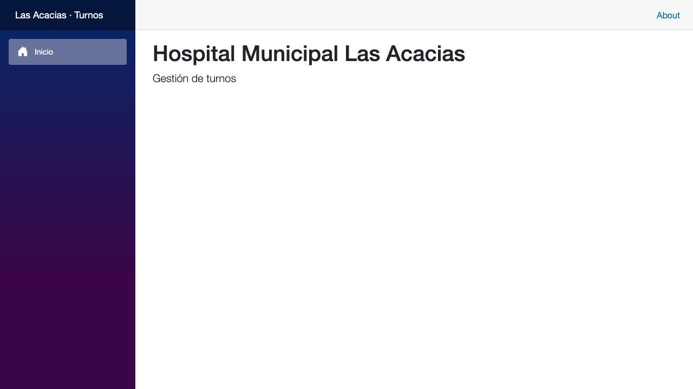
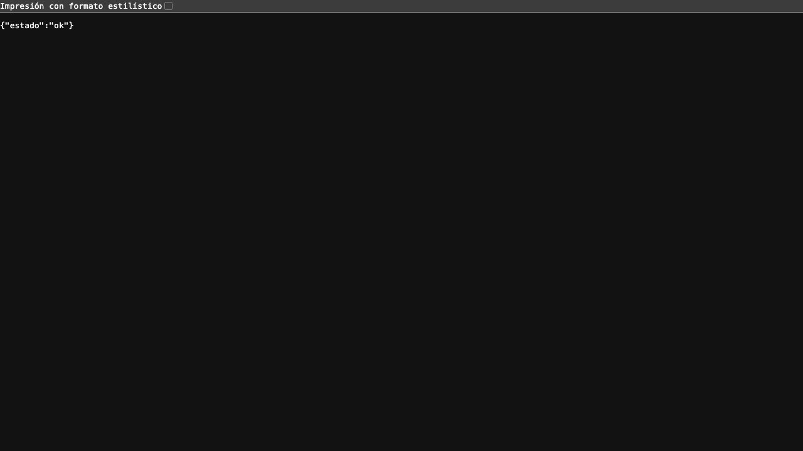
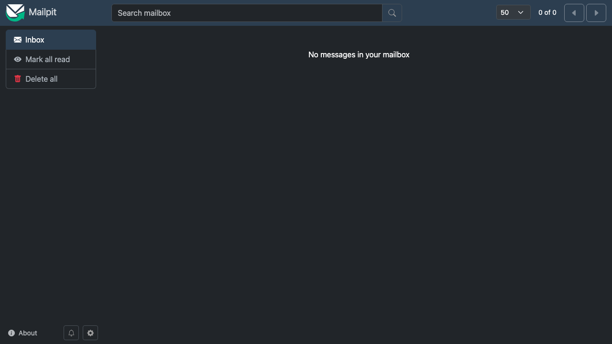

# Sesión 02 — La primera story: estructura de la solución

**Fecha:** 15 de octubre de 2026, desde las 19:39
**Participantes:** el docente (Ing. Fernando Bono) y el equipo de agentes de IA con el método BMAD:
Amelia (desarrolladora) y un grupo de agentes revisores.
**Resultado:** la story 1.1 implementada y verificada: la solución en 4 capas, PostgreSQL con dos
usuarios, todo levantado con Docker y 23 pruebas automáticas en verde.

> Registro curado de la conversación: los mensajes del docente están tal cual; las respuestas del
> equipo están resumidas. La transcripción completa es
> [02-Conversacion-completa-2026-10-15-1939.md](02-Conversacion-completa-2026-10-15-1939.md).

---

## 1. Aprobar las stories y borrar el código viejo

**Docente:** sigamos con BMAD-Hospital

El equipo retomó donde quedó la sesión 01: las 6 stories del sprint 1 esperaban aprobación.
**Docente:** "Aprobar las 6".

La story 1.1 pide borrar el código del arranque (el que se escribió sin saber qué hacer). El control
de permisos frenó el borrado y el equipo lo consultó: ya estaba guardado en git, en el primer commit.
**Docente:** "Sí, borralo".

> 💡 **Para la clase.** Borrar código es fácil; recuperarlo, no. Por eso la story exigía un commit
> previo del código viejo: la story 4.1 quiere reaprovechar una idea de ahí.

## 2. Validar la story antes de programar

Un agente revisor validó la story contra el repo real. Resultado: sana, los 20 criterios con su
prueba. Encontró dos avisos menores: la sección "qué existe hoy" describía el repo de la sesión
anterior. **Docente:** "seguimos", y se corrigió la story.

## 3. El plan y las pruebas primero

Amelia armó el plan. **Docente:** "abrime el plan", lo leyó y **"si aprobado el plan"**.

La regla del equipo es escribir **las pruebas antes que el código**. Primero se escribieron las 12
pruebas de la story, que ni siquiera compilaban porque el código no existía. Después vino el código
hasta que todas pasaron.

| Qué se construyó | Para qué |
|---|---|
| 7 proyectos: 4 capas + 3 de pruebas | La arquitectura aprobada, con las dependencias "hacia adentro" |
| PostgreSQL con dos usuarios | El que usa la app no puede cambiar la estructura de la base |
| Docker Compose: base, app y buzón de mails de prueba | Todo arranca con un comando, sin contraseñas en el repo |
| Página de inicio y `/salud` | Ver que la app está viva y que la base responde |
| HTTPS detrás del proxy | Sólo se le cree "vengo por HTTPS" a un proxy conocido |

> 💡 **Para la clase.** Las pruebas de integración corren contra un **PostgreSQL de verdad**, en un
> contenedor que se crea y se destruye en cada corrida. Una base falsa en memoria no habría
> detectado los permisos de los dos usuarios.

## 4. La revisión: cuatro vueltas

Seis agentes revisores leyeron el código, cada uno con un foco: cobertura de pruebas, seguridad,
alcance contra la story, criterios cubiertos, fallas silenciosas y la story misma.

- Uno marcó un problema **falso**: dos pruebas "no existían" porque buscaba sólo en archivos C# y
  esas pruebas son un script de Docker. Otro revisor lo confirmó como falso positivo.
- Dos avisos reales, chicos: el buzón de mails quedaba visible para toda la red, y `/salud` no dejaba
  registrada la causa cuando fallaba. Se arreglaron.
- Cada arreglo obliga a otra vuelta de revisión sobre lo que cambió.

El equipo ofreció además un "pase adversarial": agentes que intentan romper el código
ejecutándolo, durante 20 a 40 minutos. **Docente:** "No, saltearlo".

## 5. Probar en vivo: el defecto que las pruebas no veían

Antes del commit, cada criterio de la story se prueba **contra la aplicación corriendo**, no sólo
con pruebas automáticas.

Al probar el criterio 7 ("sin contraseña de base, la app no arranca"), la app escribió el error
correcto **pero el contenedor no terminó**: quedó colgado al 100% de CPU. La causa: dentro de un
contenedor, la app es el proceso número 1, y Linux ignora ahí la señal con la que .NET se cierra
tras un error. La corrección es una línea en el Compose (`init: true`).
**Docente:** "Sí, agregalo". Primero se actualizó la story y después el código.

> 💡 **Para la clase.** La prueba automática de ese criterio pasaba. Corría la app dentro del
> proceso de pruebas, donde ese problema no existe. Sólo apareció al correr el contenedor real.
> Por eso "las pruebas pasan" no alcanza para decir "funciona".

Otro detalle que apareció: en una Mac, Docker muestra como ejecutable un archivo que no lo es si se
lo comparte como carpeta. La prueba del script de roles tuvo que copiarlo al contenedor para ser
honesta.

**Docente:** "en que estas?" · "cuanto estimas qeu falta?" → El equipo informó el avance: faltaban
unos 10-15 minutos.

Dos criterios no se pueden ver con la app corriendo. Uno es la regla de nombres de tablas, porque
todavía no hay tablas. El otro es interno de las pruebas. Esos dos los aprobó el docente con su
firma, desde su propia terminal. **Docente:** "cmoo lo firmo?" → el equipo le explicó los pasos.
**Docente:** "ya esta".

## 6. Cómo se ve

La página de inicio, en castellano:

`/salud`, la respuesta cuando la base está disponible (si se cae, responde 503 con
`{"estado":"sin conexión con la base"}`):

Mailpit, el buzón que atrapa los mails de prueba. Está vacío hasta la story 1.4:

## 7. Dónde estamos

**Docente:** que tenemos y que nos falta? contame en un resumen ejecutivo…
**Docente:** que incluye esta primer implementacion? y cuales serian las siguientes…
**Docente:** mostrame un resumen de todos los sprint, con sus historias, pequeño alcance y que esta listo y de que depende
**Docente:** me armas un html para compartir con este resumen

El equipo armó una página con los 7 sprints, sus 34 stories, el estado y las dependencias de cada
una. La ruta crítica es ingreso → catálogo → agendas → reserva → turno web: sin agendas aprobadas
no se puede reservar.

| Cosa | Estado |
|---|---|
| Documentos de producto | Aprobados (sesión 01) |
| 6 stories del sprint 1 | Aprobadas |
| Story 1.1 | Implementada y verificada; espera el commit |
| Pruebas | 23 de 23, más el smoke del Compose real |
| Revisión | 4 vueltas, sin nada abierto |
| Stories 1.2 a 2.1 | Listas para programar |

**Próxima sesión:** commitear la 1.1 y seguir con la 1.2 (reloj en hora de Córdoba y errores sin
detalles técnicos).
