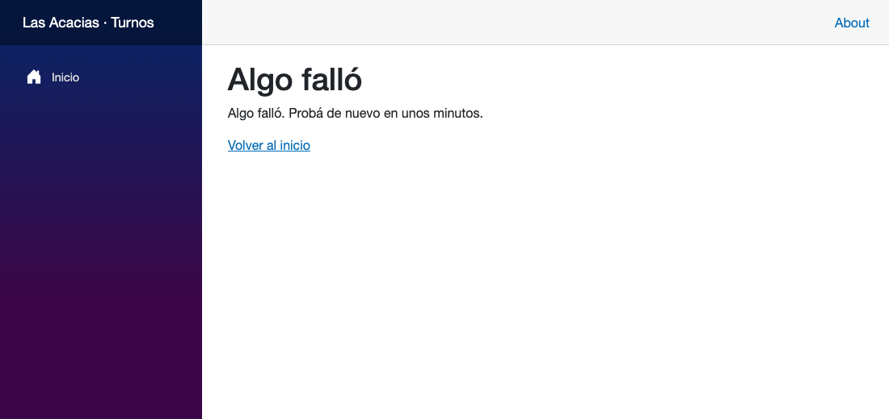
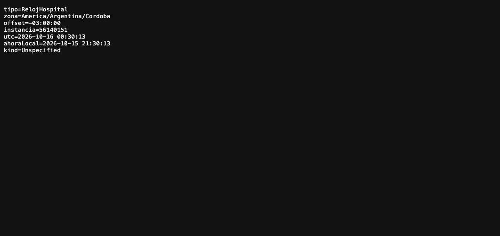

# Sesión 03 — Story 1.2: el reloj del hospital y los errores sin detalles técnicos

**Fecha:** 15 de octubre de 2026, desde las 20:54
**Participantes:** el docente (Ing. Fernando Bono) y el equipo de agentes de IA con el método BMAD:
Amelia (desarrolladora) y un grupo de agentes revisores.
**Resultado:** la story 1.2 implementada y verificada. Toda la hora del sistema sale de un único
reloj en hora de Córdoba, y ningún error muestra detalles técnicos al usuario. Hay 41 pruebas
automáticas en verde y los 14 criterios se vieron funcionando en la aplicación real.

> Registro curado de la conversación: los mensajes del docente están tal cual; las respuestas del
> equipo están resumidas. La transcripción completa es
> [03-Conversacion-completa-2026-10-15-2054.md](03-Conversacion-completa-2026-10-15-2054.md).

---

## 1. El pedido

**Docente:** "Sigamos con BMAD-Hospital (…). Esta es la sesión 03. (…) Implementemos la story
docs/stories/1-2-reloj-y-errores.md con el circuito completo, igual que la 1.1: validación, plan
para que yo lo apruebe, pruebas primero, revisores y prueba en vivo." Con tres reglas: sin pase
adversarial, una decisión por vez y nada de commit sin su aprobación.

La story responde a dos requisitos no funcionales del producto:

| Requisito | Qué pide | Cómo lo resuelve la story |
|---|---|---|
| NFR-06 | Todas las fechas y horas en hora de Argentina | Un único reloj inyectable (`RelojHospital`) con la zona `America/Argentina/Cordoba` |
| NFR-09 | Los errores no muestran detalles técnicos al usuario | Un manejador global (`ManejadorGlobalDeErrores`) que decide qué ve el usuario y qué queda en el registro técnico |

El equipo trabajó en una rama propia (`story/1-2-reloj-y-errores`), porque `main` no se toca
directamente.

## 2. Validar la story y corregirla antes de programar

Un agente revisor validó la story contra el repo. No encontró nada que bloqueara, pero sí dos
detalles de redacción. El estado figuraba distinto en dos lugares de la story, y una tarea pedía
agregar un paquete de pruebas que la story 1.1 ya había dejado puesto.
**Docente:** "a" (corregir la story antes de implementar). Se corrigió, se re-validó y quedó limpia.

Además se hizo la "salvaguarda de estado" que pide la story antes de tocar nada:

- Las pruebas de la 1.1 pasaban 15 de 15.
- Nadie leía la hora del sistema en el código.
- La imagen de Docker ya traía la zona de Córdoba, así que el `Dockerfile` no hizo falta tocarlo.

> 💡 **Para la clase.** Una story desactualizada es una mentira chica que crece: el próximo que la
> lea va a buscar un cambio que nunca existió. Corregirla **antes** de programar cuesta un minuto.

## 3. El plan

Amelia armó el plan en tres bloques: el reloj, los errores del dominio con su manejador, y la
conexión de todo en la aplicación web. Cada bloque arranca con sus pruebas.
**Docente:** "si aprobado".

## 4. Pruebas primero: cuando el rojo dice algo

Se escribieron las 9 pruebas de la tabla de la story antes que el código. El equipo verificó que
fallaran **por el motivo correcto**:

1. Al principio no compilaban: faltaban las clases que la story manda crear.
2. Con el reloj y las excepciones hechos, las pruebas de extremo a extremo seguían en rojo. La
   excepción se escapaba sin manejar, y en modo desarrollo aparecía la página técnica con la pila.
   Ése era exactamente el problema a resolver.
3. Al conectar el manejador en la aplicación, todo pasó a verde.

Hubo una prueba que pasó desde el primer momento: la que impide leer la hora del sistema fuera del
reloj. Es una **prueba guardiana**: hoy nadie lee la hora, así que pasa. Para no confiar a ciegas,
el equipo plantó un `DateTime.Today` a propósito en el código. La prueba falló y señaló archivo y
línea; después se sacó la trampa.

> 💡 **Para la clase.** Una prueba que nunca vio fallar no prueba nada: puede estar mal escrita y
> pasar siempre. Si una prueba arranca en verde, hay que forzarla a fallar al menos una vez.

## 5. Las piezas

| Pieza | Qué hace |
|---|---|
| `RelojHospital` | Hereda de `TimeProvider`. Es el único lugar que conoce la zona del hospital. Si la máquina no tiene esa zona, la app **no arranca** y lo dice ("Instalá el paquete tzdata"): mejor no arrancar que dar turnos corridos 3 horas |
| `AhoraLocal()` | Devuelve la hora local del hospital sin zona adjunta, como se van a guardar los turnos |
| 4 excepciones del dominio | `ReglaDeNegocio`, `Conflicto`, `NoEncontrado` y `AccesoDenegado`, cada una con el mensaje escrito **para el usuario** |
| `ManejadorGlobalDeErrores` | Traduce cada error: 409, 400, 404, 403 con el mensaje de la regla; lo inesperado, 500 con "Algo falló. Probá de nuevo en unos minutos." El detalle completo va sólo al registro técnico |
| Página `/Error` | Para el navegador, el mismo mensaje genérico; sin código de pedido ni texto técnico de la plantilla |

> 💡 **Para la clase.** En las pruebas el reloj se reemplaza por uno **falso y fijo**
> (`FakeTimeProvider`). Así una prueba puede decir "son las 23:30 del 9 de octubre" y verificar la
> regla de "cancelar hasta 2 h antes" sin depender de la hora en que se corre. Por eso nadie puede
> leer `DateTime.Now` directamente: esa lectura escapa del reloj falso.

## 6. La revisión

Seis agentes revisores leyeron el código, cada uno con un foco: pruebas y cobertura, seguridad,
alcance contra la story, criterios cubiertos, fallas silenciosas y la story misma. Ninguno bloqueó y
no hubo que cambiar código.

- Un chequeo automático marcó como "crítico" que la prueba de regresión de la 1.1 no existía. Era
  falso: buscó sólo en los archivos de la 1.2. Otro revisor lo confirmó.
  **Docente:** "a" (aceptarlo como falso positivo).
- Un revisor preguntó si era intencional que un error de regla pedido desde el navegador muestre la
  página genérica. Sí: la story lo dice. Mostrar el mensaje de la regla dentro de cada pantalla es
  trabajo de las stories de pantalla.
- La story declaraba que se iba a modificar el `Dockerfile`, y no hizo falta. Se corrigió la story.

## 7. Probar en vivo sin ensuciar el código

La aplicación real no tiene, ni debe tener, una ruta que falle a propósito. Entonces, ¿cómo se ve en
vivo que el manejador funciona?

El equipo armó una **sonda fuera del repositorio**: un pequeño complemento que .NET carga al arrancar
(`DOTNET_STARTUP_HOOKS`). Agrega rutas de prueba sólo en un contenedor aparte, con la **misma
imagen** de producción. El código del producto no cambió ni una línea.

Con eso se comprobaron los 14 criterios contra la aplicación corriendo en Docker:

| Qué se vio | Resultado |
|---|---|
| Imagen sin la base de zonas horarias | La app no arranca y explica por qué (tzdata) |
| El reloj de la app en ejecución | `RelojHospital`, Córdoba UTC-3, la misma instancia en cada pedido |
| Los 4 errores del dominio por JSON | 409, 400, 404 y 403 con el mensaje de la regla |
| Un error inesperado por JSON | 500 genérico, sin el detalle interno |
| El mismo error desde el navegador | Página "Algo falló", en producción y en modo desarrollo |
| El registro técnico | Una sola entrada por error, con el nivel correcto |
| `/salud` con la base caída | Sigue respondiendo 503 como en la 1.1 |

Hubo una coincidencia útil. La prueba se hizo a las 21:30 de Córdoba, que en UTC ya eran las 00:30
**del día siguiente**. El "borde del cambio de día" que la story sólo podía probar con reloj fijo se
vio con la hora real. Y dos chequeos fallaron al principio por errores del guion de prueba, no de la
aplicación: se corrigieron y se repitieron.

> 💡 **Para la clase.** "No agregar código de prueba a producción" y "probar en vivo" parecen
> chocar. La salida fue inyectar la prueba **desde afuera**, con un mecanismo de la plataforma, sobre
> la misma imagen que se despliega. Las pruebas automáticas (T8 y T9) hacen lo mismo dentro del
> proceso de pruebas; la sonda lo repite en el contenedor real.

## 8. Cómo se ve

Un error inesperado en producción, visto desde el navegador:

En modo desarrollo se ve **la misma página**, no la pila técnica. El detalle queda en la consola:

El reloj de la aplicación en ejecución (la ruta existe sólo con la sonda). Son las 00:30 en UTC y
las 21:30 del día anterior en el hospital:

También quedaron las capturas de un error de regla pedido desde el navegador
([03-error-regla-navegador.png](img/03-error-regla-navegador.png)) y de la página `/Error` abierta
directamente ([03-pagina-error.png](img/03-pagina-error.png)).

## 9. Dónde estamos

| Cosa | Estado |
|---|---|
| Story 1.1 | En `main` (sesión 02) |
| Story 1.2 | Implementada, revisada y probada en vivo; en revisión |
| Pruebas | 41 de 41 (18 casos nuevos más las 15 de la 1.1) |
| Prueba en vivo | Los 14 criterios vistos corriendo la app |
| Stories 1.3 a 2.1 | Listas para programar |

**Docente:** "antes del commit hace resumen de la sesion y ponela junto a la conversacion como las
otras y luego commit, push, pr, actauliza esto (…) y dame el prompt para poder seguir en una sesion
limpia y cerrar esta"

**Próxima sesión:** mergear la 1.2 y seguir con la 1.3 (auditoría).
