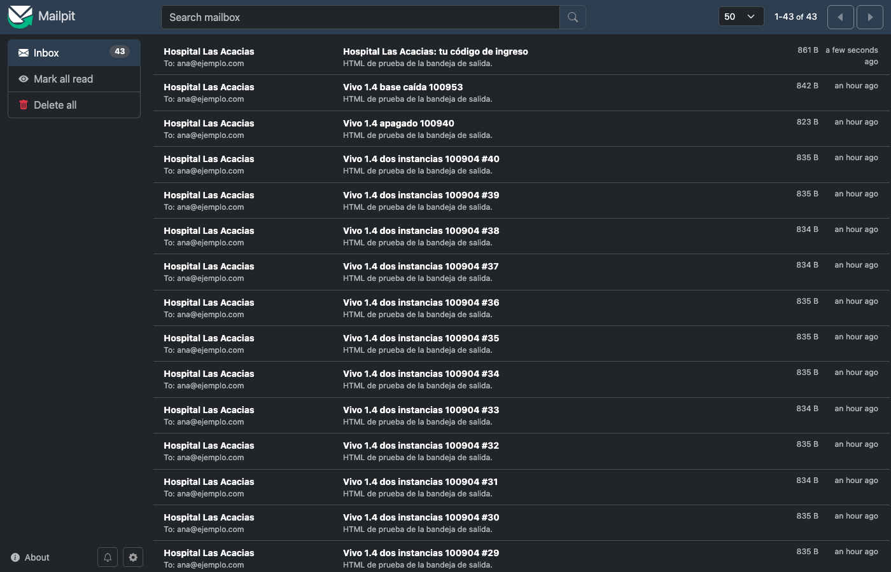
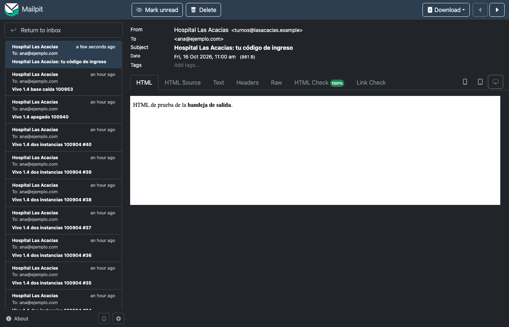

# Sesión 05 — Story 1.4: la bandeja de salida de emails

**Fecha:** del 15 de octubre de 2026 a las 22:42 al 16 de octubre a la mañana
**Participantes:** el docente (Ing. Fernando Bono) y el equipo de agentes de IA con el método BMAD:
Amelia (desarrolladora) y un grupo de agentes revisores.
**Resultado:** la story 1.4 quedó implementada, revisada y probada en vivo, con el PR #3 abierto. Los casos de uso
ya no mandan emails: los dejan en una "bandeja de salida" en la base, y un proceso de fondo los envía
y los reintenta. Un servidor de correo caído no hace fallar una reserva ni pierde un aviso. Hay 86 pruebas
automáticas en verde, y 16 de los 18 criterios se vieron funcionando contra la app real con Mailpit.

> Registro curado de la conversación: los mensajes del docente están tal cual; las respuestas del
> equipo están resumidas. La transcripción completa es
> [05-Conversacion-completa-2026-10-15-2242.md](05-Conversacion-completa-2026-10-15-2242.md).

---

## 1. El pedido

**Docente:** "Sigamos con BMAD-Hospital (…). Esta es la sesión 05. (…) Implementemos la story
docs/stories/1-4-bandeja-de-salida.md con el circuito completo, igual que la 1.3: validación, plan para
que yo lo apruebe, pruebas primero, revisores y prueba en vivo." Con las reglas de siempre: sin registro
de horas ni pase adversarial, una decisión por vez, y nada de subir sin su aprobación. Y una novedad:
"la 1.4 manda mails: mostrá Mailpit".

La story responde a la decisión de arquitectura ADR-05. El hospital manda emails en tres momentos: el
código de ingreso, la confirmación de un turno y el aviso de un turno bloqueado. Si el servidor de correo
falla, no puede caerse la reserva, y tampoco puede perderse el aviso en silencio.

| Pieza | Qué hace |
|---|---|
| La bandeja (`IBandejaDeSalida.Encolar`) | El caso de uso deja el email en la tabla `mensajes_salientes`, **en la misma transacción** que el cambio: se guardan juntos o no se guarda ninguno |
| El proceso de fondo | Cada 15 segundos toma los pendientes y los envía. Si falla, reintenta a 1, 5 y 15 minutos. Al cuarto intento fallido lo da por perdido y avisa al "manejador" de ese tipo de email |
| El manejador | Lo escribe cada story que manda emails. El de los turnos bloqueados (story 7.2) pondrá al paciente en la lista "Pacientes para avisar" |

## 2. Validar la story y corregirla antes de programar

Como en la sesión anterior, la story se había escrito antes de que existieran las stories 1.1 a 1.3, y la
sección "Qué existe hoy" estaba vieja. **Docente:** "Corregir la story" (la opción recomendada). Se
actualizó, se re-validó y quedó limpia.

## 3. Una dependencia que la story no decía

El proceso de fondo usa una pieza estándar de .NET (`BackgroundService`) que el proyecto de
infraestructura no tenía. El contrato técnico fija qué paquetes se pueden usar, así que no se podía agregar
uno por cuenta propia. **Docente:** "Usar el marco web ya instalado" (la opción recomendada): ningún
paquete nuevo y el contrato intacto. Después, **Docente:** "Aprobado, arrancá" (el plan).

> 💡 **Para la clase.** Una story muy detallada igual puede dejar un hueco. Lo correcto es frenar y
> preguntar: un paquete que el contrato no lista no lo agrega el desarrollador por su cuenta.

## 4. Pruebas primero: tres rojos distintos

Se escribieron las 13 pruebas antes que el código. Hubo tres rojos distintos, cada uno con su lección:

1. **No compilaban:** faltaba todo el código de email. Es el rojo esperado.
2. **Un paquete con una vulnerabilidad conocida:** la librería de correo (MailKit) arrastra otro paquete
   con un problema de seguridad publicado, y el proyecto trata eso como error. Se fijó la versión corregida.
3. **10 de 14 pruebas en rojo por una sola causa, que venía de la 1.1.** El proceso de fondo lee la
   bandeja con SQL directo (`SELECT … FOR UPDATE SKIP LOCKED`) para bloquear la fila mientras envía.
   EF buscaba la columna `CreadoEl`, pero la base tiene `creado_el`. La convención de nombres de la 1.1
   traducía el nombre sólo para la tabla, no para las lecturas con SQL. Nadie lo había notado porque
   ninguna story leía así. **Docente:** "Corregir la convención de 1.1" (la opción recomendada). Es una
   línea, y se verificó que la base no cambia.

> 💡 **Para la clase.** Un error que estuvo escondido tres stories aparece el día que alguien usa el
> código de otra forma. Arreglarlo en la raíz (la convención) evita que reaparezca en cada story que
> lea con SQL; un parche local en la consulta lo habría dejado vivo.

## 5. Un control de la 1.1 que frenó a la story

Al correr la suite completa falló una prueba de la 1.1: el control de secretos. Prohíbe escribir en
`docker-compose.yml` cualquier valor por defecto con la forma `${VARIABLE:-…}`, porque ahí alguien podría
esconder una contraseña. Y la story pedía justo esa forma para el usuario y la clave del correo.
**Docente:** "Variable sin valor por defecto" (la opción recomendada): el control queda intacto.

> 💡 **Para la clase.** Las pruebas de una story vieja no son un estorbo: son reglas que el equipo ya
> decidió. Cuando chocan con una story nueva, se decide cuál manda, en vez de aflojar la prueba en
> silencio.

## 6. La revisión: cinco vueltas, y un error que introdujimos nosotros

Ocho agentes revisores, cada uno con un foco: pruebas, seguridad, la story, el alcance, los criterios,
el proceso de fondo, la resiliencia del cliente de correo y los fallos silenciosos. Ninguno bloqueó en la
primera vuelta, pero marcaron cuatro mejoras chicas:

| Mejora | Por qué |
|---|---|
| La seguridad SMTP pasa a ser obligatoria | Si faltaba la variable, el correo salía **sin cifrar**, con usuario y clave a la vista |
| No esperar el "chau" del servidor | Si el servidor aceptaba el email pero fallaba la despedida, se contaba como fallo y el paciente lo recibía **dos veces** |
| Tope de 60 segundos por email | El límite de MailKit es por paso; una entrega lenta podía dejar la fila bloqueada minutos |
| Log de error al perder un email | Antes no quedaba ninguna línea: ninguna alarma se enteraba |

**Docente:** "Arreglar las 4" (la opción recomendada). Y en la segunda vuelta, el revisor de seguridad
encontró un problema **introducido por uno de esos arreglos**. Para el cuarto, el log empezó a llevar el
error técnico completo. Y cuando un servidor rechaza un destinatario, el texto del error suele repetir la
dirección (`<paciente@x.com>: Recipient address rejected`). El email del paciente iba a terminar en los
logs, y la Ley 25.326 lo prohíbe. **Docente:** "Log sin el texto del error" (la opción recomendada): el log
lleva sólo el tipo de error y el código SMTP; el texto completo queda en la base, en la misma fila que
ya guarda la dirección.

Las vueltas tres a cinco cerraron el mismo tipo de detalle en los demás lugares donde aparecía:

- los logs se escriben **después** de guardar, para no registrar algo que se revirtió;
- el error de un manejador va antes de deshacer la transacción, para que el número de mensaje quede
  aunque la base esté caída;
- se agregó la prueba de un rechazo real con código 550.

En esta última, el equipo recomendó anotarla para después. **Docente:** "Arreglarla ahora".

> 💡 **Para la clase.** Cada arreglo es código nuevo, y el código nuevo también se revisa. Por eso el
> circuito vuelve a pasar los revisores después de cada cambio, aunque sea chico: la segunda vuelta
> encontró una fuga de datos personales que la primera no podía ver, porque todavía no existía.

## 7. Probar en vivo, con Mailpit

La app corrió en Docker con la base y Mailpit de verdad, sin agregarle código de prueba. Para encolar se
usó un programita aparte que llama al código real de la bandeja. Para no esperar 21 minutos de
reintentos, el equipo "adelantó el reloj" editando la hora del próximo intento en la base.

| Qué se hizo | Qué se vio |
|---|---|
| Encolar sin guardar | Ninguna fila |
| Encolar y guardar | La fila pendiente; en ~11 s el email llegó a Mailpit, una sola vez |
| Apagar Mailpit | Reintentos a 1, 5 y 15 min; al cuarto, perdido; logs sin la dirección; al volver Mailpit, nadie lo reintenta |
| Un destinatario sin arroba | Perdido sin intentar enviarlo, con el motivo "Destinatario inválido" |
| Dos copias de la app a la vez, 40 emails | 40 en Mailpit, **ninguno duplicado** |
| Detener la app con un envío trabado | Se detuvo al instante, sin errores, y el email quedó pendiente; al volver, salió |
| Apagar la base | Un error en el log, la app siguió viva y al volver la base envió |
| Arrancar sin configuración de correo | La app no arranca y el error nombra la clave que falta |
| Pruebas de 1.1-1.3 y smoke de Docker de la 1.1 | Todo en verde |

Dos criterios no se podían ver en vivo: que el manejador se entere del email perdido (criterio 7) y
que, si el manejador falla, se reintente sin reenviar el email (criterio 9). Hoy no existe ningún
manejador: el primero llega con la story 7.2. Los cubren dos pruebas automáticas contra la base real.
**Docente:** "Declararlos y firmar vos" (la opción recomendada). El docente firmó en su terminal, después
de leer el motivo de cada uno.

> 💡 **Para la clase.** "No se puede probar en vivo" no lo decide el desarrollador. Se escribe el motivo
> y qué prueba lo cubre, y lo firma una persona. Así la excepción queda a la vista, y no escondida
> detrás de un "verificado".

## 8. Dónde estamos

| Cosa | Estado |
|---|---|
| Stories 1.1, 1.2 y 1.3 | En `main`, cerradas (`done`) |
| Story 1.4 | Implementada, revisada y probada en vivo; en revisión (PR #3 abierto) |
| Pruebas | 86 de 86 (13 métodos y 18 casos nuevos de la 1.4) |
| Prueba en vivo | 16 de 18 criterios vistos; 2 firmados por el docente |
| Pendientes anotados | Prueba del tope de 60 s y de la autenticación SMTP, indicador de salud del proceso de fondo, entre otros |
| Stories 1.5 y 2.1 | Listas para programar |

**Docente:** "Commit, push y PR" (la opción recomendada), y después el cierre de la sesión.

**Próxima sesión:** mergear la 1.4 y seguir con la 1.5 (integración continua).
