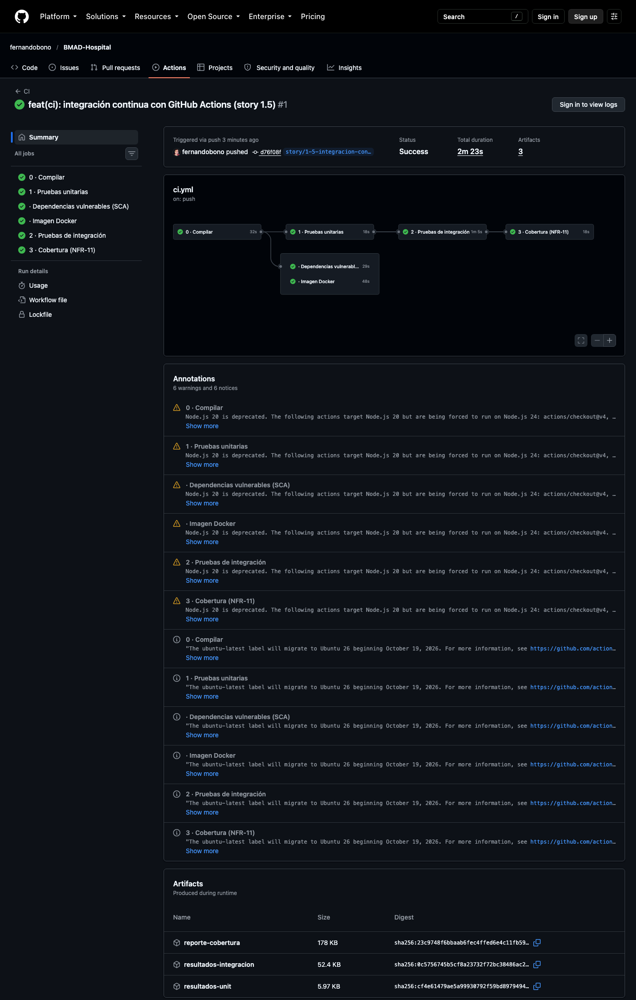
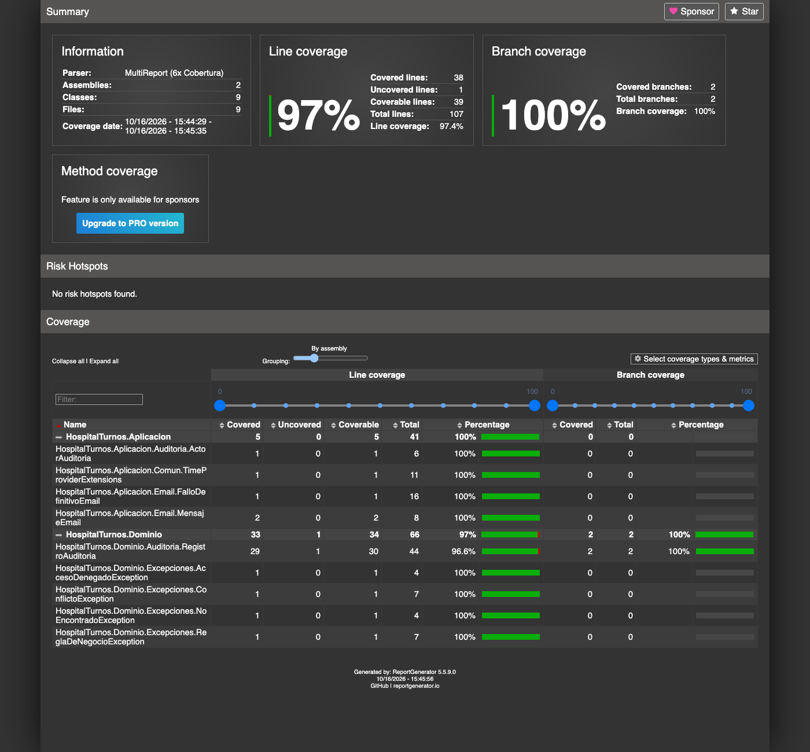
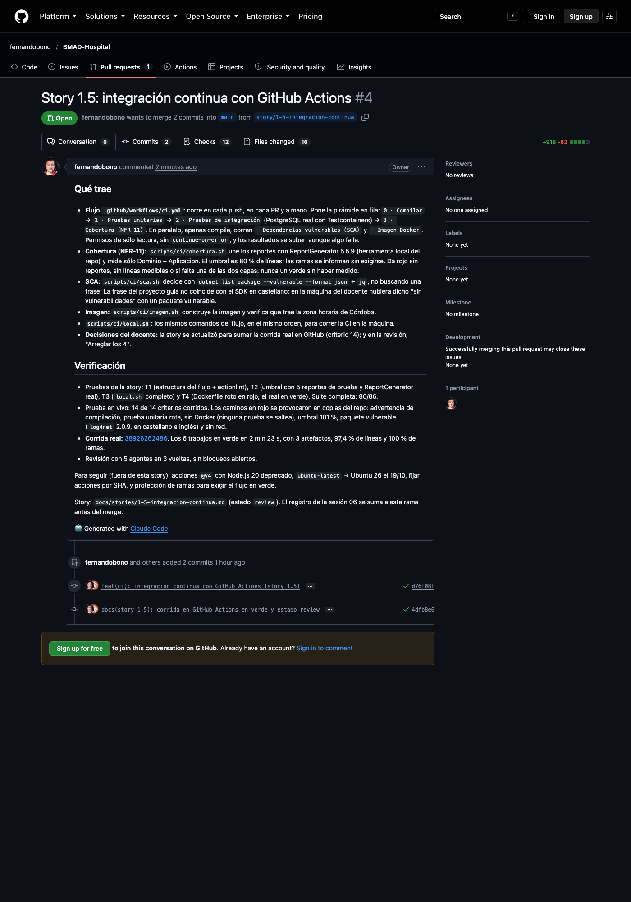

# Sesión 06 — Story 1.5: la integración continua

**Fecha:** 16 de octubre de 2026, de 11:09 a 13:45
**Participantes:** el docente (Ing. Fernando Bono) y el equipo de agentes de IA con el método BMAD:
Amelia (desarrolladora) y un grupo de agentes revisores.
**Resultado:** la story 1.4 quedó mergeada y cerrada, y la story 1.5 quedó implementada, revisada y
probada en vivo, con el PR #4 abierto. Desde ahora, cada push a GitHub compila el sistema, corre la
pirámide de pruebas, mide la cobertura de las reglas de negocio, busca dependencias vulnerables y
construye la imagen Docker. La primera corrida real salió en verde: 6 de 6 trabajos en 2 min 23 s.

> Registro curado de la conversación: los mensajes del docente están tal cual; las respuestas del
> equipo están resumidas. La transcripción completa es
> [06-Conversacion-completa-2026-10-16-1109.md](06-Conversacion-completa-2026-10-16-1109.md).

---

## 1. El pedido

**Docente:** "Sigamos con BMAD-Hospital (…). Esta es la sesión 06. (…) Primero: mergeá el PR #3 a
main (sólo cuando yo lo apruebe) y pasá la story 1.4 a done. Después implementemos la story
docs/stories/1-5-integracion-continua.md con el circuito completo, igual que la 1.4: validación,
plan para que yo lo apruebe, pruebas primero, revisores y prueba en vivo." Con las reglas de
siempre: sin registro de horas ni pase adversarial, una decisión por vez, y nada de subir sin su
aprobación. La novedad: "la 1.5 corre en GitHub Actions: mostrá la corrida".

**Docente:** "Sí, mergear" (la opción recomendada). El PR #3 entró a `main` y la 1.4 pasó a `done`.

La story 1.5 pide un flujo de GitHub Actions que ponga en fila la pirámide de pruebas de la materia:

| Trabajo | Qué hace | Si falla… |
|---|---|---|
| 0 · Compilar | `dotnet build` en Release; una advertencia cuenta como error | no corre nada más |
| 1 · Pruebas unitarias | Dominio, sin base de datos (segundos) | no se gasta en levantar PostgreSQL |
| 2 · Pruebas de integración | Aplicación y Web contra PostgreSQL real (Testcontainers) | no se mide la cobertura |
| 3 · Cobertura (NFR-11) | une los reportes y exige 80 % de líneas en Dominio + Aplicación | el flujo queda en rojo |
| · Dependencias vulnerables | busca paquetes con vulnerabilidades conocidas | rojo |
| · Imagen Docker | construye la imagen y verifica la zona horaria de Córdoba | rojo |

Los dos últimos no dependen de las pruebas: corren en paralelo apenas compila.

## 2. Validar la story: el repo ya estaba en GitHub

La story se escribió el 9 de octubre, cuando el repo todavía no tenía remoto. Por eso decía que la
verificación era sólo local y prohibía hacer push. Hoy el repo es público en GitHub, y el docente
quería ver la corrida real. **Docente:** "Corregir y sumar GitHub" (la opción recomendada). Se agregó
el criterio 14: el flujo tiene que verse en verde en GitHub Actions al subir la rama.

> 💡 **Para la clase.** Una story describe el mundo del día en que se escribió. Antes de programar se
> valida contra el repo **de hoy**: en una semana cambiaron cuatro stories y el lugar donde vive el
> código.

**Docente:** "Aprobado, arrancá" (el plan).

## 3. Pruebas primero, también para la CI

Esta story no tiene pruebas xUnit: lo que se prueba es la propia integración continua. El equipo
escribió primero tres verificaciones y las vio fallar porque no existía nada:

- **T1:** lee el `ci.yml` y verifica los 6 trabajos, su orden, los permisos y que no haya
  `continue-on-error` ni filtros de pruebas. Además corre `actionlint`, el revisor de flujos de
  GitHub.
- **T2:** corre el script de cobertura con reportes inventados. Con uno al 90 % tiene que pasar y
  con uno al 50 % tiene que fallar. Un tercero agrega la capa Web al 100 %, que no debe inflar el
  número.
- **T4:** construye la imagen con un `Dockerfile` roto (tiene que fallar) y con el real (tiene que
  pasar).

Después vino el código, hasta verlas en verde, y la CI completa en la máquina (T3, `local.sh`).
Resultado: 86 pruebas, **97,4 %** de cobertura de líneas.

## 4. La revisión: un control que no controlaba

Cinco agentes revisores. El de "fallos silenciosos" busca lugares donde un error puede leerse como
éxito, y marcó cuatro. El más serio era el control de dependencias vulnerables. El script, copiado
del proyecto guía de la materia, buscaba una frase en la salida de `dotnet list`: "has the following
vulnerable" en inglés, "tiene la siguiente" en castellano.

El equipo no se quedó con la sospecha: armó un proyecto con un paquete vulnerable de verdad y miró
qué decía el SDK en castellano. Decía **"tiene los paquetes vulnerables siguientes"**, que no
contiene "tiene la siguiente". En la máquina del docente, el control habría dicho "Sin
vulnerabilidades conocidas" con un paquete vulnerable instalado. En GitHub sí funcionaba, porque
ahí el SDK habla en inglés.

**Docente:** "Arreglar los 4" (la opción recomendada):

| Arreglo | Por qué |
|---|---|
| El control de dependencias lee la lista en JSON, no una frase | El JSON es igual en cualquier idioma |
| La cobertura exige que estén medidas las dos capas | Si faltaba el reporte de una, el 80 % se medía sobre la otra |
| La imagen copia la zona horaria siguiendo enlaces | Un enlace roto contaba como "tiene la zona horaria" |
| La prueba del `Dockerfile` roto exige el error esperado | Cualquier falla la daba por buena |

La segunda vuelta encontró tres detalles más del mismo tipo, por ejemplo un listado sin proyectos
que daba verde. La tercera vuelta salió limpia.

> 💡 **Para la clase.** Un control que nunca vimos fallar no sabemos si controla. Este tenía la
> forma correcta y había pasado de un proyecto a otro, pero dependía del idioma de la máquina. Lo
> descubrió alguien que preguntó "¿qué pasa si esto falla?" y lo **provocó** de verdad, en vez de
> leer el código y suponer.

## 5. Probar en vivo: provocar cada rojo

Para cada criterio se provocó la falla en una **copia** del repo, sin tocar el original:

| Qué se hizo | Qué se vio |
|---|---|
| Una variable sin usar en el código | Corta en "0 · Compilar"; no corre ninguna prueba |
| Una prueba unitaria que falla a propósito | Corta en "1 · Unitarias"; las de integración no arrancan y el resultado queda guardado |
| Docker apagado (apuntando a uno que no existe) | Las pruebas de integración **fallan**; ninguna se saltea |
| Umbral de cobertura en 101 % | Rojo: "97.4 % < 101 %", con el reporte HTML para ver qué falta |
| Un paquete vulnerable (`log4net` 2.0.9) | Rojo en castellano y en inglés, con el nombre del paquete |
| Sin conexión al servidor de paquetes | Rojo con el motivo; nunca "sin vulnerabilidades" |
| La CI completa sin cambios | Verde: 86 pruebas, 97,4 %, sin vulnerabilidades, imagen OK |

Hubo un hallazgo más: en este proyecto, un paquete vulnerable ya rompe la compilación (lo dejó así la
story 1.4). Así que la CI lo frena desde el primer trabajo, y el control de dependencias queda como
segunda red.

## 6. La corrida real en GitHub

**Docente:** "Sí, commit y push" (la opción recomendada). Al subir la rama, GitHub disparó el flujo
solo:

El diagrama de la corrida es la pirámide en fila: Compilar → Unitarias → Integración → Cobertura, con
SCA e Imagen en paralelo. Abajo están los artefactos que se pueden bajar. Uno es el reporte de
cobertura:

> 💡 **Para la clase.** El 97,4 % se mide sobre **39 líneas**: Dominio y Aplicación todavía casi no
> tienen reglas, porque el sprint 1 armó la base. El número empieza a significar algo cuando lleguen
> las stories de negocio (turnos, agendas). El valor de este control es que ya está puesto el día
> que lleguen.

La corrida dejó dos avisos que no fallan: las acciones `@v4` usan Node.js 20, que GitHub da por
viejo, y `ubuntu-latest` pasa a Ubuntu 26 el 19 de octubre. Quedaron anotados para más adelante.

## 7. Dónde estamos

| Cosa | Estado |
|---|---|
| Stories 1.1 a 1.4 | En `main`, cerradas (`done`) |
| Story 1.5 | Implementada, revisada y probada en vivo; en revisión (PR #4 abierto) |
| Corrida en GitHub Actions | Verde: 6 de 6 trabajos; también corre en cada PR |
| Prueba en vivo | 14 de 14 criterios vistos funcionando |
| Pendientes anotados | Actualizar las acciones a la versión nueva, fijarlas por SHA, proteger `main` para que no se pueda mergear con el flujo en rojo |
| Story 2.1 | Lista para programar |

**Docente:** "Commit, push y PR" (la opción recomendada), y después el cierre de la sesión. Al abrirse
el PR #4, GitHub corrió la CI otra vez, ahora sobre el PR: 12 controles en verde (la corrida del push
y la del PR, 6 trabajos cada una).

> 💡 **Para la clase.** Desde ahora cada PR muestra si rompe algo **antes** de mergearlo. Falta un
> paso, que queda como decisión pendiente: proteger `main` para que GitHub **no deje** mergear con
> el flujo en rojo. Hoy el semáforo avisa, pero no frena.

**Próxima sesión:** mergear la 1.5 (ahora con la CI en verde en el PR) y seguir con la 2.1.
