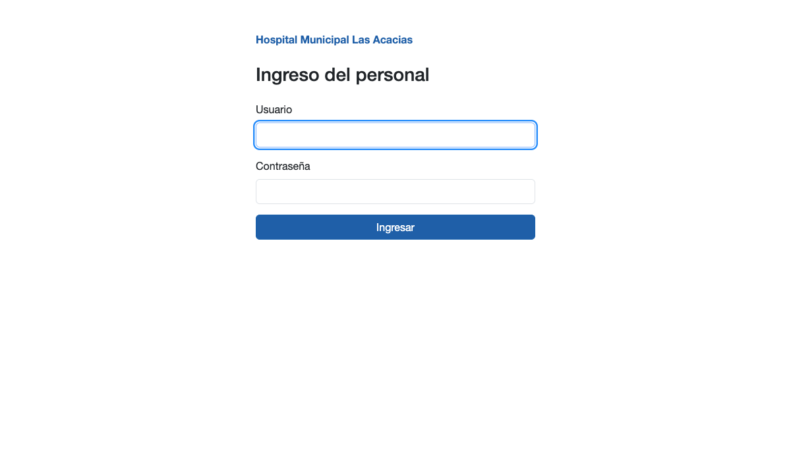
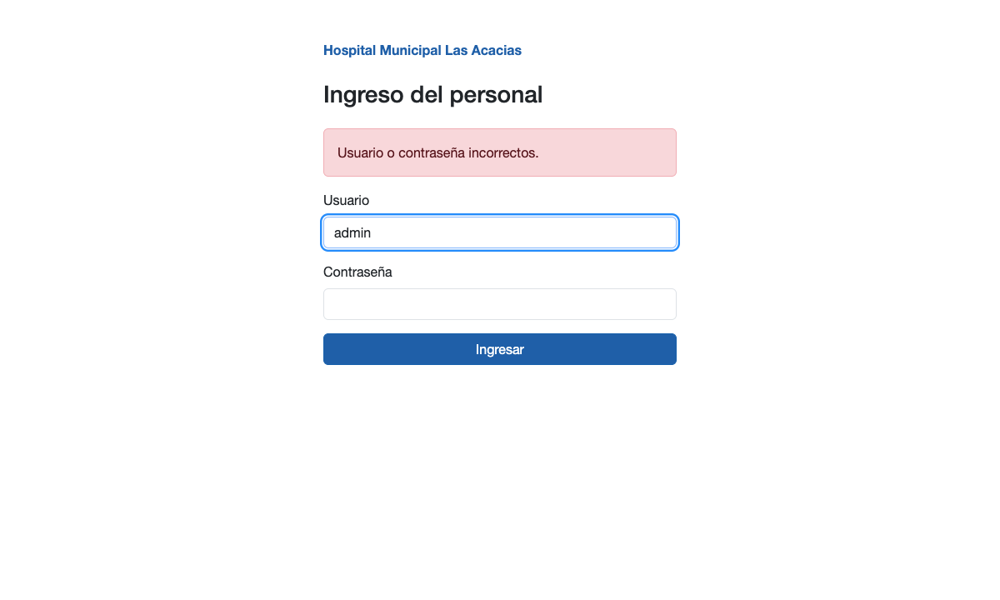
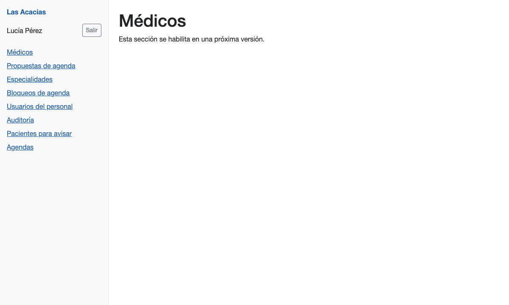
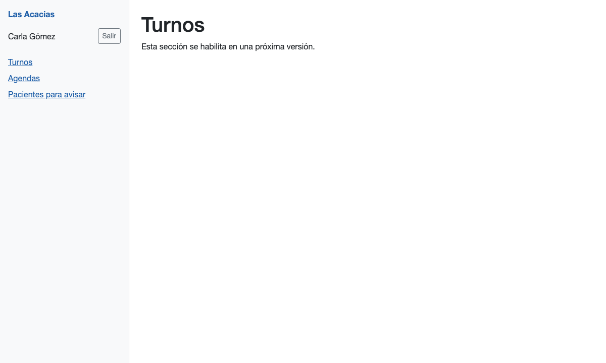
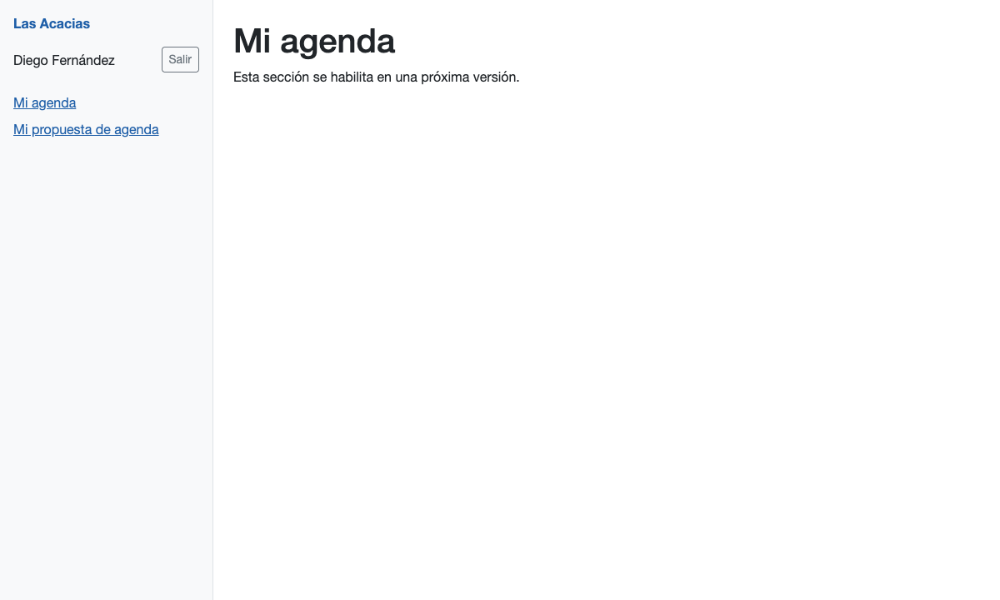
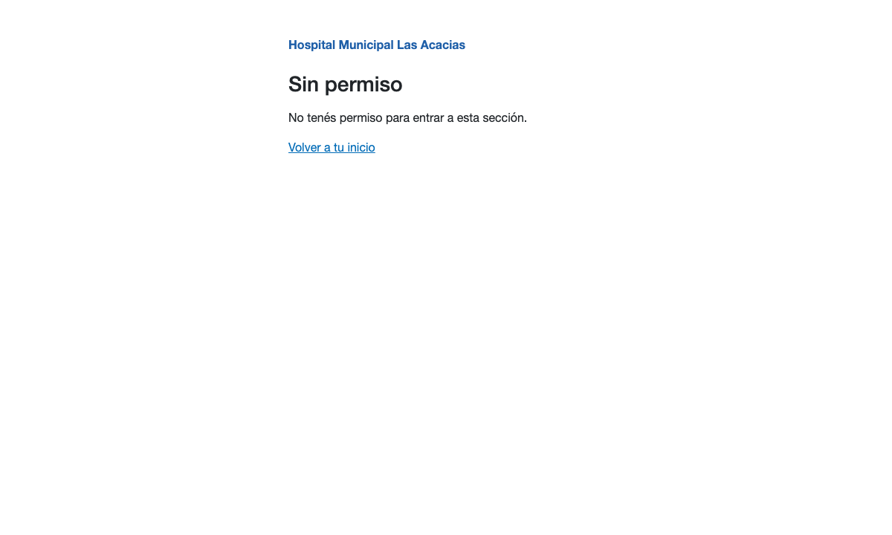
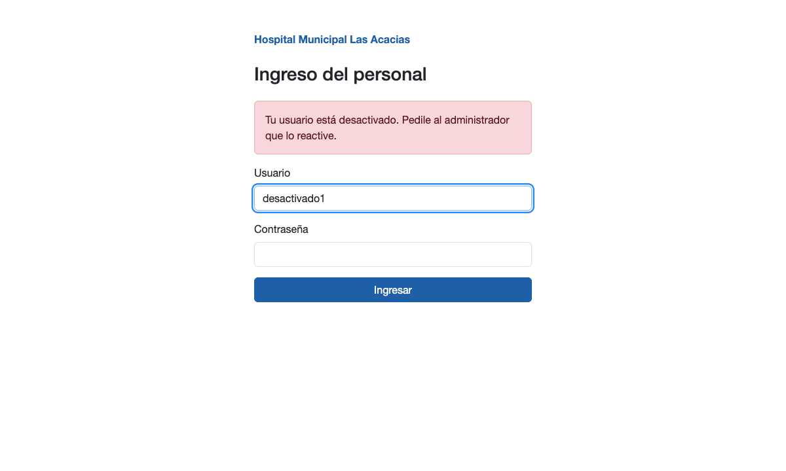
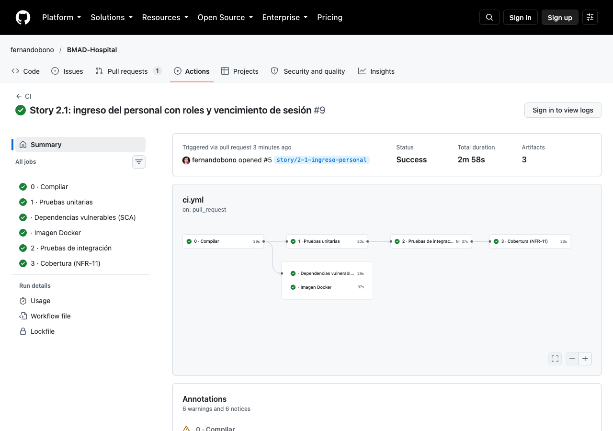
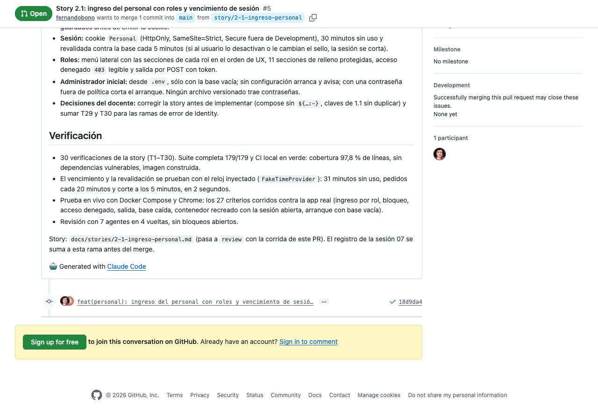

# Sesión 07 — Story 2.1: el ingreso del personal

**Fecha:** 16 de octubre de 2026, de 13:45 a 16:40
**Participantes:** el docente (Ing. Fernando Bono) y el equipo de agentes de IA con el método BMAD:
Amelia (desarrolladora), un grupo de agentes revisores y un "tester no técnico".
**Resultado:** la story 2.1 quedó implementada, revisada y probada en vivo, con el PR #5 abierto y su
CI en verde. El personal del hospital entra con usuario y contraseña, ve sólo las secciones de su rol,
y la sesión se cierra sola a los 30 minutos sin uso. Con esto el sprint 1 queda completo.

> Registro curado de la conversación: los mensajes del docente están tal cual; las respuestas del
> equipo están resumidas. La transcripción completa es
> [07-Conversacion-completa-2026-10-16-1345.md](07-Conversacion-completa-2026-10-16-1345.md).

---

## 1. El pedido

**Docente:** "Sigamos con BMAD-Hospital (…). Esta es la sesión 07. (…) Implementemos la story
docs/stories/2-1-ingreso-personal.md con el circuito completo, igual que la 1.5: validación, plan para
que yo lo apruebe, pruebas primero, revisores y prueba en vivo. Antes de pedirme el merge, el PR tiene
que tener la CI en verde." Con las reglas de siempre: sin registro de horas ni pase adversarial, una
decisión por vez, y nada de subir sin su aprobación. Para el cierre pidió capturas del ingreso con
cada rol, del vencimiento de la sesión y de la corrida de la CI del PR.

La 2.1 es la story más grande del sprint: 27 criterios de aceptación y 28 verificaciones. Cubre el
ingreso, el bloqueo tras 5 intentos fallidos, la sesión de 30 minutos, 11 secciones protegidas por
rol, la salida y la creación del primer administrador.

## 2. Validar la story: chocaba con lo que ya existía

La story se escribió el 9 de octubre, antes de que existiera el código de las stories 1.1 a 1.5. El
validador encontró tres choques con el repo de hoy:

| La story pedía… | Pero hoy… |
|---|---|
| La contraseña del administrador en Docker Compose como `${ADMIN_INICIAL_CONTRASENA:-}` | Una prueba de la 1.1 prohíbe cualquier `${…:-}` en ese archivo: la habría roto |
| Guardar las claves de las sesiones en `/home/app/claves-proteccion` | La 1.1 ya las guardaba, en otra carpeta |
| "Confirmar" que Infraestructura usa el paquete de Identity | No lo usaba: había que agregarlo |

**Docente:** "Corregirla y seguir" (la opción recomendada). La contraseña quedó como la clave del correo
de la 1.4, sin valor por defecto, y lo de las claves se marcó como "ya hecho por la 1.1".

**Docente:** "Aprobado" (el plan).

> 💡 **Para la clase.** Es la segunda sesión seguida en que la validación encuentra que la story
> describe un repo que ya no existe. Las pruebas de stories anteriores son la red: la de secretos de la
> 1.1 avisó del choque antes de escribir una línea.

## 3. Pruebas primero

Antes del código se escribieron las 28 pruebas de la story. Al compilar fallaban todas, porque
faltaban las clases que la story pide crear: ese es el "rojo" correcto. Después vino el código hasta
verlas en verde. Al correrlas aparecieron cuatro rojos de comportamiento con dos causas, ninguna
prevista en la story:

- **Salir sin el código de seguridad del formulario daba error 500 en vez de 400.** Leer un formulario
  con ese código inválido hace fallar el pedido entero. Se pasó a validarlo a mano.
- **Las claves de las sesiones iban a la carpeta equivocada en las pruebas.** El código de la 1.1 leía
  la configuración demasiado temprano, antes de que las pruebas la cambiaran. Nadie lo había notado
  porque ninguna prueba lo miraba.

Resultado: 179 pruebas en verde y 97,8 % de cobertura de líneas.

## 4. La revisión: cuatro vueltas

Siete agentes revisores. La primera vuelta encontró que el código ignoraba el resultado de algunas
operaciones de usuarios: si guardar un intento fallido no salía bien, el sistema seguía como si nada,
y el bloqueo nunca llegaba. Se arregló para que corte con error.

La segunda vuelta avisó que ese corte no tenía ninguna prueba que lo hiciera fallar a propósito.
**Docente:** "Sumar una prueba T29" (la opción recomendada). La tercera vuelta marcó lo mismo para el
arranque. **Docente:** "Sumar T30". La T30 encontró un error real: cuando fallaba la creación de un
rol, el mensaje de error salía vacío. La cuarta vuelta salió limpia.

> 💡 **Para la clase.** La T30 se escribió para "cubrir una rama" y terminó encontrando un mensaje
> vacío que nadie habría visto hasta un arranque fallido en producción. Una prueba de un camino de
> error no es relleno: es la única forma de ver ese camino antes de que pase.

## 5. Probar en vivo

Con Docker Compose desde cero, el primer arranque creó al administrador del archivo `.env` y avisó
"Administrador inicial creado: admin", sin mostrar la contraseña. Después se recorrieron las pantallas
con el navegador, con un usuario de cada rol:



Con una contraseña equivocada, el mensaje no dice si el usuario existe:



Cada rol entra a su pantalla principal y ve sólo sus secciones, en el orden de UX:







Si la recepcionista escribe la dirección de una sección de administración, ve un aviso claro con un
enlace para volver, nunca una página en blanco:



Un usuario desactivado sólo se entera de su estado si escribió bien la contraseña:



Además, cada criterio se comprobó contra la app real con un script, y quedó registrado:

| Qué se hizo | Qué se vio |
|---|---|
| 5 contraseñas malas seguidas, después la buena | El mismo mensaje las seis veces; bloqueado 15 minutos |
| Enviar el formulario sin su código de seguridad | Rechazado (400), sin contar el intento |
| Apagar la base de datos y enviar el formulario | "Algo falló. Probá de nuevo en unos minutos.", sin detalles técnicos |
| Reconstruir el contenedor con una sesión abierta | La sesión sigue |
| Arrancar la imagen contra una base vacía sin administrador | Arranca igual y avisa qué falta |
| Lo mismo con una contraseña corta | El arranque se corta y nombra la regla, sin mostrar la contraseña |

Resultado: los 27 criterios vistos funcionando en la app real.

## 6. El vencimiento de la sesión: el tiempo se inyecta

Para mostrar el vencimiento, el equipo dejó un navegador abierto esperando 31 minutos reales.
**Docente:** "¿Cómo vamos a probar un vencimiento de ese tipo? Se supone que podés usar inyección de
dependencias y simular el tiempo, esto es de juniors."

Tenía razón, y la prueba que importa ya estaba hecha así. La cookie lee el reloj que le pasa el
contenedor de dependencias. En las pruebas, ese reloj es uno falso que se adelanta a mano:

```csharp
await IngresarAsync(cliente, fijo.Usuario, fijo.Contrasena);

app.Reloj.Advance(TimeSpan.FromMinutes(31));          // 31 minutos sin uso, sin esperar
var vencida = await cliente.GetAsync(Turnos);

Assert.Equal(HttpStatusCode.Redirect, vencida.StatusCode);
Assert.Equal("/personal/ingreso?ReturnUrl=%2Fpersonal%2Frecepcion%2Fturnos", Destino(vencida));
```

Las cuatro pruebas de tiempo (vencimiento a los 31 minutos, sesión que sigue con pedidos cada 20, corte
a los 5 minutos si al usuario lo desactivan) corren en **2 segundos**. La espera real se cortó.

> 💡 **Para la clase.** La app en Docker usa el reloj real, y por eso la tentación es esperar. Pero
> esperar 31 minutos no prueba nada que la prueba con el reloj inyectado no pruebe, y no se puede
> repetir en cada cambio. Es la misma idea de la story 1.2 (un solo reloj, el `TimeProvider`):
> pagó su costo acá.

## 7. La CI del PR

**Docente:** "Dale el commit", y después "sí, dale" para subir y abrir el PR. GitHub corrió la CI sobre
el PR: 6 de 6 trabajos en verde en 2 min 58 s.





## 8. Dónde estamos

| Cosa | Estado |
|---|---|
| Stories 1.1 a 1.5 | En `main`, cerradas (`done`) |
| Story 2.1 | Implementada, revisada y probada en vivo; en revisión (PR #5, CI en verde) |
| Pruebas | 30 verificaciones de la story; 179 en total; cobertura 97,8 % |
| Sprint 1 | Completo cuando se mergee el PR #5 |

**Próxima sesión:** mergear la 2.1, cerrar el sprint 1 (medir la velocidad real para proyectar el
resto) y escribir las stories del sprint 2, empezando por la 2.2 (usuarios del personal).
