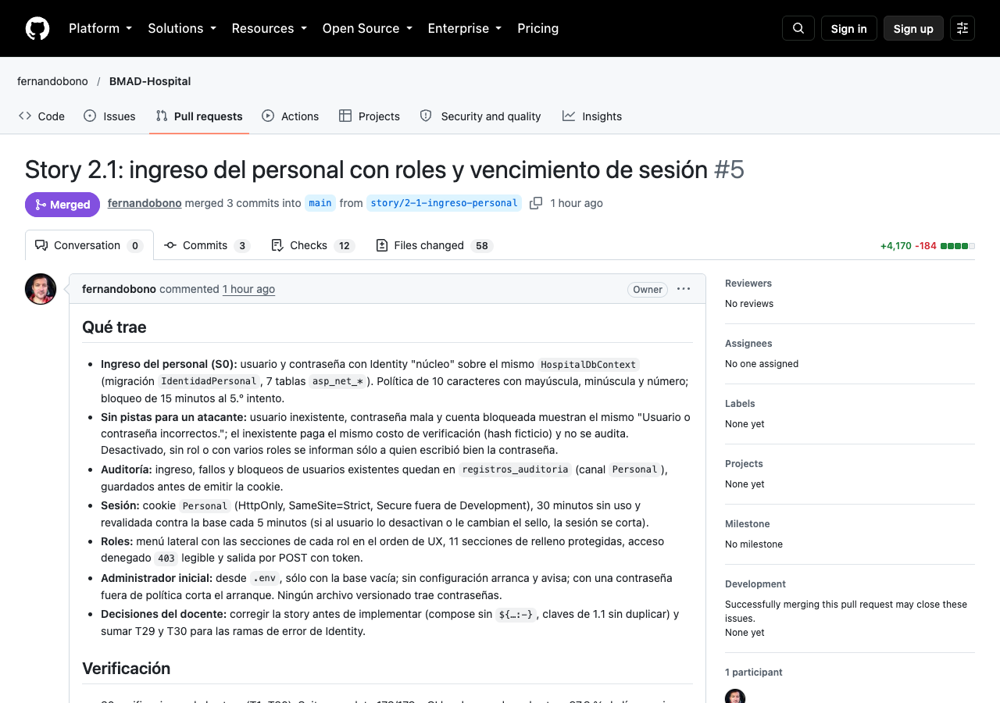
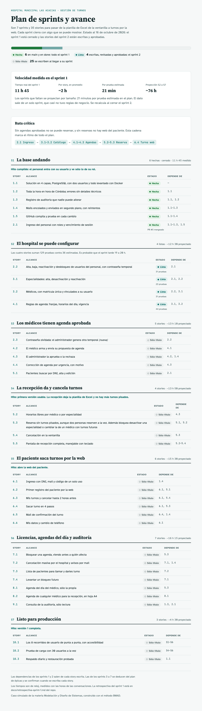

# Sesión 08 — Cierre del sprint 1 y stories del sprint 2

**Fecha:** 16 de octubre de 2026, desde las 16:34
**Participantes:** el docente (Ing. Fernando Bono) y el equipo de agentes de IA con el método BMAD:
Bob (facilita la retrospectiva), John, Winston, Mary, Amelia, Quinn, y un grupo de agentes que
escribieron y revisaron las stories.
**Resultado:** la story 2.1 quedó mergeada y en done, y con ella cerró el sprint 1. Se hizo la
retrospectiva, se midió la velocidad real y se proyectaron los sprints 2 a 7. Las cuatro stories del
sprint 2 quedaron escritas, revisadas dos veces y aprobadas. No se programó nada.

> Registro curado de la conversación: los mensajes del docente están tal cual; las respuestas del
> equipo están resumidas. La transcripción completa es
> [08-Conversacion-completa-2026-10-16-1634.md](08-Conversacion-completa-2026-10-16-1634.md).

---

## 1. El pedido

**Docente:** "Sigamos con BMAD-Hospital (…). Esta es la sesión 08." Tres pasos: confirmar la CI del
PR #5 y mergearlo cuando él lo apruebe; cerrar el sprint 1 con una retrospectiva y proyectar los
sprints 2 a 7; y escribir las stories del sprint 2 (2.2, 3.1, 3.2 y 4.1) con revisión adversarial
antes de aprobarlas. Con las reglas de siempre: sin registro de horas, una decisión por vez, el tiempo
probado con el reloj inyectado, y nada de subir sin su aprobación.

## 2. El merge de la 2.1

Los 12 controles de la CI estaban en verde en las dos corridas, la del push y la del PR, sobre el
último commit de la rama. `main` no había cambiado desde que se abrió el PR.

**Docente:** "si" (el merge). **Docente:** "si" (el commit que pasa la 2.1 a done).

Después del merge se registró la retrospectiva del merge, el archivo que deja constancia de cada
merge a `main`.

## 3. La retrospectiva del sprint 1

El plan no fijaba una duración para los sprints: había que medirla en el primero. El tiempo se
sacó de las horas de las conversaciones de cada sesión.

| | Estimado | Real |
|---|---|---|
| Pruebas | 34 | 77 escritas en las stories (179 casos que corren) |
| Tiempo | sin estimar | 11 h 45 de reloj, unas 2 h por story |

Lo que funcionó: validar cada story contra el código del día (en las 6 encontró algo
desactualizado), pruebas primero viéndolas fallar, las pruebas viejas como red, y el reloj
inyectado. Lo que no: las stories escritas una semana antes que el código, la estimación de pruebas
corta (2,3 veces), y `main` sin proteger contra un merge con la CI en rojo.

> 💡 **Para la clase.** La velocidad no se adivina: se mide. El plan del 9 de octubre dejó a
> propósito los sprints sin duración (supuesto S-35) para medirla en el primero. Con un solo sprint
> el número es frágil, y por eso la proyección dice cuándo se recalcula.

**Docente:** "Por tamaño" (la opción recomendada). Los sprints 2 a 7 se proyectan a 21 minutos por
prueba estimada: unas 74 h. Contando por story habría dado 55 h y habría subestimado las grandes.

Todo quedó en `docs/retrospectiva-sprint-1.md` y en el plan de sprints.

## 4. Las stories del sprint 2

Se escribieron en paralelo, cada una por un agente distinto, con un mismo resumen de reglas y de
contratos entre ellas: qué crea cada una, qué lee de las otras y en qué orden se implementan.

| Story | Criterios | Pruebas | Estimadas |
|---|---|---|---|
| 2.2 Usuarios del personal | 27 | 31 | 8 |
| 3.1 Especialidades | 19 | 23 | 6 |
| 3.2 Médicos | 24 | 31 | 8 |
| 4.1 Dominio de agenda | 32 | 44 | 14 |

## 5. La revisión adversarial

La primera vuelta encontró 1 problema crítico, 8 importantes y 12 menores. El crítico: la 3.2 y la
4.1 describían distinto el estado de agenda de la lista de médicos, y cada una decía que lo fijaba la
otra. La 4.1 se habría frenado en su primer paso.

> 💡 **Para la clase.** Escribir en paralelo es rápido, pero cada agente ve sólo su story. Los
> errores aparecieron justo en las costuras: piezas escritas dos veces con nombres distintos, dos
> carpetas para lo mismo, dos tipos de id. La revisión que mira las cuatro juntas es la que los ve.

Las stories traían 15 decisiones abiertas, que juntando las repetidas quedaron en 14. La revisión
agregó 3.

**Docente:** "Aceptar las 14 en bloque" (la opción recomendada). Después, de a una:

- Una agenda aprobada que todavía no rige se ve como "Sin agenda (rige desde 01/12)".
- El id del médico es `long`, como el del resto de las tablas.
- El permiso del administrador se confirma en la base en cada cambio, no sólo en la sesión.
- El usuario de un médico se puede crear antes de vincularlo, pero se ve "Sin vincular".

Un agente aplicó todas las correcciones en las cuatro stories. La segunda vuelta salió limpia: dos
errores de texto, que corrigió en el momento.

Quedaba una decisión de fondo: las acciones de auditoría tenían dos estilos de nombre.
**Docente:** "Punto, para todas las nuevas" (`usuario-personal.creado`, `medico.creado`). Quedó
fijado en el contrato técnico.

**Docente:** "si aproba" (las cuatro stories).

## 6. Lo que cambió fuera de las stories

- **Plan de sprints:** suma la story 2.3 (contraseña olvidada) al sprint 3, y la nota de lo que
  la 5.3 tiene que bloquear cuando existan los turnos. Avisa que el sprint 2 probablemente tarde 19
  a 20 h y no 12 h 30: sus pruebas crecieron 3,6 veces.
- **Contrato técnico:** el estilo de nombre de las acciones de auditoría.
- **Arquitectura:** los horarios del día se calculan en la agenda y no en el médico.
- **Página del plan de sprints**, actualizada.

## 7. Dónde estamos

| Cosa | Estado |
|---|---|
| Sprint 1 (1.1 a 2.1) | Cerrado, en `main` |
| Retrospectiva y proyección | Hechas |
| Stories 2.2, 3.1, 3.2 y 4.1 | Aprobadas, `ready-for-dev` |
| Próxima sesión | Implementar la 2.2 con el circuito completo |
