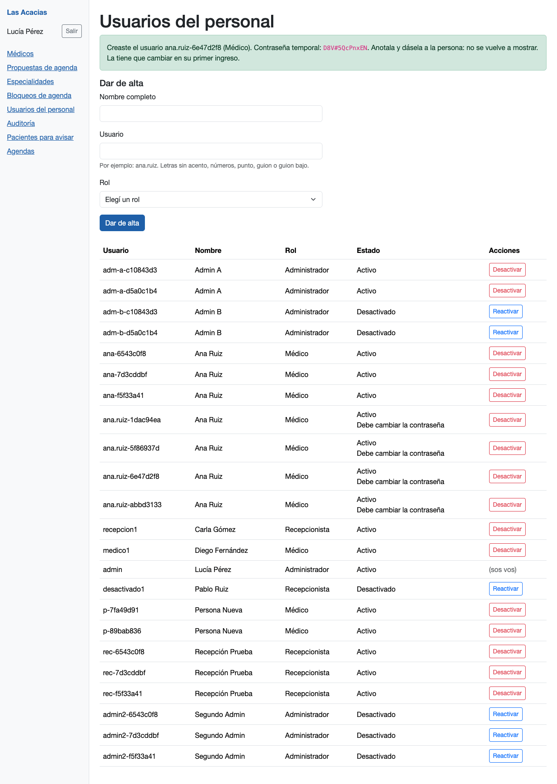
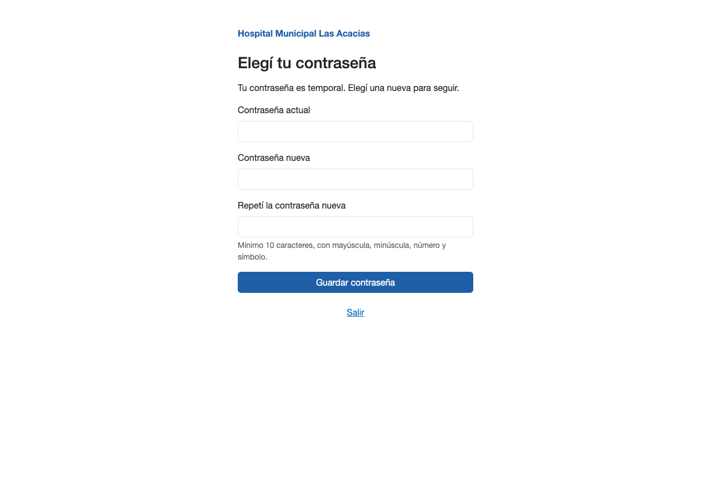
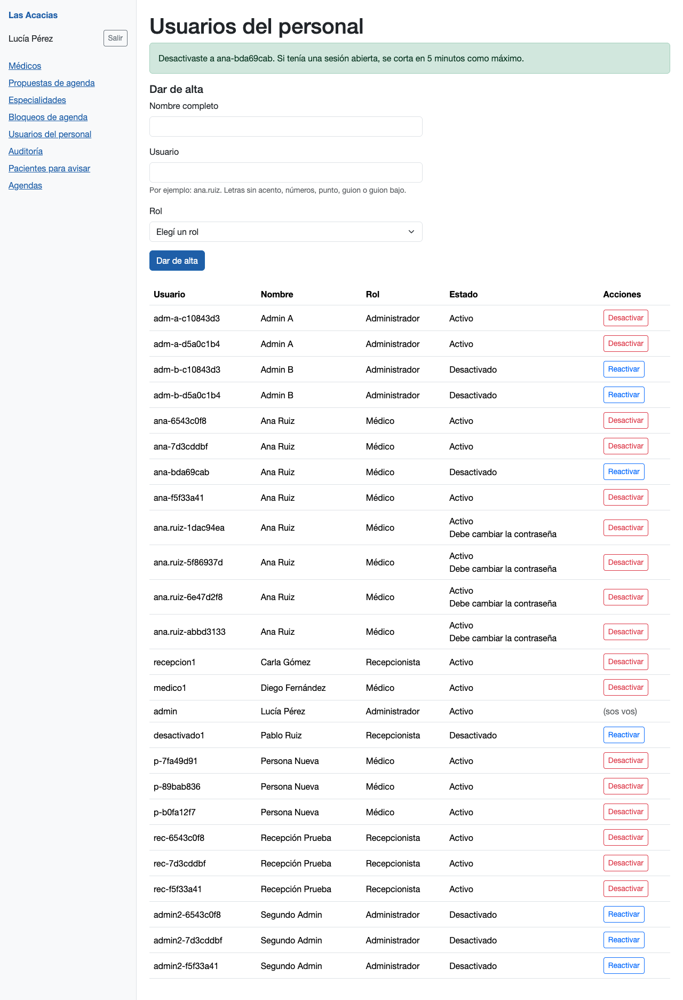
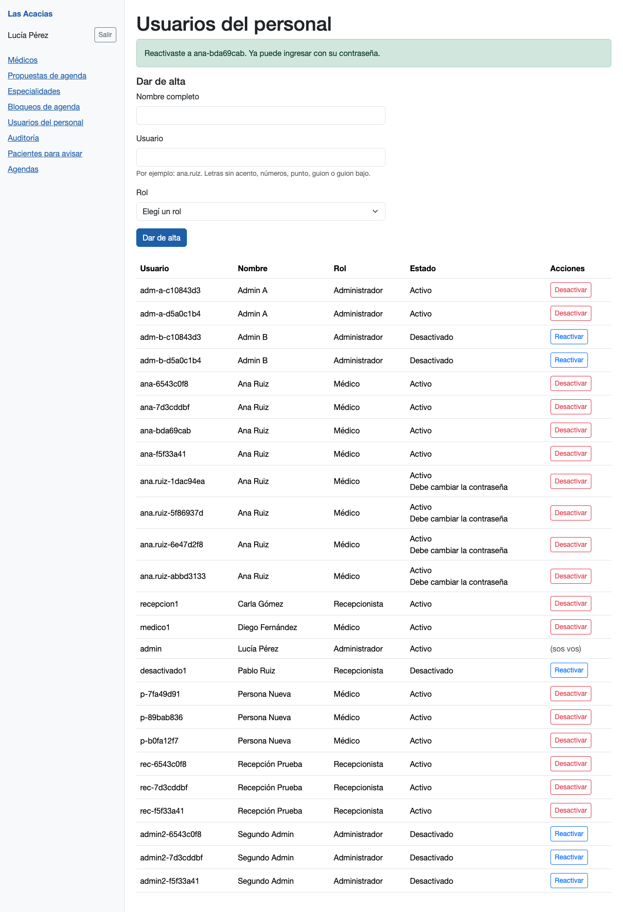
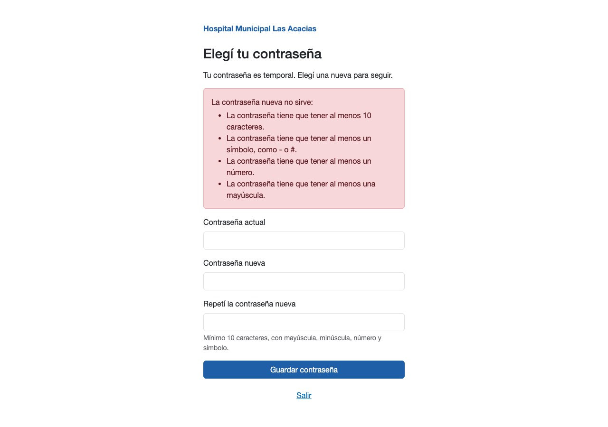
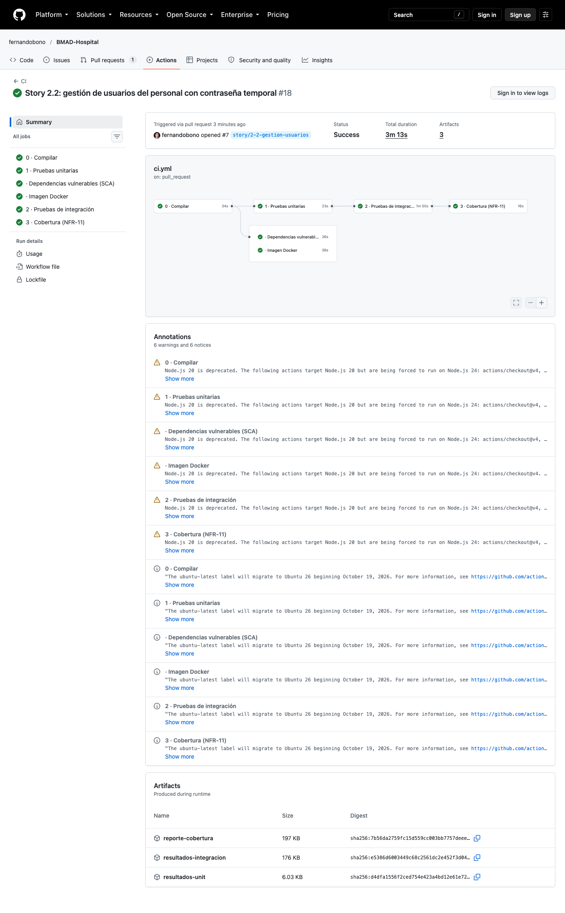
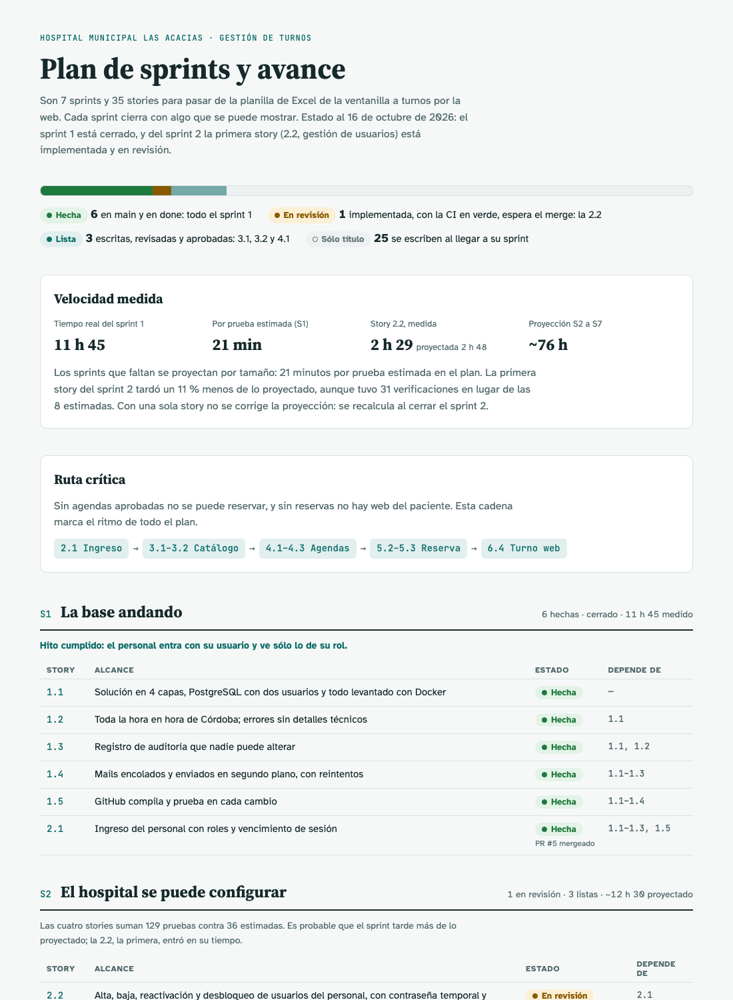

# Sesión 09 — Story 2.2: gestión de usuarios del personal

**Fecha:** 16 de octubre de 2026, desde las 17:59
**Participantes:** el docente (Ing. Fernando Bono) y el equipo de agentes de IA con el método BMAD:
Mary (valida la story), Amelia (implementa), siete revisores automáticos y un "tester no técnico" que
revisa que la guía y las pantallas se entiendan.
**Resultado:** el PR #6 (stories del sprint 2) quedó mergeado. La story 2.2 quedó implementada,
revisada, probada en vivo y en `review`, con el PR #7 y la CI en verde. Llevó 2 h 29 de reloj contra
2 h 48 proyectadas.

> Registro curado de la conversación: los mensajes del docente están tal cual; las respuestas del
> equipo están resumidas. La transcripción completa es
> [09-Conversacion-completa-2026-10-16-1759.md](09-Conversacion-completa-2026-10-16-1759.md).

---

## 1. El pedido

**Docente:** "Sigamos con BMAD-Hospital (…). Esta es la sesión 09." Primero, confirmar la CI del
PR #6 y mergearlo cuando él lo apruebe. Después, implementar la story 2.2 con el circuito completo:
validación contra el repo de hoy, plan aprobado, pruebas primero, revisores y prueba en vivo; el PR
con la CI en verde antes de pedir el merge, y medir cuánto tarda la story. Con las reglas de siempre:
sin registro de horas, una decisión por vez, el tiempo probado con el reloj inyectado y nada de subir
sin su aprobación.

## 2. El merge del PR #6

Los controles de la CI estaban en verde salvo el de cobertura, que todavía corría. El equipo esperó a
que terminara (6 de 6) antes de preguntar.

**Docente:** "Sí, con commit de merge (Recomendado)". Las cuatro stories del sprint 2 quedaron en
`main`.

## 3. Validar la story contra el código de hoy

Mary no encontró bloqueos, pero sí dos tipos de cosas viejas. La story citaba números de línea de
archivos que ella misma iba a modificar, y una nota y una consulta seguían el estilo de auditoría
`usuario-personal-…` cuando el criterio 25, ya decidido, usa `usuario-personal.creado` con punto.

**Docente:** "Corregirlos y seguir (Recomendado)". Se corrigió la story, sin tocar ningún criterio ni
prueba.

> 💡 **Para la clase.** Una story aprobada el mismo día también puede quedar desactualizada: entre que
> se escribe y se programa, el repo cambia (acá, por una decisión tomada en la revisión). La
> validación la compara con el código del momento, no con el de cuando se escribió.

## 4. El plan

Amelia propuso el orden: firmas, 19 pruebas de la lógica (que fallan), migración y casos de uso; después
12 pruebas de las pantallas (que fallan) y las pantallas. Todo dentro de los 38 archivos de la story y
sin librerías nuevas. Antes de tocar nada corrió la suite: 179 pruebas en verde.

**Docente:** "Sí, aprobado (Recomendado)".

## 5. Pruebas primero, y una prueba que se probó a sí misma

Las 31 verificaciones se escribieron antes que el código y se las vio fallar por la razón correcta:
faltaban las piezas que la story manda crear. En las pantallas fallaron 25 de 28 casos. Los otros 3
eran el freno a los formularios sin token, que el framework ya da desde la 1.1. Quedan como protección
para que nadie lo saque.

Con el código hecho, el equipo probó la prueba más delicada: la de dos administradores que se
desactivan uno al otro al mismo tiempo. Sacó a propósito el candado de la base y la corrió 5 veces:
falló las 5. Con el candado, pasa siempre.

> 💡 **Para la clase.** Una prueba que pasa no dice nada si también pasaría sin el código que dice
> proteger. Romper el código a propósito y ver la prueba en rojo es la forma de saber que sirve.

## 6. Un 404 que no llegaba a la pantalla

Para "ese usuario no existe" la story pedía un 404 con un cartel. La prueba falló: llegaba el 404,
pero sin el cartel. El equipo leyó el código de .NET 10 y encontró la causa: Blazor no escribe el
cuerpo de una página que terminó en 404, porque lo reserva para la página de "no encontrado". La
solución fue fijar el 404 justo antes de enviar la respuesta.

## 7. Los revisores

Siete revisores en la primera vuelta. Seguridad, cobertura y resiliencia salieron limpios. Dos avisos
llevaron a cambiar código: un error de "usuario repetido" que se podía mostrar ante otra causa, y el
arreglo del 404, que hacía falta compartir. La 3.1 y la 3.2 lo van a necesitar, y la story dice que
esas piezas se reusan, no se copian.

**Docente:** "Pieza compartida (Recomendado)". El arreglo pasó al manejador de errores, y la story se
actualizó antes que el código. Hubo una segunda vuelta (6 revisores) sin hallazgos nuevos.

## 8. La prueba en vivo

Con la app real del Compose y Chrome manejado por un script, se recorrieron los 27 criterios en
cinco grupos: alta, cambio de contraseña, estados, errores y fallas. En el de fallas, la base perdió
a propósito el permiso de escribir la auditoría (y se le devolvió), dos administradores se
desactivaron a la vez, y la base se apagó en medio de un alta. El corte de la sesión a los 5 minutos
se probó con el reloj inyectado, sin esperar.

## 9. El tester no técnico

Un agente con el papel de alguien que no programa leyó la guía de prueba y las pantallas. En la guía
marcó 10 cosas (jerga, pasos ambiguos). En las pantallas marcó que los errores de contraseña salían
pegados, que el formato del usuario se explicaba recién al fallar, que la fila propia quedaba sin
botones y sin explicación, y que la pantalla de cambio no tenía botón "Salir".

**Docente** (mensaje en medio del trabajo): "puedo ver el sistema en el navegador o aun no? (…)". Se le
abrió la app. **Docente:** "la pass es incorrecta". La base mostraba que no había intentos fallidos:
se le pasaron el usuario y la contraseña del `.env`.

**Docente:** "Arreglar 4 en esta story (Recomendado)". Primero la story (criterios 1, 5, 20 y 22) y las
pruebas, que fallaron; después las pantallas. Hubo una tercera vuelta de revisores y la prueba en vivo
se repitió. La guía necesitó cuatro pasadas más del tester hasta quedar sin marcas: cada arreglo
destapaba otro hueco en el orden de los pasos.

> 💡 **Para la clase.** Las pruebas automáticas verifican que la pantalla dice lo que la story manda.
> No verifican que se entienda. Para eso hace falta alguien que la lea sin saber cómo está hecha.

## 10. Commit, PR y CI

**Docente:** "Sí: commit, push y PR (Recomendado)". La CI del PR #7 pasó 6 de 6 controles en la
corrida del push y en la del PR. Un segundo commit dejó la story en `review`, y su CI también pasó.

## 11. Cuánto tardó

| | Proyectado | Medido |
|---|---|---|
| Pruebas | 8 (plan) | 31 verificaciones (249 casos en la suite, antes 179) |
| Tiempo | 2 h 48 (8 × 21 min) | 2 h 29 de reloj; 1 h 14 activo |

El reloj quedó un 11 % por debajo de lo proyectado. La pausa más larga (1 h 14, de 18:59 a 20:14) fue
la espera de la decisión sobre la legibilidad de las pantallas. Con una sola story no se corrige la proyección: se recalcula al cerrar el sprint 2. La
página del plan de sprints quedó actualizada.

## Pendientes

- Mergear el PR #7 y pasar la 2.2 a `done` (decide el docente).
- Al validar la 3.1 y la 3.2: cambiar el patrón del cartel por `FijarEstadoEnPagina`.
- "Mi agenda" todavía dice "en construcción" después del primer ingreso; lo resuelve su story.
