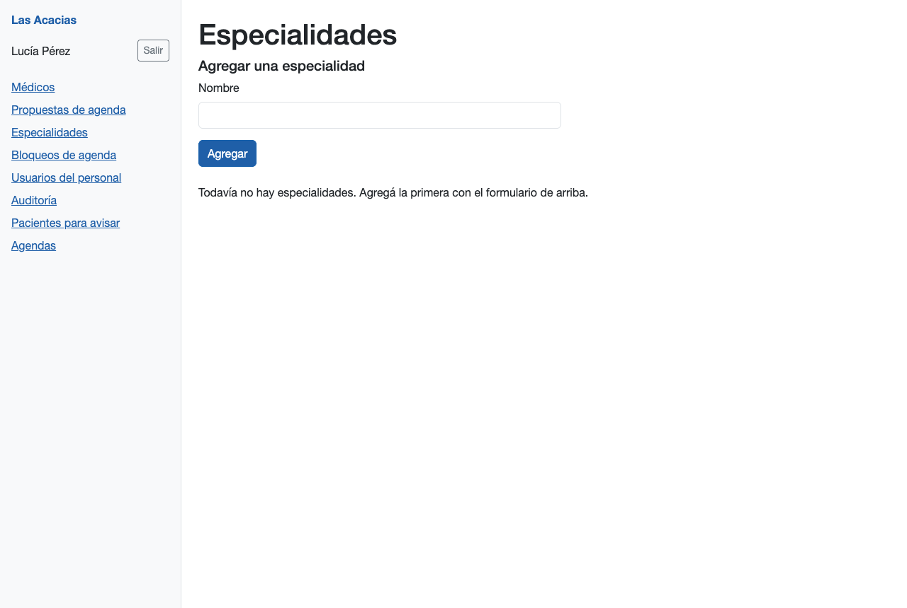
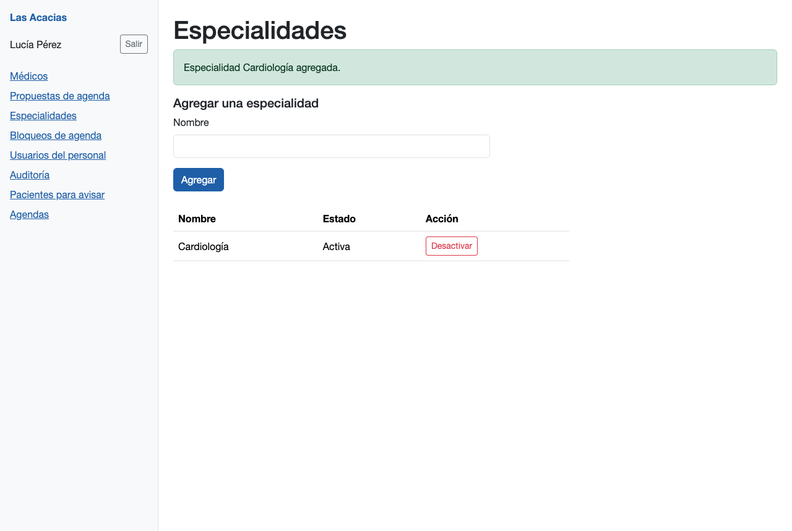
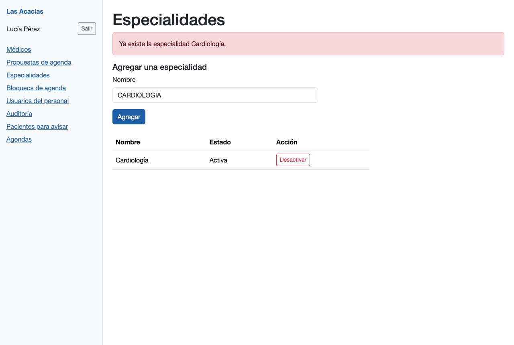
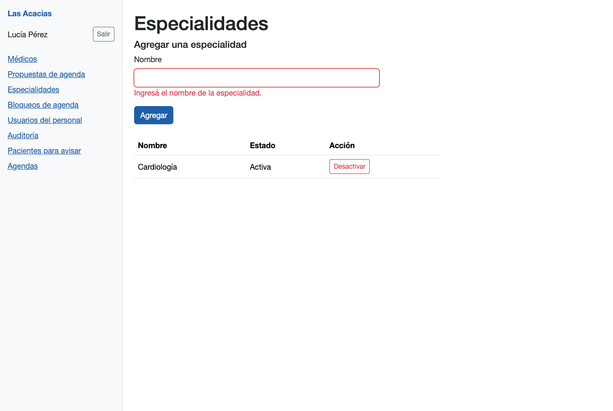
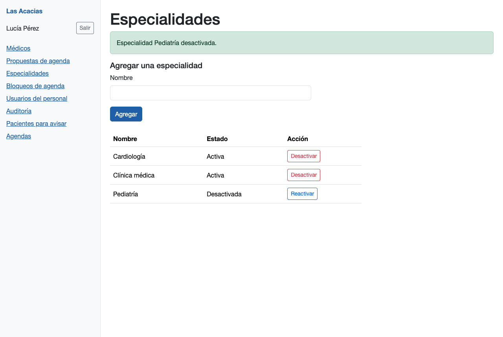
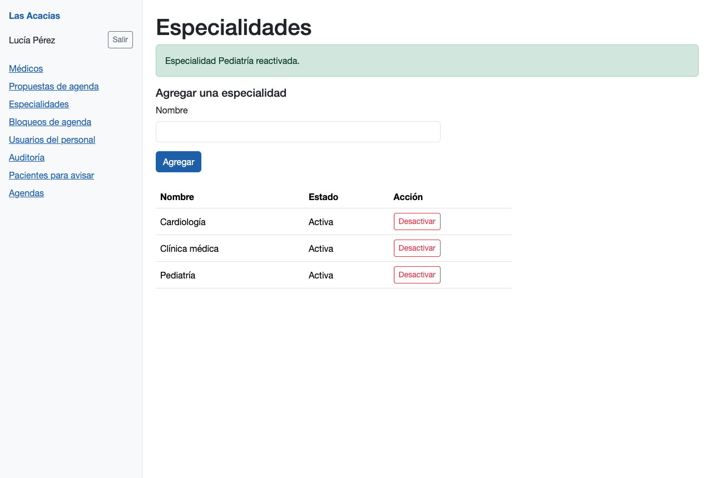
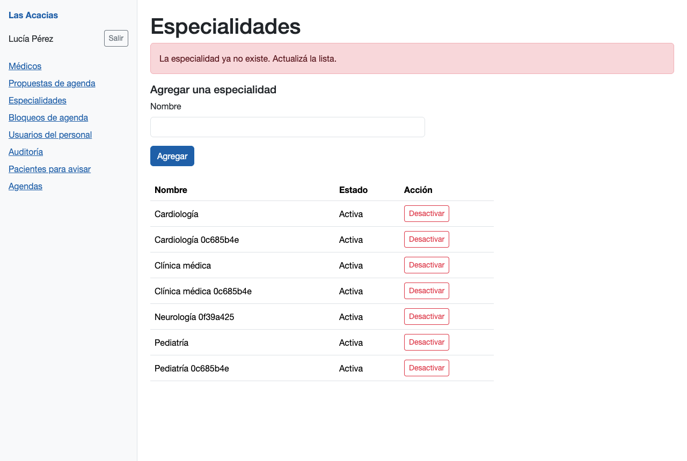
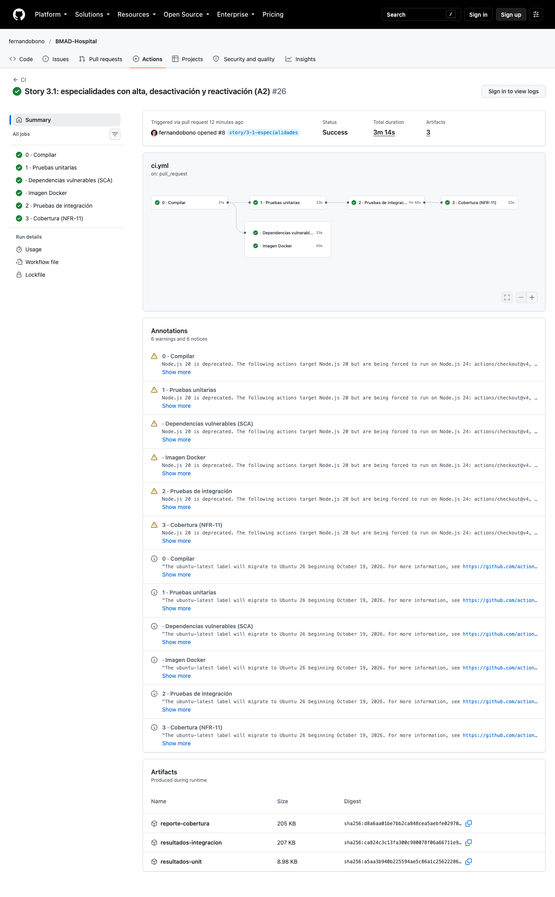
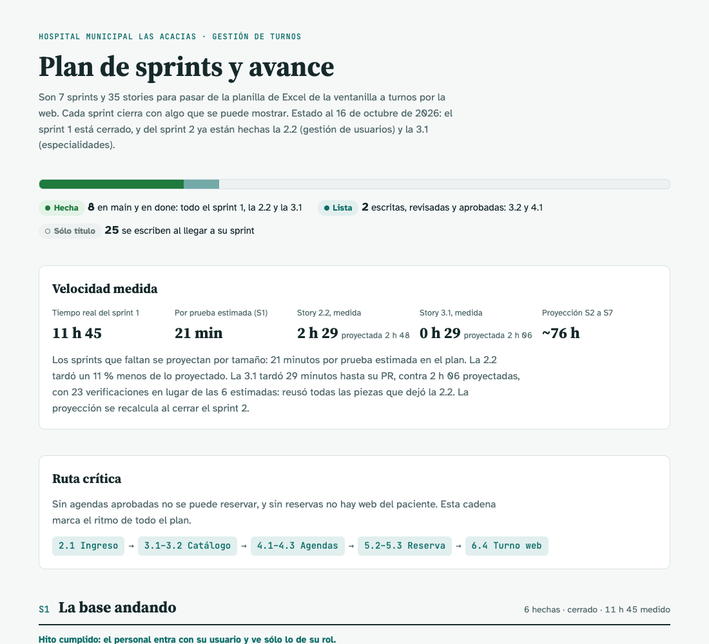

# Sesión 10 — Story 3.1: especialidades

**Fecha:** 16 de octubre de 2026, desde las 20:58
**Participantes:** el docente (Ing. Fernando Bono) y el equipo de agentes de IA con el método BMAD:
Mary (valida la story), Amelia (implementa), siete revisores automáticos y un "tester no técnico" que
revisa que la guía y las pantallas se entiendan.
**Resultado:** la story 3.1 quedó implementada, revisada, probada en vivo, con el PR #8 y la CI en
verde, mergeada a `main` y en `done`. Llevó 29 minutos de reloj hasta el PR, contra 2 h 06
proyectadas.

> Registro curado de la conversación: los mensajes del docente están tal cual; las respuestas del
> equipo están resumidas. La transcripción completa es
> [10-Conversacion-completa-2026-10-16-2058.md](10-Conversacion-completa-2026-10-16-2058.md).

---

## 1. El pedido

**Docente:** "Sigamos con BMAD-Hospital (…). Esta es la sesión 10." Implementar la story 3.1 con el
circuito completo de la 2.2: validación contra el repo de hoy, plan aprobado, pruebas primero,
revisores y prueba en vivo; el PR con la CI en verde antes de pedir el merge, y medir cuánto tarda
para comparar con la proyección del sprint 2 (21 minutos por prueba estimada). Con un aviso: la
story todavía decía que el cartel de error se muestra con `Response.StatusCode = EstadoPara(e)`, y
desde la 2.2 hay que usar la pieza compartida `ManejadorGlobalDeErrores.FijarEstadoEnPagina`, porque
Blazor .NET 10 no escribe el cuerpo de una página que responde 404. Corregirlo antes de implementar.

## 2. Corregir y validar la story

El equipo cambió los siete lugares de la story que citaban el patrón viejo. Después Mary la validó
contra el código de hoy: nada que bloqueara, pero varios textos habían quedado viejos con la 2.2
(cuántas rutas tenía la pantalla de secciones, cuántos tipos de registro de auditoría había, el
commit contra el que se verificó, números de línea de archivos que la story misma iba a cambiar).

**Docente:** "Corregir y seguir (Recomendado)". Segunda validación: limpia.

> 💡 **Para la clase.** La 2.2 descubrió un problema del framework y lo resolvió con una pieza
> compartida. Las stories siguientes ya estaban escritas con la solución anterior. Una decisión que
> se toma al implementar tiene que volver a las stories que vienen, no sólo al código.

## 3. El plan

Amelia propuso cuatro capas, cada una con sus pruebas antes que el código: las reglas de la
especialidad, la tabla en la base, las operaciones del administrador y la pantalla A2. Dentro de los
19 archivos de la story, sin librerías nuevas.

**Docente:** "Aprobar (Recomendado)".

## 4. Pruebas primero, capa por capa

Antes de tocar nada, la suite de `main` estaba en verde. En cada capa las pruebas se escribieron
primero y fallaron por la razón correcta: faltaba lo que la story manda crear. Después se escribió el
código hasta que pasaron.

- **Las reglas.** "  Clínica   médica " se guarda como "Clínica médica". "Cardiología", "cardiologia"
  y " CARDIOLOGÍA " dan la misma clave, y la base tiene un índice único sobre esa clave.
- **La carrera.** Si dos altas iguales pasan la verificación a la vez, el índice de la base rechaza la
  segunda y la persona recibe "Ya existe…", nunca un error interno. Para probarlo sin depender de la
  suerte, un doble de prueba inserta la misma especialidad por otra conexión justo antes de guardar.
- **La pantalla.** Al principio las pruebas fallaron todas por un error interno: la ruta la
  atendían dos páginas a la vez, la nueva y la vieja "en construcción". Se quitó la vieja y pasaron.

Resultado: 300 pruebas en verde (antes 249) y 98,7 % de las líneas cubiertas.

> 💡 **Para la clase.** La prueba-trampa T15 no prueba código de hoy: falla el día que aparezca la
> tabla de turnos, con un mensaje que dice qué regla hay que cumplir. Es una forma de que un
> requisito que todavía no se puede cumplir no se olvide.

## 5. Un túnel para mostrar el sistema

**Docente** (mensaje en medio del trabajo): "me habilitas ngrok para el puerto 8080 así pueden probar
el sistema en mi pc". Se abrió el túnel, con la advertencia de que quedaba público y de que todavía
mostraba la versión anterior. Más tarde: **Docente:** "cerrá el túnel ngrok". Se cerró y se comprobó
que ya no respondía.

## 6. Los revisores

Siete revisores automáticos (cobertura, seguridad, la story contra el código, alcance no documentado,
criterios sin prueba, llamadas HTTP y fallos silenciosos) salieron limpios en la primera vuelta.

## 7. La prueba en vivo

Un script maneja Chrome contra la app real del Compose y verifica cada paso de "Como verificar". La
primera corrida, con la base vacía, dio dos fallas. Las capturas mostraban que la pantalla estaba
bien: el error era del script, que buscaba una clase CSS que Blazor reemplaza. Se corrigió y se
repitió con nombres marcados. Los 19 criterios quedaron probados en vivo, incluidos dos que no se ven
a mano:

- el 404 de una especialidad que ya no existe llega **con** su cartel dentro de la pantalla;
- diez altas iguales al mismo tiempo, desde dos sesiones: un 200, nueve 409 y una sola fila.

## 8. El tester no técnico

En la guía marcó que el criterio 13 explicaba un caso del 403 y la captura mostraba el otro; se
corrigió la guía y la segunda pasada quedó limpia. En la pantalla marcó que el administrador recién
desactivado ve "Sólo el administrador puede modificar las especialidades." mientras el menú lo sigue
mostrando como administrador.

**Docente:** "Dejarlo como está". La marca quedó anotada como aceptada en la story.

## 9. Commit, PR, CI y merge

**Docente:** "si" (commit, push y PR). La CI del PR #8 pasó todos sus controles en 3 min 14 s.
**Docente:** "si" (merge). El PR quedó mergeado y la 3.1 en `done`.

## 10. Cuánto tardó

| | Proyectado | Medido |
|---|---|---|
| Pruebas | 6 (plan) | 23 verificaciones (300 casos en la suite, antes 249) |
| Tiempo | 2 h 06 (6 × 21 min) | 29 min de reloj hasta el PR; 34 min hasta `done` |

Sin pausas largas: el reloj y el tiempo activo coinciden. Fue tan rápida porque reusó todas las
piezas que dejó la 2.2: el actor de la sesión, el control de permiso en la base, el cartel de error
y las ayudas de prueba. La proyección se recalcula al cerrar el sprint 2. La página del plan de
sprints quedó actualizada.

## Pendientes

- Sigue la 3.2 (médicos). Al validarla, cambiar el patrón del cartel por `FijarEstadoEnPagina`. Ojo
  también con la ficha del médico: la story fija el 404 a mano (`Response.StatusCode = 404`), y con
  Blazor .NET 10 esa página llegaría sin cuerpo.
