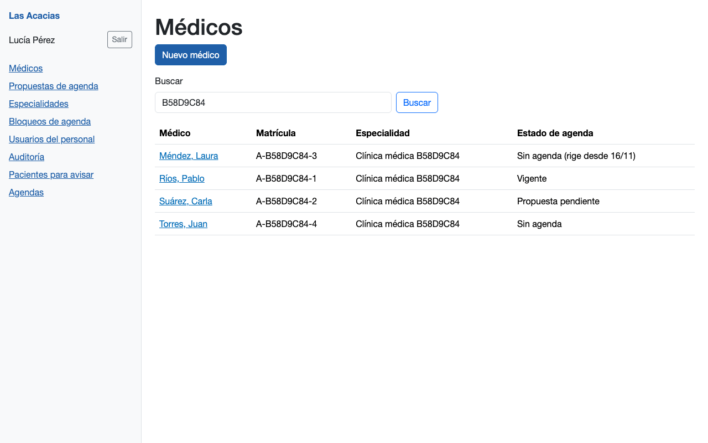
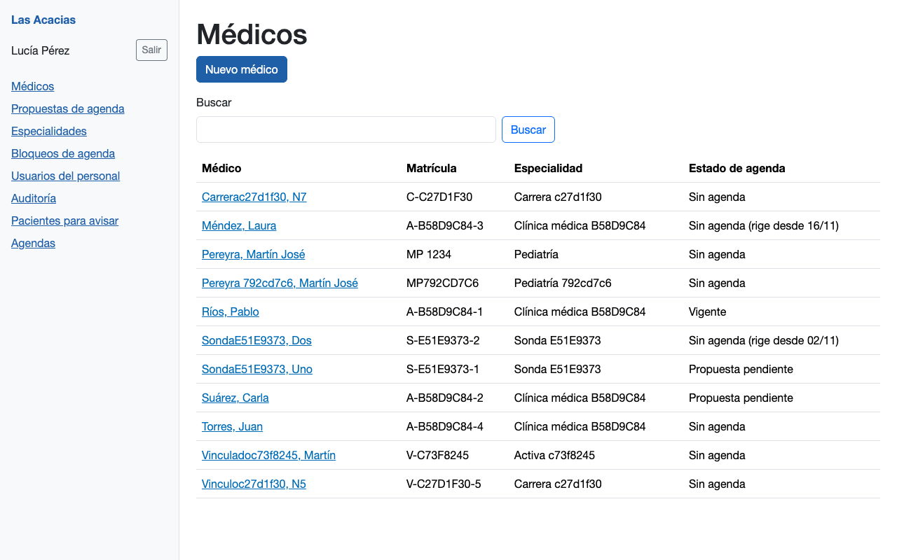
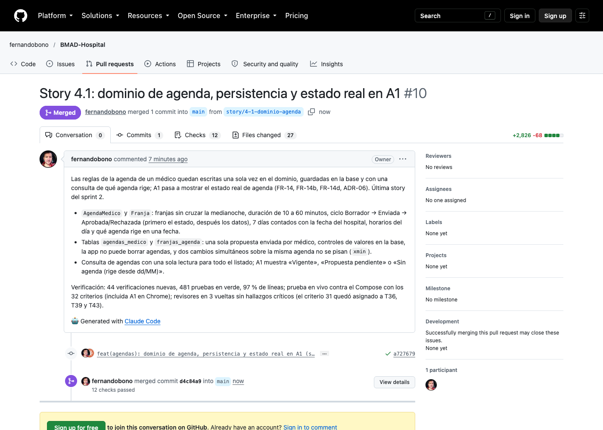
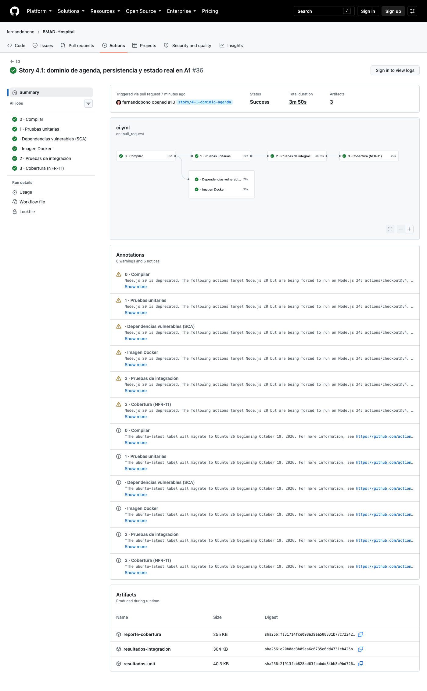
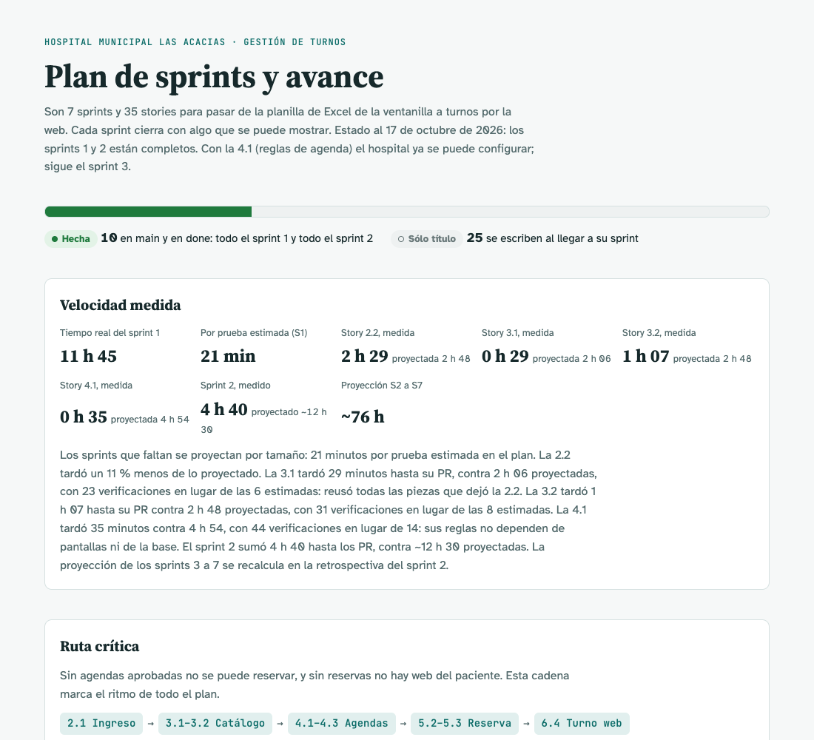

# Sesión 12 — Story 4.1: dominio de agenda

**Fecha:** 16 de octubre de 2026, desde las 23:38
**Participantes:** el docente (Ing. Fernando Bono) y el equipo de agentes de IA con el método BMAD:
Mary (valida la story), Amelia (implementa) y seis revisores automáticos.
**Resultado:** la story 4.1 quedó implementada, revisada, probada en vivo, con el PR #10 y la CI en
verde, mergeada a `main` y en `done`. Con ella **se completa el sprint 2**. Llevó 35 minutos de reloj
hasta el PR, contra 4 h 54 proyectadas.

> Registro curado de la conversación: los mensajes del docente están tal cual; las respuestas del
> equipo están resumidas. La transcripción completa es
> [12-Conversacion-completa-2026-10-16-2338.md](12-Conversacion-completa-2026-10-16-2338.md).

---

## 1. El pedido

**Docente:** "Sigamos con BMAD-Hospital (…). Esta es la sesión 12." Implementar la 4.1 con el mismo
circuito que la 3.2, con el PR en verde antes de pedir el merge y midiendo el tiempo contra la
proyección (21 minutos por prueba estimada). Un aviso: la 4.1 se escribió **antes** que la 3.2, así
que había que confirmar contra el código real el contrato que la 3.2 le dejó (su AC 23) y corregir la
story si algo no coincidía.

## 2. Confirmar el contrato y validar

El contrato coincidía en lo importante: los dos tipos del estado de agenda estaban en
`Dominio/Agendas`, `GestionMedicosEnBase` tenía cuatro parámetros y había dos lugares marcados para la
4.1. Tres cosas no coincidían y se corrigieron en la story antes de programar:

- Las marcas no eran una asignación `Agenda = SituacionDeAgenda.SinAgenda`, sino el último argumento
  de los constructores de la fila del listado y de la ficha.
- La sección "Qué existe hoy" describía el repo de antes de la 3.1 y la 3.2.
- Las ayudas de prueba `DatosDeCatalogo` tienen otra firma: en un proyecto trabajan sobre el contenedor
  de servicios y piden un administrador propio para crear la especialidad; en el otro, sobre la app.

Mary validó sin nada que bloqueara. El AC 31 (el contrato que la 4.1 ofrece a las stories
siguientes) no tenía prueba asignada.

**Docente:** "Asignarle pruebas (Recomendado)" — T36, T39 y T43, que ya lo cubrían, como en la 3.1 y
la 3.2.

> 💡 **Para la clase.** Cuando dos stories se escriben en paralelo, la que se implementa después
> hereda un contrato que todavía no existía cuando se escribió. Revalidarla contra el código del día
> es lo que evita programar sobre un supuesto.

## 3. El plan

Seis tramos, cada uno con sus pruebas antes que el código: las reglas de la agenda (sin base), el
contrato de consulta, las tablas y la migración, la consulta y el listado A1, la pantalla, y el cierre.
Son 44 verificaciones, contra las 14 que estimaba el plan de sprints.

**Docente:** "Si aprobado".

## 4. Pruebas primero

- **El dominio (T1–T32).** 92 casos que corren en menos de una décima de segundo, todos con un reloj
  falso fijado en Córdoba. El más fino es T12: a las 23:30 del viernes en Córdoba ya es sábado en UTC;
  la regla de los 7 días tiene que contar desde el viernes.
- **La base (T33–T43).** Contra PostgreSQL real: una sola propuesta enviada por médico, controles de
  valores en la base, la app no puede borrar agendas y dos cambios simultáneos no se pisan.
- **La pantalla (T44).** A1 muestra el estado real, con las agendas armadas con relojes falsos
  derivados del reloj de la app, sin esperar tiempo real.

Dos sorpresas, las dos atrapadas antes de llegar a los revisores:

- **Una columna que no tenía que existir.** La protección contra cambios simultáneos usa una columna
  de sistema de PostgreSQL (`xmin`). La convención de nombres del proyecto la renombraba a `version`, y
  la migración creaba una columna nueva. Se fijó el nombre explícito y se comprobó con el SQL generado
  que la tabla no tiene columna de versión. Quedó anotado en la story.
- **Un reloj de prueba mal armado.** La primera corrida contra la base falló porque la ayuda de prueba
  armaba la hora con −03:00 y la base sólo acepta UTC. El reloj real del hospital siempre da UTC: el
  error era de la ayuda, no del código.

> 💡 **Para la clase.** Generar la migración no es el final: hay que leer el SQL que va a correr. Una
> convención que funciona para todas las tablas puede romper un caso especial sin que ninguna prueba
> lo note, salvo la que mira la tabla real.

## 5. Los revisores

Seis revisores en la primera vuelta: ninguno crítico. Los avisos eran administrativos de la story
(tareas sin tildar, el registro del desarrollador vacío, el nombre real de la migración, el AC 27 sin
el nombre `xmin`) y uno de cobertura que se cerró con la CI local: **97 % de líneas** (antes 95,6 %).
Como se corrigió la story, hubo dos vueltas más de tres revisores cada una; las dos limpias.

## 6. La prueba en vivo

La mayoría de los criterios son reglas del dominio que todavía no tienen pantalla (la propuesta del
médico es la 4.2). Para probarlas en vivo, el equipo armó una sonda fuera del repo que usa el código
compilado de la rama contra la base de Compose, en cuatro grupos:

| Grupo | Criterios | Resultado |
|---|---|---|
| Reglas del dominio | 1 a 22 | 22 de 22 |
| Base de datos (borrar prohibido, índice, controles, cambios simultáneos) | 23 a 28, 31, 32 | 7 de 7 |
| Consulta con el reloj real del hospital | 29, 31 | Vigente, Propuesta pendiente, Sin agenda con fecha |
| A1 en Chrome | 22, 30 | 7 de 7 |

Los 32 criterios quedaron probados en vivo. Para la pantalla se sembraron cuatro médicos: uno con una
agenda que rige hoy, otro con una propuesta enviada, otro con una agenda aprobada que empieza dentro
de un mes y otro sin agenda.

## 7. Commit, PR, CI y merge

**Docente:** "Si" (commit, push y PR). La CI del PR #10 pasó sus seis controles en 3 min 50 s.
**Docente:** "Si" (merge). El PR quedó mergeado y la 4.1 en `done`.

## 8. Cuánto tardó

| | Proyectado | Medido |
|---|---|---|
| Pruebas | 14 (plan) | 44 verificaciones (481 casos en la suite, antes 370) |
| Tiempo | 4 h 54 (14 × 21 min) | 35 min de reloj hasta el PR; 42 min hasta `done` |

Fue la story más rápida del sprint aunque es la que tiene más verificaciones. El dominio no depende de
nadie (las 32 primeras pruebas no necesitan base ni pantalla) y reusó todo lo que dejaron la 1.3, la
2.2, la 3.1 y la 3.2: la base de pruebas, las ayudas y el patrón de permisos. La página del plan de
sprints quedó actualizada.

## Pendientes

- El sprint 2 está completo (2.2, 3.1, 3.2 y 4.1). Falta su retrospectiva, para recalcular la
  proyección por prueba antes del sprint 3.
- Avisos de GitHub Actions que vienen de antes: acciones con Node.js 20 y el cambio de
  `ubuntu-latest` a Ubuntu 26 desde el 19/10.
