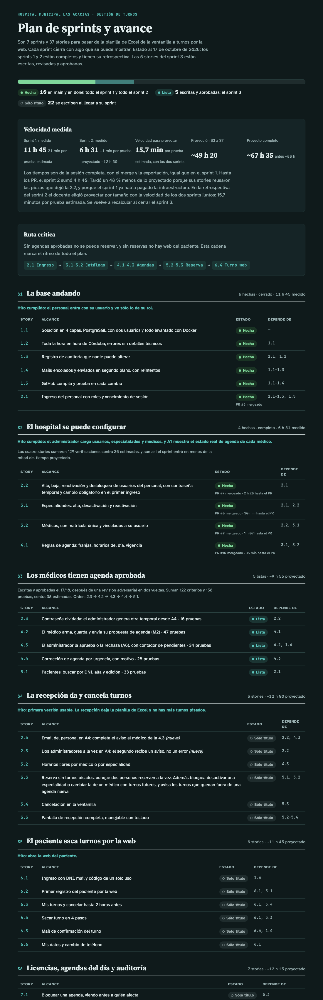

# Sesión 13 — Retrospectiva del sprint 2 y stories del sprint 3

**Fecha:** 17 de octubre de 2026, desde las 00:33
**Participantes:** el docente (Ing. Fernando Bono) y el equipo de agentes de IA con el método BMAD:
Bob (facilita la retrospectiva), John, Winston, Mary, Amelia y Quinn; cinco agentes escriben una
story cada uno y un revisor adversarial las revisa juntas.
**Resultado:** la retrospectiva del sprint 2 quedó escrita y la proyección, recalculada: del sprint 3
al 7 quedan ~49 h 20, y el proyecto completo, ~67 h 35 (antes ~88 h). Las 5 stories del sprint 3
quedaron escritas, revisadas en dos vueltas y aprobadas (`ready-for-dev`).

> Registro curado de la conversación: los mensajes del docente están tal cual; las respuestas del
> equipo están resumidas. La transcripción completa es
> [13-Conversacion-completa-2026-10-17-0033.md](13-Conversacion-completa-2026-10-17-0033.md).

---

## 1. El pedido

**Docente:** "Sigamos con BMAD-Hospital (…). Esta es la sesión 13." Hacer la retrospectiva del
sprint 2 con el formato de la del sprint 1: medir cada story con los registros de las sesiones 09 a
12 (reloj y activo), comparar pruebas estimadas con reales (36 contra 129), explicar por qué el
sprint entró en mucho menos de lo proyectado, juntar las lecciones técnicas y proponer cómo
recalcular la proyección, con opciones. Después, preparar el sprint 3.

## 2. Medir: un corte distinto

Las transcripciones guardan sólo la hora de los mensajes del docente. El equipo usó los registros
completos de cada sesión, que tienen la hora de cada paso, y encontró algo importante: **el sprint 1
se había medido con la sesión completa** (hasta exportar), no hasta el PR.

| | Hasta el PR | Sesión completa |
|---|---|---|
| Reloj del sprint 2 | 4 h 40 | **6 h 31** |
| Activo (sin pausas de más de 15 min) | 3 h 26 | 4 h 26 |

Para comparar con las 11 h 45 del sprint 1 sirve la segunda columna: 6 h 31, un 48 % menos de lo
proyectado.

> 💡 **Para la clase.** Antes de comparar dos mediciones hay que confirmar que miden lo mismo.
> "4 h 40 contra 11 h 45" exageraba la mejora: el sprint 1 incluía el cierre de cada sesión y ese
> número no.

## 3. Lo que encontró la retrospectiva

- **Pruebas:** 129 escritas contra 36 estimadas (3,6 veces), y parejo en las cuatro stories (entre
  3,1 y 3,9). Sirve para comparar tamaños, pero no predijo el tiempo: la 4.1 era la más grande y fue
  de las más rápidas.
- **Por qué rindió:** las tres stories que siguieron a la 2.2 reusaron sus piezas; el sprint 1 había
  pagado la infraestructura; la 4.1 era casi toda reglas sin base ni pantalla.
- **14 lecciones técnicas**, del 404 de Blazor a la columna `xmin` que la convención de nombres
  convertía en otra.
- **Pendientes que siguen:** `main` sin proteger, y la CI tiene un aviso que vence el 19/10
  (Ubuntu 26).

El documento es [docs/retrospectiva-sprint-2.md](../docs/retrospectiva-sprint-2.md).

> 💡 **Para la clase.** La revisión del sprint 2 había previsto 19 a 20 h, multiplicando por las
> pruebas escritas. Tardó 6 h 31. Contar pruebas mide el tamaño del trabajo; no mide cuánto de ese
> trabajo ya está hecho en piezas que se reusan.

## 4. La proyección nueva

El equipo propuso cuatro formas de recalcular: con los dos sprints (15,7 min por prueba estimada,
~48 h), sólo con el sprint 2 (~33 h), por story (~46 h) o sin cambios (~64 h).

**Docente:** "A: los dos sprints (Recomendado)". Era lo que había acordado la retrospectiva del
sprint 1 si el desvío pasaba el 20 %.

## 5. Las stories del sprint 3

**Docente:** "Las 5 ahora (Recomendado)". Igual que en la sesión 08: un resumen común con los
contratos entre las stories, y un agente por story trabajando en paralelo. El resumen fijaba quién es
dueño de cada pieza compartida: la 4.2, del editor y del resumen de agenda que reusan la 4.3 y la
4.4; la 4.3, del punto de extensión de "turnos fuera de agenda" que usa la 4.4 y que completa la 5.3.

| Story | Criterios | Pruebas | Estimadas |
|---|---|---|---|
| 2.3 Contraseña olvidada | 17 | 16 | 4 |
| 4.2 Propuesta del médico | 25 | 47 | 9 |
| 4.3 Aprobación de propuestas | 30 | 34 | 10 |
| 4.4 Corrección de urgencia | 28 | 28 | 5 |
| 5.1 Pacientes | 22 | 33 | 10 |
| **Total** | **122** | **158** | **38** |

## 6. La revisión adversarial

La primera vuelta encontró 1 problema crítico, 7 importantes y 11 menores. El crítico: la 4.4 armaba
su formulario con otros nombres que el editor de la 4.2, así que no podía usarlo. Entre los
importantes, el control de permiso por rol se creaba dos veces (en la 4.2 y en la 5.1).

> 💡 **Para la clase.** Otra vez los errores aparecieron en las costuras. Cada agente escribió bien
> su story; lo que no podía ver era cómo la llamaba la del lado.

Quedaron 26 decisiones abiertas. **Docente:** "Aceptar en bloque (Recomendado)" para la 2 a la 26.
La 1 iba aparte, porque deja un requisito a medias: hoy ningún usuario tiene email, así que el aviso
al médico (FR-14e) no tiene a quién llegar. **Docente:** "Story corta aparte (Recomendado)".

Se sumaron al sprint 4 dos stories chicas: la 2.4 (email del personal en A4) y la 2.5 (dos
administradores a la vez en A4). **Docente:** "Ok".

Un agente aplicó todas las correcciones y las decisiones. La segunda vuelta salió sin críticos ni
importantes: 3 menores, corregidos en el momento. **Docente:** "Sí, aprobar (Recomendado)".

## 7. Lo que cambió fuera de las stories

- **Plan de sprints** ([docs/05-epicas-y-plan.md](../docs/05-epicas-y-plan.md)): la proyección
  nueva, las stories 2.4 y 2.5 en el sprint 4 y lo que hereda la 5.3 de la 4.3 y de la 5.1.
- **Revisión** del sprint 3 en [docs/stories/revision-sprint-3.md](../docs/stories/revision-sprint-3.md).
- **Página del plan de sprints**, actualizada.

## 8. Dónde estamos

| Cosa | Estado |
|---|---|
| Sprints 1 y 2 | Cerrados, con su retrospectiva |
| Proyección | Del sprint 3 al 7, ~49 h 20 |
| Stories del sprint 3 | Aprobadas, `ready-for-dev` |
| Próxima sesión | Implementar la 2.3 con el circuito completo |

## Pendientes

- Antes de la 2.3: resolver los avisos de la CI (Ubuntu 26 desde el 19/10) y decidir si se protege
  `main` (acciones B-3 y B-4 de la retrospectiva).
- Orden del sprint 3: 2.3 → 4.2 → 4.3 → 4.4 → 5.1.
