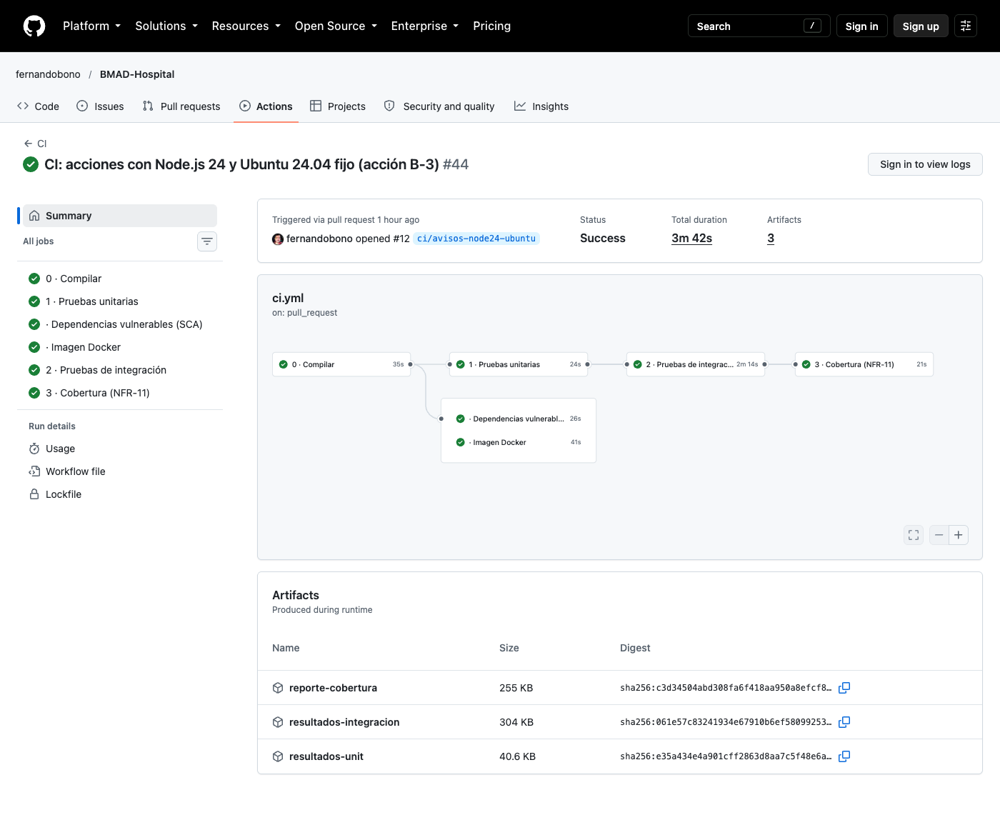
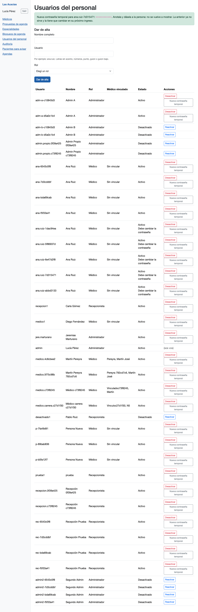
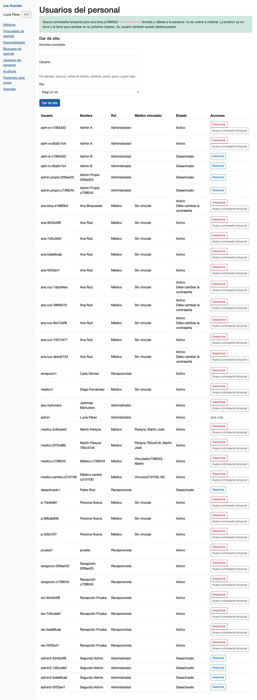
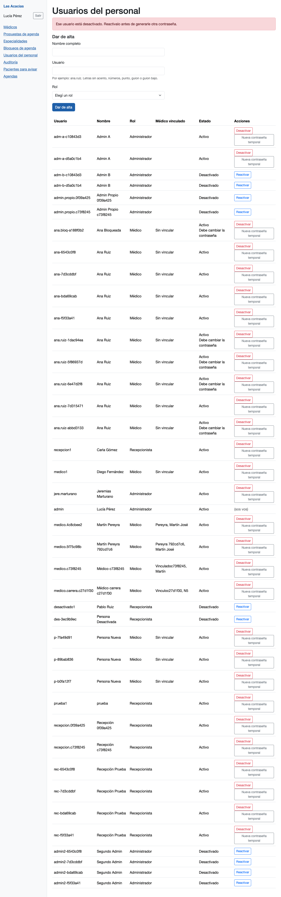
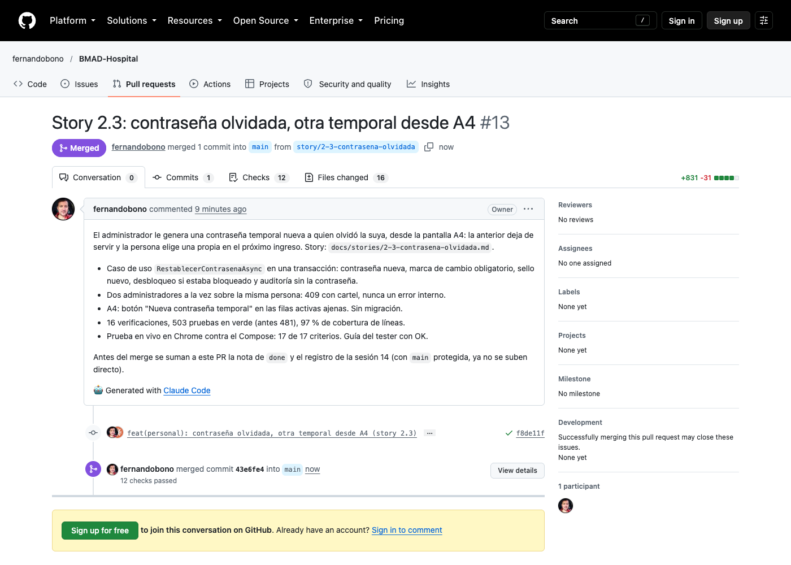
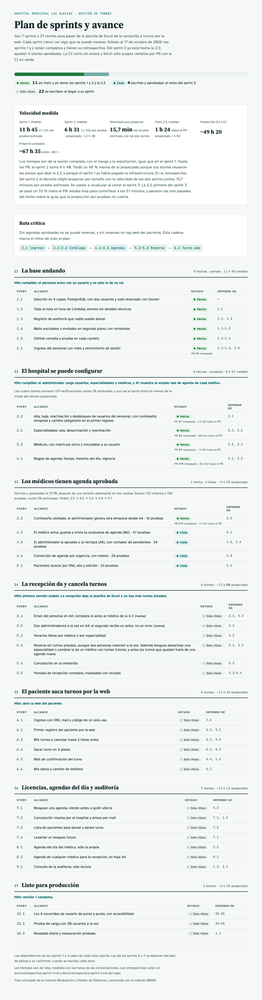

# Sesión 14 — CI al día, `main` protegida y story 2.3

**Fecha:** 17 de octubre de 2026, desde las 08:53
**Participantes:** el docente (Ing. Fernando Bono) y el equipo de agentes de IA con el método BMAD:
Winston (la CI), Mary (valida la story), Amelia (implementa), seis revisores automáticos y un tester
no técnico.
**Resultado:** la CI quedó sin avisos (PR #12) y `main` quedó protegida: no se mergea sin pasar por un
PR con la CI en verde. La story 2.3 (contraseña olvidada) quedó implementada, revisada, probada en vivo
y mergeada con el PR #13. Llevó 1 h 24 de reloj hasta el PR, contra 1 h 03 proyectada.

> Registro curado de la conversación: los mensajes del docente están tal cual; las respuestas del
> equipo están resumidas. La transcripción completa es
> [14-Conversacion-completa-2026-10-17-0853.md](14-Conversacion-completa-2026-10-17-0853.md).

---

## 1. El pedido

**Docente:** "Sigamos con BMAD-Hospital (…). Esta es la sesión 14." Primero, dos pendientes de la
retrospectiva del sprint 2, de a uno: los avisos de la CI (acción B-3) y decidir si se protege `main`
(B-4). Después, implementar la 2.3 con el circuito completo, más la pasada del tester no técnico, y
medir con los dos cortes de la retrospectiva contra la proyección: 4 pruebas estimadas × 15,7 min ≈
1 h 03.

## 2. La CI sin avisos (B-3)

La CI tenía dos avisos. Las cuatro acciones de GitHub corrían sobre Node.js 20, que GitHub da de baja,
y `ubuntu-latest` pasaba a Ubuntu 26 el 19/10. El equipo leyó las notas de cambios de cada acción
antes de proponer: ninguna versión nueva rompe lo que usa el proyecto.

**Docente:** "Si vamos con la 24.04".

- Las acciones pasaron a sus versiones de Node.js 24 y la máquina quedó fija en `ubuntu-24.04`, con un
  comentario que explica por qué: pasar a 26 va a ser una decisión con su propio PR, no una sorpresa.
- La prueba que revisa el propio archivo de la CI (de la story 1.5) exigía las versiones viejas. Se
  actualizó y se comprobó que falla con el archivo viejo y pasa con el nuevo.

**Docente:** "Si" (commit, push y PR) y "si" (merge). El PR #12 pasó sus 6 controles sin ningún aviso.

> 💡 **Para la clase.** "La última versión" (`ubuntu-latest`) es cómoda hasta el día en que cambia
> sola. Fijar la versión convierte una sorpresa en una decisión: el cambio llega cuando el equipo lo
> elige, con su PR y su prueba.

## 3. Proteger `main` (B-4)

Hasta hoy nada impedía mergear con la CI en rojo: se cumplía por disciplina. El equipo planteó tres
opciones, con la recomendada primero.

**Docente:** "PR obligatorio + CI verde (Recomendada)".

Una regla de GitHub sobre `main`: todo entra por un PR, los 6 trabajos de la CI tienen que estar en
verde, no se puede reescribir la historia y no hay excepción, ni siquiera para el dueño. Se vio
funcionar en el PR #13: GitHub lo marcó "bloqueado" mientras la CI corría y lo habilitó al terminar en
verde.

Consecuencia práctica: la nota de "done" y el registro de la sesión ya no se suben directo a `main`.
Al cerrar la 2.3, el equipo preguntó cómo seguir.

**Docente:** "Merge ahora + PR de cierre (Recomendada)": la 2.3 se mergeó y el cierre va en un PR
aparte, que también pasa la CI.

## 4. Validar la story contra el repo de hoy

El validador no encontró nada que bloqueara. Quedaban arreglos chicos: el vínculo de vuelta en la 2.2
(es la primera story del proyecto que continúa a otra), el estado y el commit de referencia. El equipo
encontró además algo que el validador no vio: la ayuda de prueba `Detalle` lee todo como texto, y el
detalle nuevo de la auditoría trae un valor de verdad (`"desbloqueado": true`) que la rompe. Un aviso
del validador resultó falso (decía que una ayuda no existía, y existe).

**Docente:** "si arreglala".

## 5. El plan y las pruebas primero

Cuatro tramos, con pruebas antes que el código en cada uno: el caso de uso contra PostgreSQL real
(T1–T9), su implementación, la pantalla A4 (T10–T16) y la verificación.

**Docente:** "si".

- **Rojo legítimo.** T1–T9 no compilaban porque faltaba el tipo que la story pide crear; T10–T16
  fallaban porque la acción caía en "No reconocemos esa acción". Dos casos de T15 ya pasaban en rojo, y
  estaba bien: la protección de la página entera (sin token, otro rol) viene de la 2.1 y la 2.2.
- **Romper a propósito.** Sin la traducción del choque entre dos administradores, T8 falla con el
  error interno de Identity (`ConcurrencyFailure`). Con la traducción, el segundo recibe un 409 con
  cartel.
- **El portón de pruebas no reconoce las soluciones `.slnx`** de .NET 10, como en la 4.1: se corrió
  proyecto por proyecto. 503 pruebas en verde (antes 481) y 97 % de cobertura de líneas.
- **Una falla de proceso.** Las primeras ediciones se hicieron con scripts y el arnés no las registró;
  un freno del arnés lo detectó a mitad de camino. Desde ahí, todo con la herramienta de edición. El
  orden real (pruebas primero) quedó demostrado por el rojo de compilación.

> 💡 **Para la clase.** Romper a propósito es la forma de saber que una prueba prueba algo: si al
> sacar el código que la hace pasar sigue en verde, no estaba probando ese código.

## 6. Un criterio sin prueba y los revisores

Antes de lanzar a los revisores, el chequeo mecánico marcó como crítico que el criterio 17 (no romper
lo de la 2.2) no tenía ninguna prueba asignada.

**Docente:** "oka asigname esos 3 controles": T10 comprueba además que los botones de la 2.2
(Desactivar, Reactivar, Desbloquear) siguen en su fila.

Seis revisores en la primera vuelta, ninguno crítico. El de criterios contra código pidió dos
controles que la story ya exigía: las filas `(sin rol)` y `(varios roles)` en T10, y un control
negativo en T14 (la sesión de otra persona, a la que no se le tocó nada, sigue viva). La segunda vuelta
(4 revisores) salió limpia. Quedaron dos avisos aceptados: un bloqueo ya vencido no tiene prueba
propia (la story no lo pide) y el portón no mide la cobertura por archivo (la mide la CI local).

## 7. El tester no técnico (B-6)

Por primera vez la pasada del tester cuenta en el plan. Leyó la guía como si la fuera a seguir:

| Pasada | Marcas | Qué encontró |
|---|---|---|
| 1 | 13 | No se sabía qué contraseña tenía Ana en cada paso, ni si estaba bloqueada o adentro |
| 2 | 3 | La sigla "AC" sin explicar, dónde está "Salir", la dirección escrita fija |
| 3 | 0 | OK |

La guía se reescribió con contraseñas de nombre fijo (Clave-Ana-1, Temporal 1…) y una tabla del estado
de Ana después de cada paso. Sobre las capturas de la pantalla no dejó marcas.

> 💡 **Para la clase.** Una guía de prueba escrita por quien hizo el código salta pasos que "son
> obvios". El tester no técnico encontró 13 en la primera lectura, casi todos de continuidad: qué
> estado deja cada paso para el siguiente.

## 8. La prueba en vivo

En Chrome contra la app de Compose, en cuatro grupos; las capturas tapan la contraseña porque el repo
es público.

| Grupo | Criterios | Resultado |
|---|---|---|
| Pantalla: generar la temporal, primer ingreso, auditoría | 1, 2, 3, 4, 12, 13, 16, 17 | 21 de 21 |
| Usuario bloqueado | 5, 12 | 8 de 8 |
| Errores: desactivado, a sí mismo, inexistente, sin permiso, otro rol | 6, 7, 8, 9, 12, 14 | 11 de 11 |
| Fallas: auditoría caída, diez pedidos a la vez, base detenida | 10, 11, 15 | 8 de 8 |

Los 17 criterios quedaron probados en vivo. Con diez pedidos a la vez sobre la misma persona, uno se
cumplió y nueve recibieron el cartel "Otro administrador cambió a ese usuario recién…", sin errores
internos. El corte de sesión a los 5 minutos no se esperó en tiempo real: lo prueba T14 con el reloj
inyectado; en vivo se verificó el cambio de sello que lo dispara. La primera corrida del grupo de
fallas falló por un error del guion (comparaba el cartel sin decodificar los acentos), no de la app.

## 9. Commit, PR, CI y merge

**Docente:** "si" (commit, push y PR). La CI del PR #13 pasó sus 6 controles en 3 min 30 s, sin
avisos. El merge se hizo con la protección nueva activa.

## 10. Cuánto tardó

| Corte | Proyectado | Medido |
|---|---|---|
| Story 2.3, hasta el PR | 1 h 03 (4 × 15,7 min) | 1 h 24 de reloj (09:26 → 10:50) |
| Story 2.3, hasta el merge | — | 1 h 34 |
| Sesión completa (CI, `main`, story y cierre) | — | 2 h 10 (08:53 → 11:03) |
| Pruebas | 4 (plan) | 16 verificaciones (22 casos nuevos) |

Hasta el PR se pasó un 33 % de la proyección. El trabajo estuvo listo para commitear a los 51
minutos; los 33 siguientes fueron de espera de la aprobación del commit. Pesaron también las tres
pasadas del tester sobre la guía, que la proyección por pruebas no cuenta (acción B-6), y una prueba
en vivo más amplia que en otras stories (base detenida y diez pedidos a la vez).

## Pendientes

- La 2.3 está en `done`. Sigue la 4.2 (el médico arma y envía su propuesta de agenda).
- El portón de pruebas del arnés no reconoce las soluciones `.slnx`: en las dos últimas stories se
  corrió proyecto por proyecto.
- Pasar la CI a Ubuntu 26.04 queda como una decisión futura, con su propio PR.
