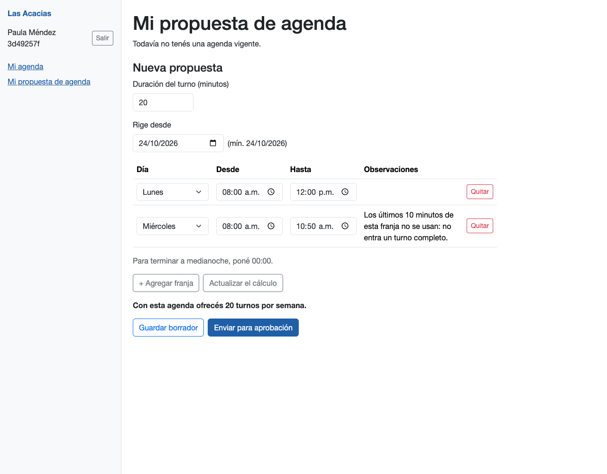
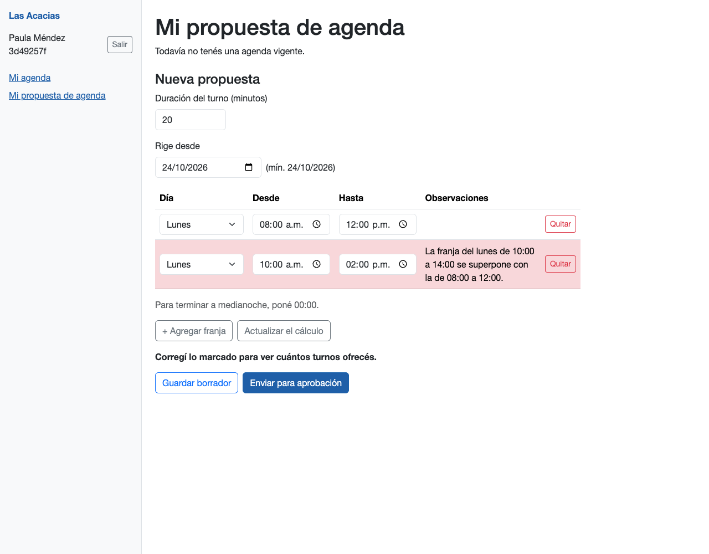
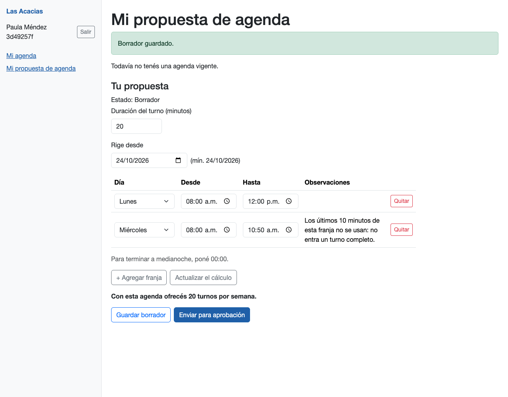
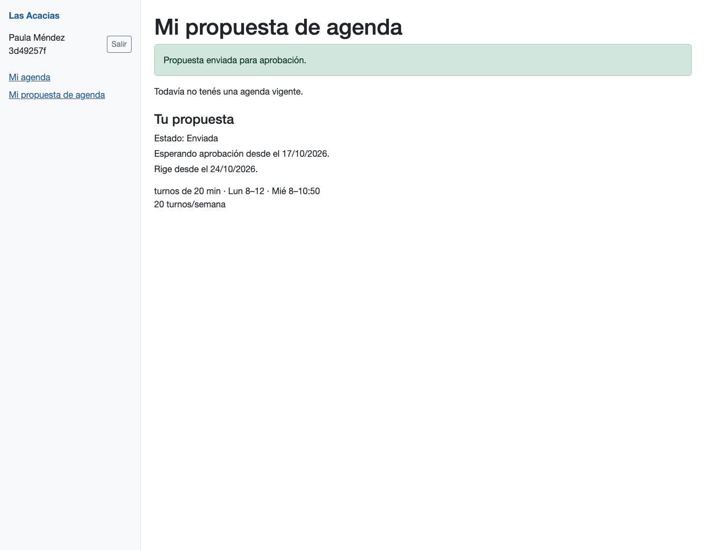
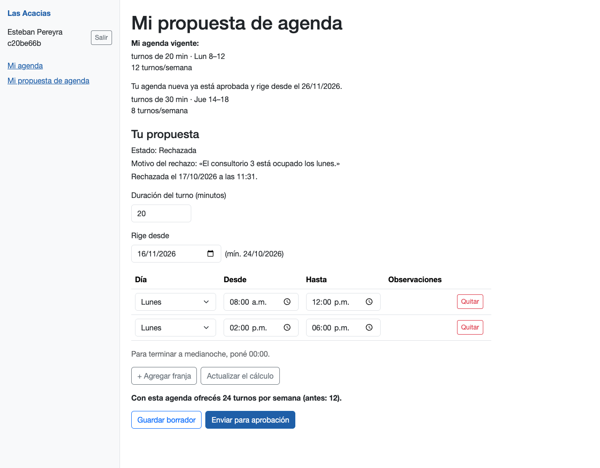
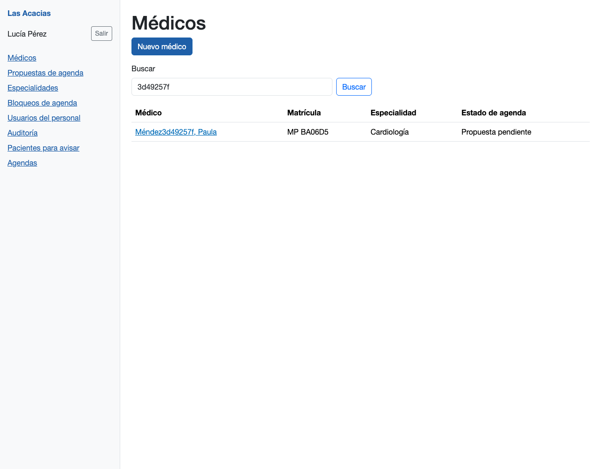
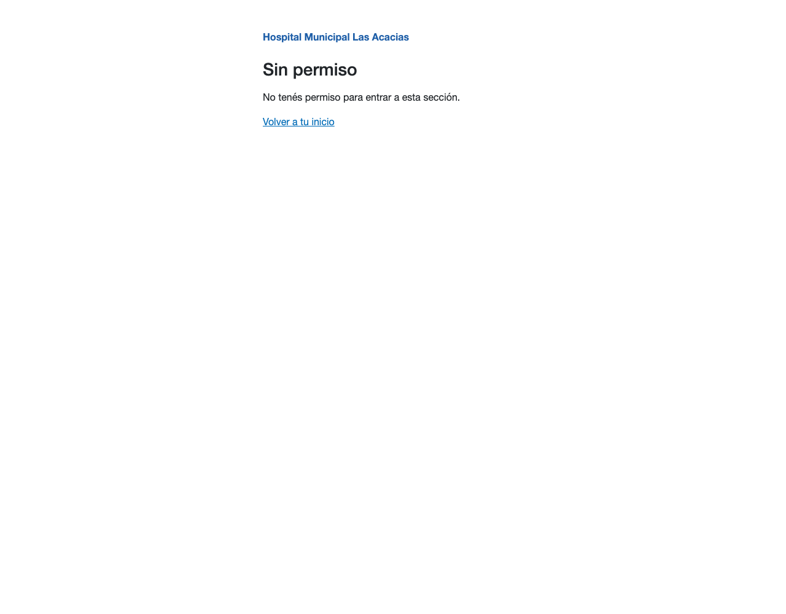
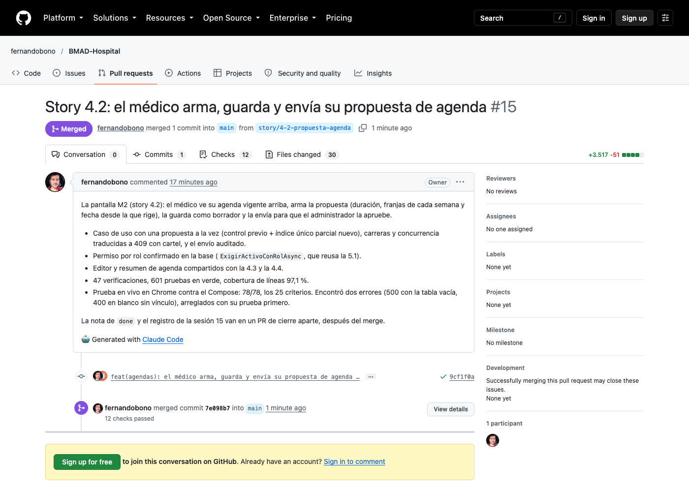
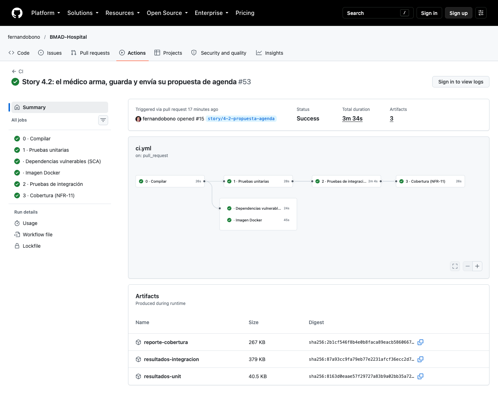
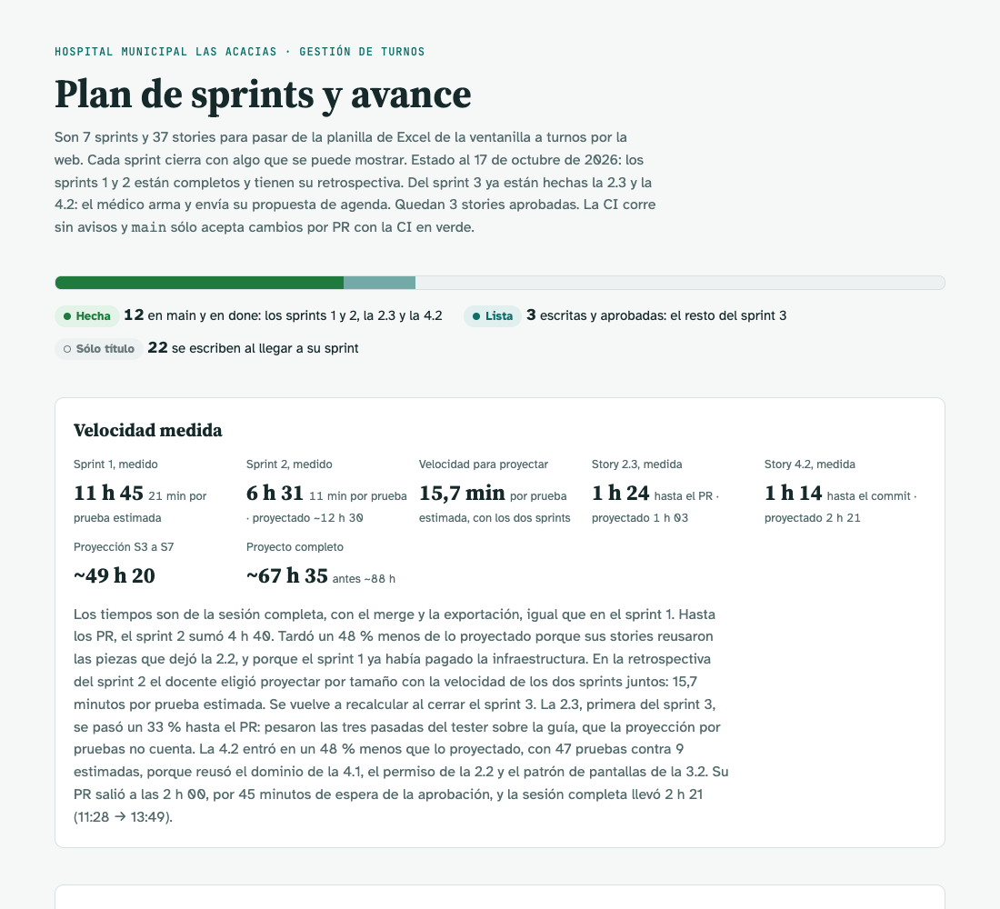

# Sesión 15 — Story 4.2: el médico arma y envía su propuesta de agenda

**Fecha:** 17 de octubre de 2026, desde las 11:28
**Participantes:** el docente (Ing. Fernando Bono) y el equipo de agentes de IA con el método BMAD:
Mary (valida la story), Amelia (implementa), seis revisores automáticos y un tester no técnico.
**Resultado:** la story 4.2 (pantalla M2: el médico arma, guarda y envía su propuesta de agenda) quedó
implementada, revisada, probada en vivo y mergeada con el PR #15. Llevó 1 h 14 de reloj hasta el commit
preparado, contra 2 h 21 proyectadas.

> Registro curado de la conversación: los mensajes del docente están tal cual; las respuestas del
> equipo están resumidas. La transcripción completa es
> [15-Conversacion-completa-2026-10-17-1128.md](15-Conversacion-completa-2026-10-17-1128.md).

---

## 1. El pedido

**Docente:** "Sigamos con BMAD-Hospital (…). Esta es la sesión 15." Implementar la story 4.2 con el
circuito completo de la 2.3: validación contra el repo de hoy, plan aprobado, pruebas primero, revisores,
tester no técnico y prueba en vivo. Un pedido especial: "la 4.2 se escribió antes de que existiera la 2.3;
confirmá contra el código real lo que cita de la 4.1 y de A4, y si algo no coincide, corregilo en la
story antes de implementar". Medir contra la proyección: 9 pruebas estimadas × 15,7 min ≈ 2 h 21.

## 2. Validar la story contra el código de hoy

Todo lo que la story usa de la 4.1, la 2.2 y la 2.3 coincidía con el código: nombres, firmas y archivos.
La 2.3 no había tocado el control de permisos que esta story amplía. Quedaban cuatro cosas desactualizadas,
que se corrigieron en la story sin tocar criterios ni pruebas: el punto del repo contra el que se verificó,
dos frases que decían "si la 2.3 ya está en main", una ayuda de prueba que sólo conocía lunes a miércoles
(una prueba usa el viernes) y los tres archivos de la guía de QA. La segunda pasada del validador salió
limpia.

## 3. El plan

Seis tramos, con las pruebas antes que el código en cada uno: el permiso del médico en la base, el índice
"una sola propuesta editable por médico", el caso de uso, el formulario y los componentes que reusan la 4.3
y la 4.4, la pantalla M2 y la verificación. El equipo avisó que la story tiene 47 verificaciones contra 9
estimadas en el plan.

**Docente:** "si, aprobado".

## 4. Una decisión sobre la base de Compose

El chequeo previo a la migración encontró, en la base de Compose, dos médicos de prueba con dos propuestas
editables cada uno: los había dejado la prueba en vivo de la 4.1. Con eso el índice nuevo no se puede crear
y la app no arranca. La story dice frenar y consultar.

**Docente:** "Borrar esas 6 (Recomendada)". Se borraron con el usuario dueño de la base; la aplicación
sigue sin permiso para borrar agendas.

> 💡 **Para la clase.** Una restricción nueva sobre datos que ya existen (un índice único) puede romper el
> arranque. Por eso la story pedía mirar la base **antes** de generar la migración, y por eso el dato de
> prueba que dejó una sesión anterior apareció acá y no en producción.

## 5. Pruebas primero, y romper a propósito

En cada tramo las pruebas fallaron primero por la razón correcta: no compilaban porque faltaban los tipos
que la story pide crear, o la pantalla seguía "en construcción". Después se rompió el código a propósito:

- Sin la traducción de las carreras, las pruebas de dos pedidos a la vez fallan con el error interno de la
  base, no con el cartel.
- Sin marcar la agenda como modificada, una franja nueva se cuela sobre una propuesta que otro acaba de
  cambiar. Con la marca, el segundo recibe "Tu propuesta cambió mientras la guardabas".

## 6. Los revisores

Primera vuelta, seis revisores, ninguno crítico. El de criterios contra código encontró tres huecos reales,
que se arreglaron con su prueba primero: faltaba probar en la pantalla el "No había cambios para guardar";
con la duración mal y sin franjas salía el cartel equivocado; y con la duración vacía, el aviso de una fila
incompleta recién aparecía al corregirla. El de alcance pidió escribir en la story dos decisiones del código.
Se aceptaron dos avisos de fallos silenciosos, por ser la misma convención que la 3.2. La segunda vuelta
(cinco revisores) salió limpia.

## 7. La prueba en vivo encontró lo que las pruebas no

En Chrome contra la app de Compose, en cinco grupos:

| Grupo | Criterios | Resultado |
|---|---|---|
| Pantalla: armar, guardar, enviar, pestaña vieja, A1 | 1, 3, 4, 6–18 | 47 de 47 |
| Con agenda vigente y propuesta rechazada | 3, 5, 13, 16, 24 | 7 de 7 |
| Errores y permisos | 2, 8, 20–23 | 11 de 11 |
| Diez pedidos a la vez | 19 | 7 de 7 |
| No romper lo anterior | 25 | 6 de 6 |

Antes de llegar a ese verde, la prueba en vivo encontró dos errores reales que las 597 pruebas automáticas
no veían. Los dos se arreglaron con una prueba que los reproducía primero:

- **Con la tabla de horarios vacía**, el navegador no manda ninguna fila y la lista llegaba "nula": "+ Agregar
  franja" daba un error interno. Las pruebas automáticas siempre mandaban al menos una fila.
- **Un médico sin vínculo** que igual manda el formulario recibía una página en blanco en lugar del cartel.

También se ensanchó la lista de días, que mostraba "Lun" en vez de "Lunes". Con diez envíos a la vez, uno
se cumplió y nueve recibieron el cartel, sin errores internos. Los 25 criterios quedaron probados en vivo.

> 💡 **Para la clase.** 597 pruebas en verde y la pantalla se caía con el primer clic de un usuario
> real. Las pruebas automáticas arman los pedidos como los imagina el programador; el navegador los arma
> como es. Por eso la prueba en vivo no es un trámite: es otra forma de mirar.

## 8. El tester no técnico

| Pasada | Marcas | Qué encontró |
|---|---|---|
| 1 | 11 | Qué usuario en cada paso, dónde anotar las contraseñas, cómo calcular las fechas, cómo elegir día y hora |
| 2 | 14 | Las horas con a.m./p.m., qué es un "AC" y el "(mín. …)", dónde está "Quitar" |
| 3 | 0 | OK |

Sobre las capturas de la pantalla dejó 6 marcas: pedían más ayuda en pantalla, como explicar que el
borrador sólo lo ve la médica. Algunas pedían cosas de otras stories.

**Docente:** "Aceptarlas sin cambios (Recomendada)".

## 9. Commit, PR, CI y merge

**Docente:** "si" (commit, push y PR). La CI del PR #15 pasó sus 6 controles en 3 min 34 s, sin avisos.

**Docente:** "si merge".

## 10. Cuánto tardó

| Corte | Proyectado | Medido |
|---|---|---|
| Story 4.2, hasta el commit preparado | 2 h 21 (9 × 15,7 min) | 1 h 14 (11:28 → 12:42) |
| Story 4.2, hasta el PR | — | 2 h 00 (11:28 → 13:28), con 45 min de espera de la aprobación |
| Story 4.2, hasta el merge | — | 2 h 16 (13:44) |
| Sesión completa (story y cierre) | — | 2 h 21 (11:28 → 13:49) |
| Pruebas | 9 (plan) | 47 verificaciones (98 casos nuevos), 601 en total (antes 503) |

El trabajo entró en un 48 % menos de la proyección, aunque la story tenía cinco veces más pruebas que las
estimadas. Ayudó que reusó casi todo: el dominio de la 4.1, el control de permisos de la 2.2 y el patrón
de pantallas de la 3.2. La prueba en vivo con sus dos arreglos y las tres pasadas del tester sumaron tiempo
que la proyección por pruebas no cuenta.

## Pendientes

- La 4.2 está en `done`. Sigue la 4.3 (el administrador aprueba o rechaza la propuesta).
- El docente sumó una guía de estándar UX/UI para pantallas ABM (`docs/ux/guia-ux-ui-abm.md` y su PDF),
  todavía sin commitear: no entró en esta story.
- El portón de pruebas del arnés sigue sin reconocer las soluciones `.slnx`: se corrió proyecto por proyecto.
