# Sesión 17 — Story 3.3: las pantallas ABM con la guía UX/UI

**Fecha:** 17 de octubre de 2026, desde las 15:33
**Participantes:** el docente (Ing. Fernando Bono) y el equipo de agentes de IA con el método BMAD: el
agente de desarrollo implementa; seis revisores automáticos, un tester no técnico simulado y una prueba
en vivo en Chrome controlan.
**Resultado:** Médicos, Especialidades, Usuarios del personal y el marco del personal quedaron con el
estándar de la guía UX/UI. Commit `1773a74` en la rama `story/3-3-alinear-abm-guia-ux`, **PR #18** con la
CI en verde y el merge pendiente: lo decide el docente. Tres stories del backlog entraron a los sprints.

> Registro curado de la conversación: los mensajes del docente están tal cual; las respuestas del
> equipo están resumidas. La transcripción completa es
> [17-Conversacion-completa-2026-10-17-1533.md](17-Conversacion-completa-2026-10-17-1533.md).

---

## 1. El pedido

El docente pidió implementar la story 3.3 con el circuito completo: validar la story contra el repo de
hoy, un plan para aprobar, pruebas primero, revisores, tester no técnico (guía y pantalla) y prueba en
vivo. El orden era obligatorio: **primero los componentes comunes con sus pruebas, después migrar A2, A1
y A4, sin tocar la lógica de negocio**. Antes de pedir el merge, la CI del PR en verde.

Puso además estas reglas:

- "Una decisión por vez, con la opción recomendada primero."
- "Toda pantalla respeta la guía; si algo no está cubierto, preguntame antes de decidir."
- "El tiempo se prueba siempre con el reloj inyectado, nunca esperando tiempo real."
- "Commit, push y PR sólo cuando yo lo apruebe."

También pidió medir el tiempo contra la proyección: 61 verificaciones × 15,7 min ≈ 16 h. Anticipó que
la proyección probablemente exageraba.

## 2. Validar la story y aprobar el plan

El validador encontró que las referencias a la plantilla oficial de la guía no se podían comprobar desde
el repo.

**Docente (elige):** "Agregar el comando (Recomendado)". La story ahora trae el comando que las reproduce.

Al armar el plan aparecieron tres huecos. El docente los resolvió uno por uno:

- **"Sumar la fecha al cálculo (Recomendado)".** El badge "Programada · desde dd/mm/aaaa" toma la fecha
  del mismo cálculo del dominio (`CambiaEl`), no de una consulta aparte.
- **"Repetir la regla en SQL".** El filtro por estado de agenda se hace en la base, así la paginación y
  el conteo siguen ahí. Una prueba compara la consulta con el dominio caso por caso.
- **"Incluirlos, sólo estilos (Recomendado)".** Los colores sueltos también se sacan de las otras cinco
  pantallas y de las hojas del marco, sin tocar su comportamiento.

**Docente:** "si dale aprobado" (15:48). Después: "seguimos con este modelo".

> 💡 **Para la clase.** Las tres decisiones son del mismo tipo: la story decía *qué* y no *dónde*. Un
> agente que decide solo elige lo más fácil (calcular la fecha en la pantalla, filtrar en memoria). Por
> eso la regla del docente: si algo no está cubierto, se pregunta.

## 3. Implementación: componentes primero

Se escribieron primero las pruebas y después el código, componente por componente: la base interactiva,
la hoja de estilos con tokens, el marco con el menú agrupado y las migas, la tabla, la barra de
filtros, el paginador, el formulario, los diálogos, las confirmaciones y las notificaciones. Después
vinieron las consultas paginadas y, por último, la migración de A2, A1 y A4.

Durante la implementación aparecieron problemas que obligaron a decidir:

- **Dos operaciones a la vez chocaban** en la misma conexión a la base, y un guardado rechazado se
  "colaba" en el siguiente. **Docente (elige):** "Un alcance por operación (Recomendado)". Cada consulta
  o acción abre su propio contexto, como un pedido HTTP. Quedó escrito en la arquitectura (§5.1) y en un
  criterio nuevo, el AC 94.
- **Podían quedar dos menús "⋯" abiertos a la vez.** **Docente (elige):** "Sumarlo al criterio 30
  (Recomendado)": uno solo por pantalla.
- **En Usuarios, reactivar o desbloquear no tiene diálogo**, así que el error no tenía dónde mostrarse.
  **Docente (elige):** "Sí, sumarlo al criterio 3 (Recomendado)": un aviso arriba de la tabla.

> 💡 **Para la clase.** Cada decisión que cambia el comportamiento entra a la story **antes** que al
> código, con una fila en el Change Log. Así la story sigue siendo la fuente de verdad, y el revisor de
> alcance no encuentra "código sin spec".

## 4. Revisores

Corrieron cuatro vueltas de revisores: seis en la primera, cuatro en cada una de las siguientes, sólo
sobre lo que había cambiado. En la primera hubo tres hallazgos críticos:

- el aviso de homónimo saltaba también con la misma matrícula;
- los dos menús abiertos a la vez (lo resolvió el docente, arriba);
- la verificación de la base de demo, que quedó para la prueba en vivo.

También hubo varios avisos de fallas silenciosas, todos corregidos. Las vueltas siguientes salieron
limpias o con avisos de formato.

## 5. La prueba en vivo: siete defectos que las pruebas no veían

Con todas las pruebas automáticas en verde, la prueba en vivo en Chrome contra la app del Compose
encontró siete defectos reales:

1. Cerrar con Esc un diálogo con formulario rompía la página: el formulario se dibujaba una última vez
   vacío.
2. Cuando el sistema rechazaba un guardado, el foco se perdía y Esc dejaba de andar.
3. Reabrir el menú "⋯" con el teclado dejaba el foco sin destino.
4. Devolver el foco a un botón que ya no existía tumbaba la conexión de la página.
5. Con la base caída, las páginas de médicos quedaban en blanco en vez de avisar.
6. Los enlaces del menú se saltaban el aviso de "cambios sin guardar". **Docente (elige):** "Que
   pregunte el navegador (Recomendado)". Los enlaces del marco recargan la página y el navegador
   pregunta (AC 36 reescrito).
7. En el celular, "Editar" y los tres puntos se salían de la pantalla. Lo encontró la revisión del
   tester no técnico, mirando las capturas.

Cada uno se corrigió con su prueba o con un control en vivo nuevo. La prueba en vivo final: **151
controles, 0 fallas, 90 de los 94 criterios corridos de verdad**.

> 💡 **Para la clase.** Las pruebas de componente simulan el navegador; la prueba en vivo usa uno de
> verdad. Seis de los siete defectos dependían de cosas que el simulador no reproduce: el orden de
> dibujo, el foco real, la navegación del navegador, el ancho real de la pantalla. Por eso el circuito
> exige las dos cosas. Y un control que cuenta botones no ve si están dentro de la pantalla: hay que
> medir lo que el usuario ve.

## 6. Lo que no se puede ver en vivo

Cuatro criterios no se pueden ver corriendo la app sin hacer trampa:

- el 5: la sesión se corta sola a los 5 minutos, y habría que esperar tiempo real;
- el 90 y el 92: hablan de cómo están escritas las pruebas;
- el 93: la CI corre en el PR.

El equipo los presentó uno por uno, con su razón y la prueba que los cubre. El docente los aprobó
desde su terminal: **"ya aprobe"**.

## 7. El tester no técnico

Un agente que hace de administrativo del hospital, sin saber programar, leyó la guía de prueba manual
(94 criterios) y las capturas:

- **La guía** tuvo 15 marcas en la primera pasada: instrucciones como "cambiá el final de la dirección",
  mensajes que no se citaban y pasos que necesitaban más de 25 registros. En la segunda pasada quedó una
  y en la tercera, ninguna.
- **Las pantallas** tuvieron 12 marcas. Una era el defecto del celular, y se arregló. Las otras 11 eran
  textos que fijan la story o la guía UX ("⋯" sin palabra, "Catálogos", "Contraseña temporal"…).
  **Docente (elige):** "Aceptarlos sin cambios (Recomendado)".

## 8. Cierre y cambio de sprints

**Docente:** "dale con el commit, push y pr si dan ok las pruebas, me tengo que ir, avisame a telegram".
Con la prueba en vivo en verde se hizo el commit `1773a74`, el push y el PR #18. La CI del PR terminó en
verde (ver más abajo).

**Docente:** "incorporemos en este sprint las story 3.4 y 3.5 que se agregaron y al sprint 6 la story
9.2 que depende de la 9.1". Renombrar especialidad (3.4) y desactivar médico (3.5) entran al S3, e
historial por registro (9.2) al S6. Las tres siguen sin escribir: se escriben en la próxima sesión.

## Números

| | |
|---|---|
| Verificaciones de la story | 64 (61 planeadas + T59, T60, T61 por decisiones del docente) |
| Pruebas | Dominio 143 · Aplicación 227 · Web 311 (antes de la story: 601 en total) |
| Prueba en vivo | 151 controles en 7 grupos, 0 fallas; 90 de 94 criterios |
| Revisores | 4 vueltas; 26 hallazgos (6 críticos), ninguno abierto |
| Tiempo hasta el PR | **3 h 44** (15:33 → 19:17) contra **~16 h** proyectadas (61 × 15,7 min) |
| Sesión completa | **~3 h 50** (15:33 → 19:23), con la exportación; sin el merge ni el PR de cierre, que quedan para la sesión 18 |

> 💡 **Para la clase.** La proyección por tamaño (minutos por prueba estimada) exageró unas cuatro
> veces, como anticipó el docente. La 3.3 tenía muchos criterios chicos y repetitivos; las stories de
> los sprints 1 y 2 tenían pocos criterios, pero cada uno más difícil. Medir sirve para corregir la
> próxima proyección, no para acertar la primera.

## Capturas

| Pantalla | Antes | Después |
|---|---|---|
| Especialidades | 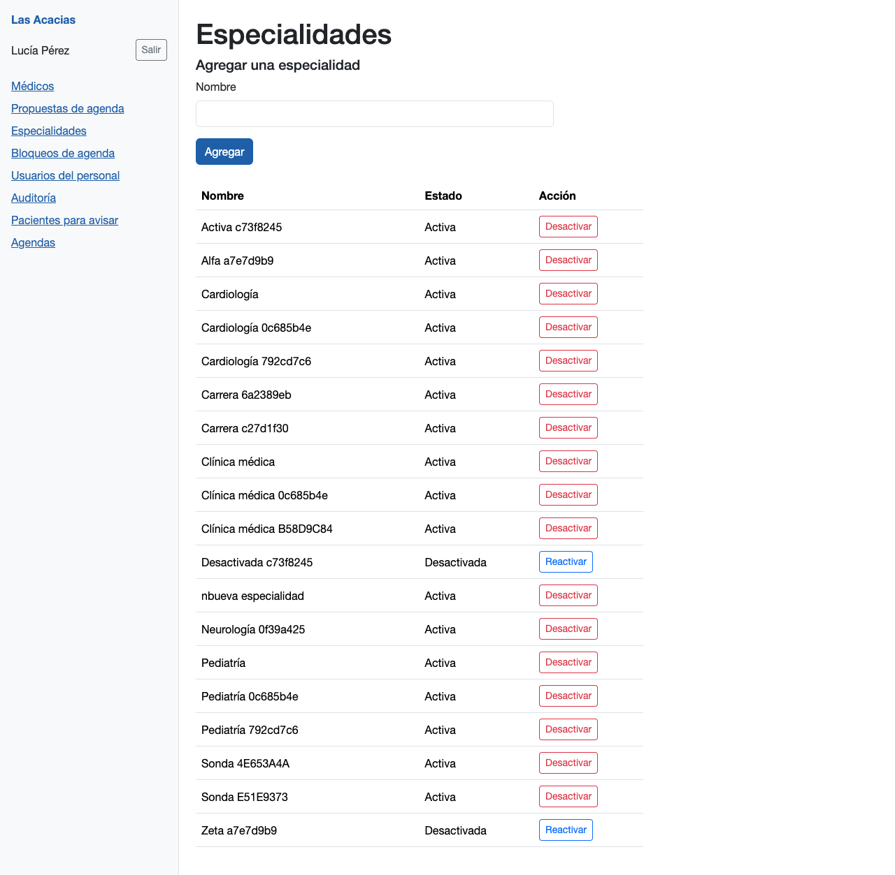 | 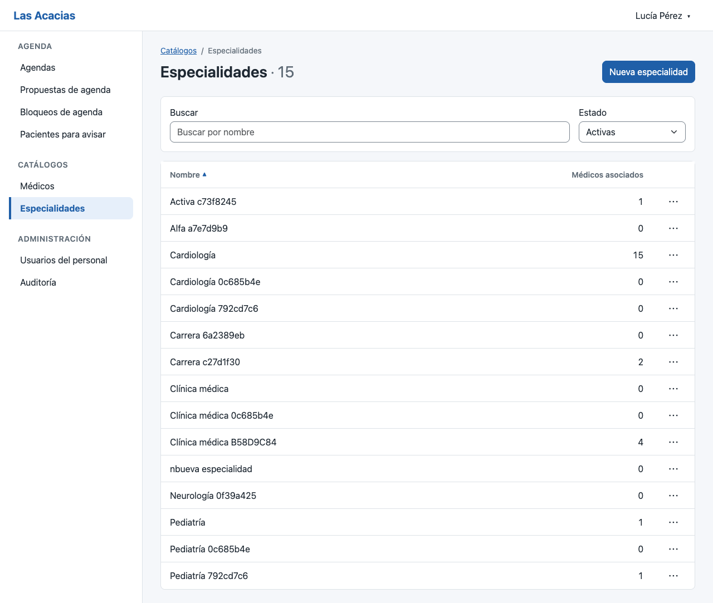 |
| Médicos (listado) | 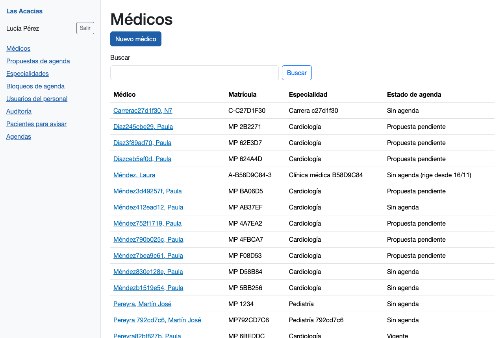 | 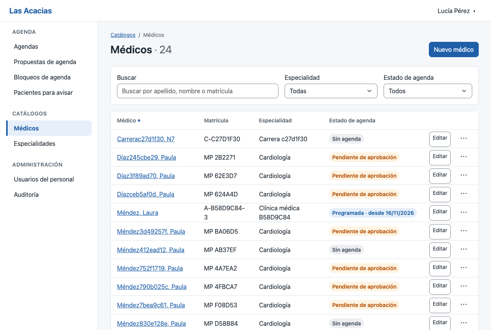 |
| Médicos (ficha) | 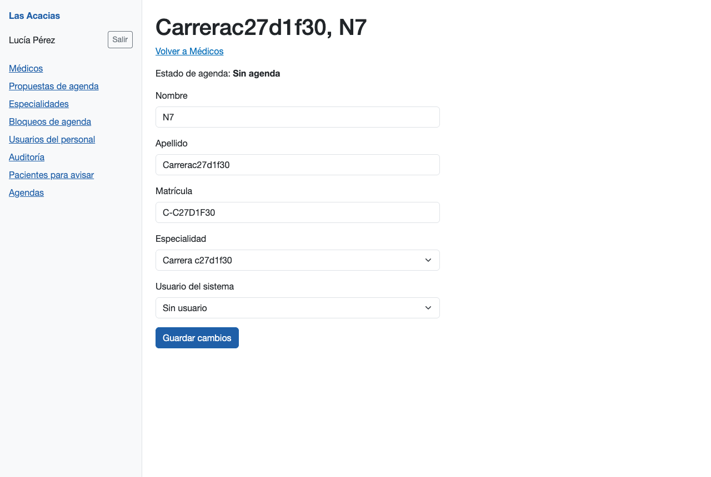 | 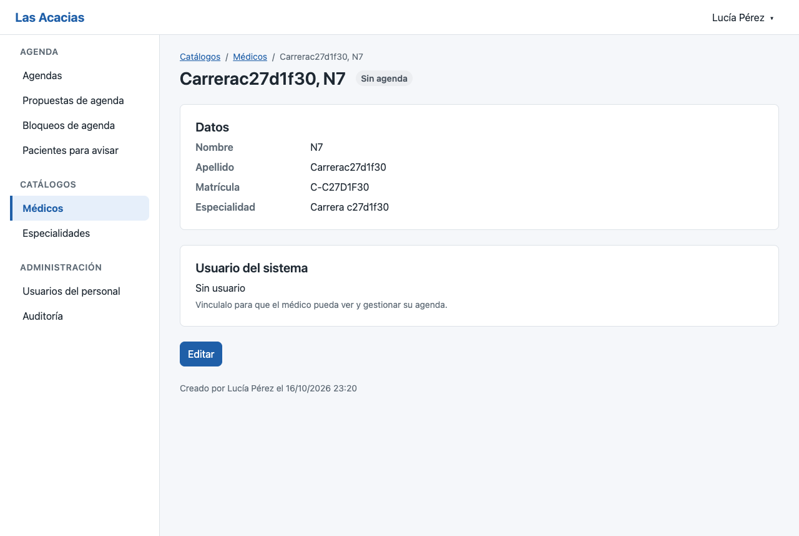 |
| Usuarios del personal | 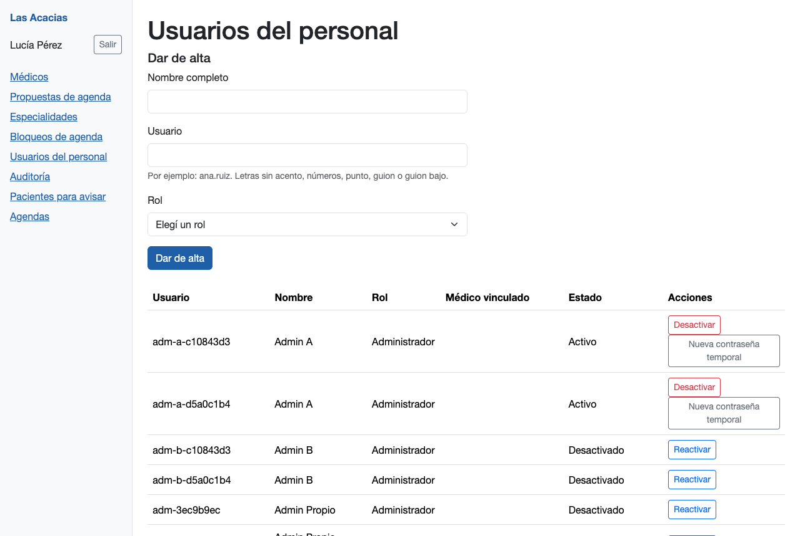 | 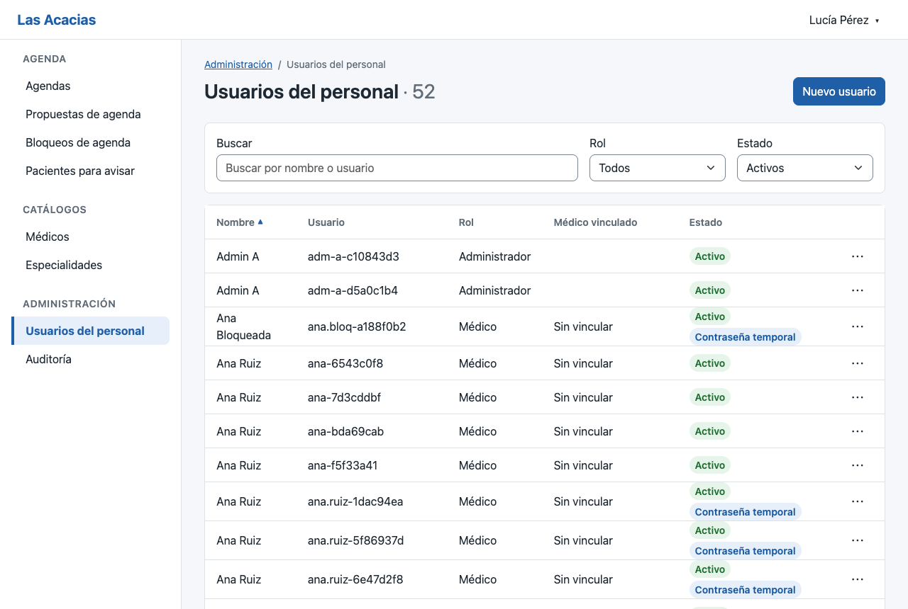 |
| Menú | 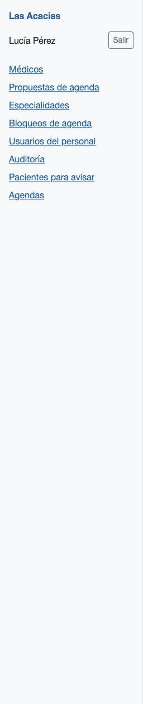 | 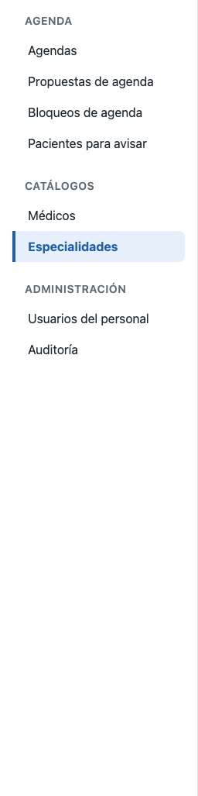 |
| Baja | 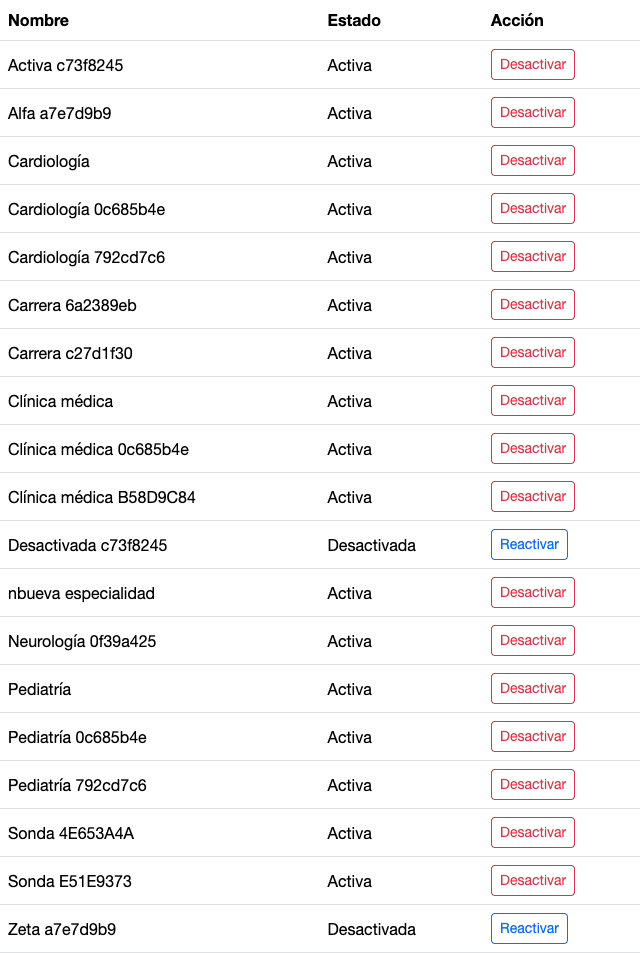 | 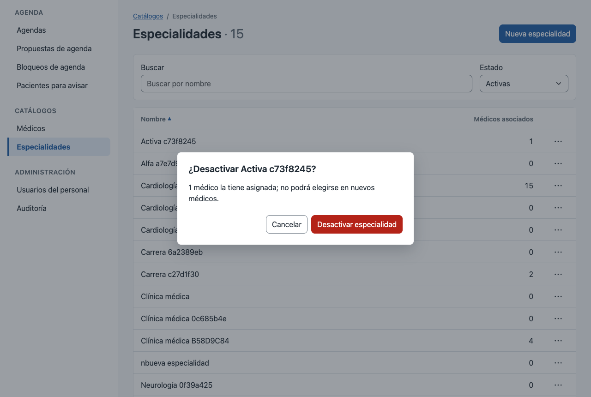 |
| Celular | 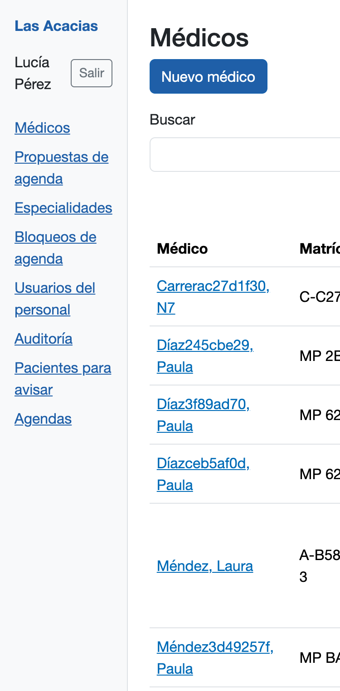 | 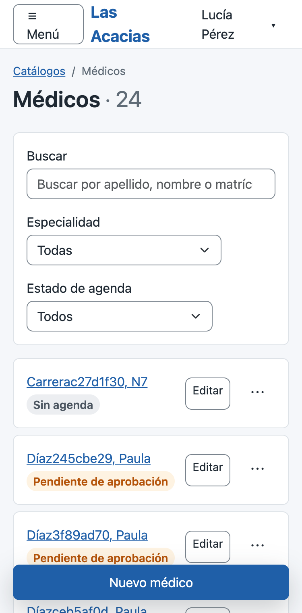 |

## CI del PR #18

Dos corridas: la del PR (`pull_request`, 3 min 55 s) y la de la rama (`push`, 4 min 16 s). Las dos en
verde, con los 6 controles cada una: compilar, pruebas unitarias, dependencias vulnerables, imagen
Docker, pruebas de integración y cobertura.

- La cobertura de líneas de Dominio y Aplicación dio 97,4 % (umbral 80 %); la de ramas, 87,9 %.
- La CI no mide la cobertura de Web. La medición local dio 95,2 %, tomada antes de los últimos arreglos.

| Corrida del PR | Corrida de la rama |
|---|---|
| 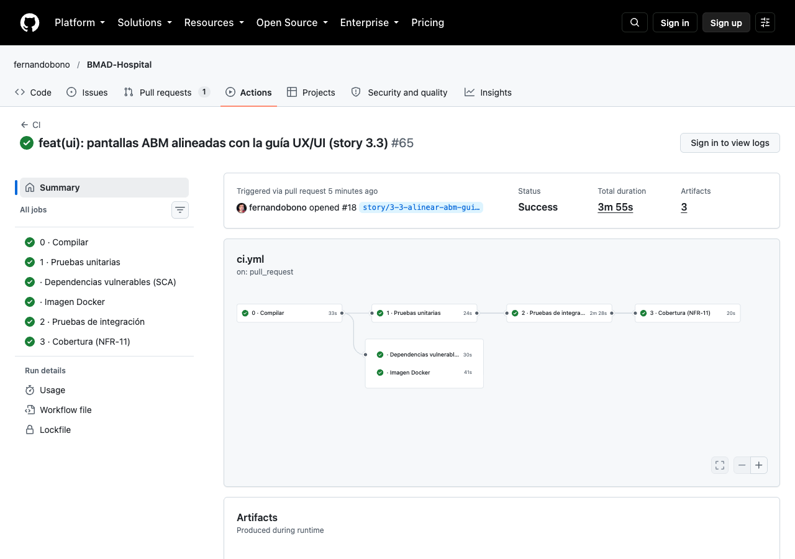 | 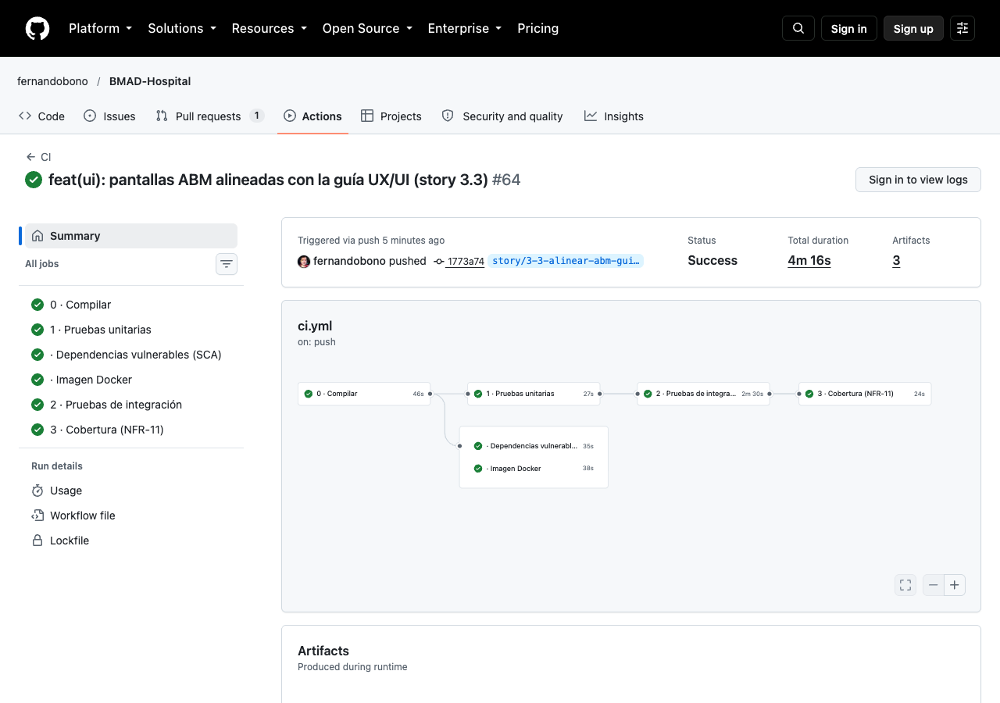 |
