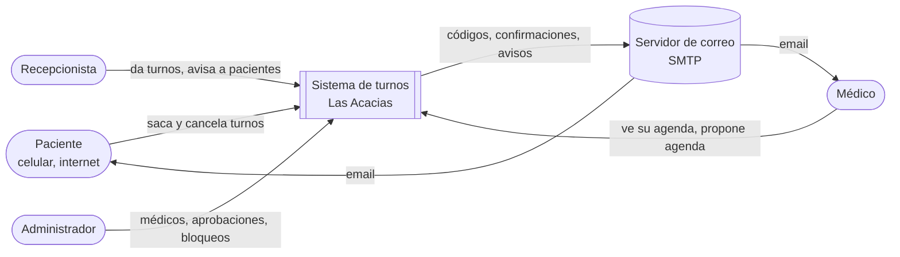
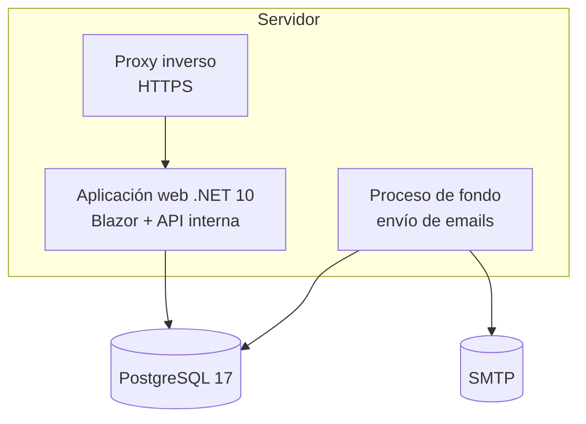
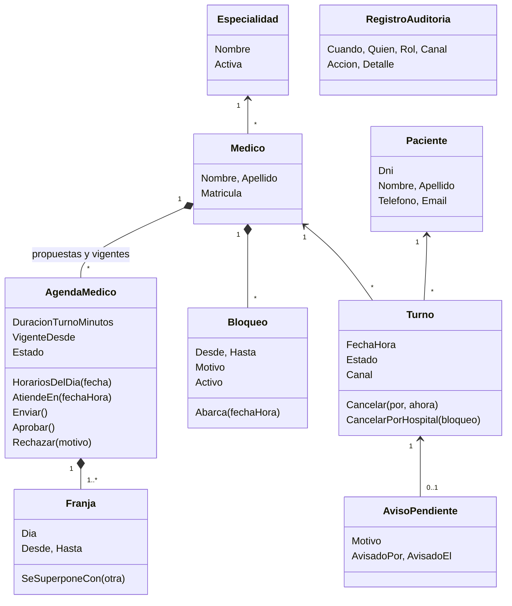
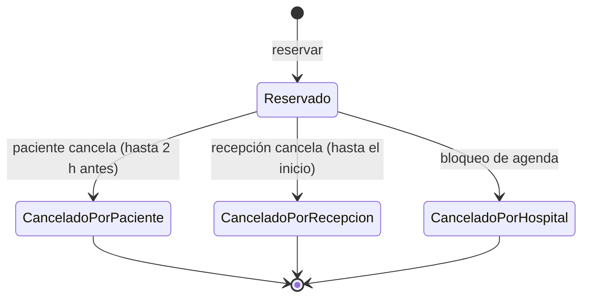
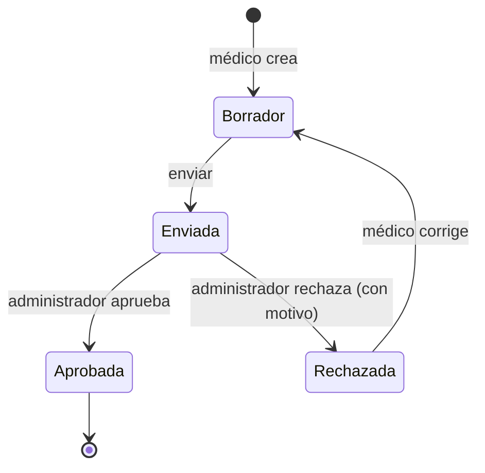

# Arquitectura — Gestión de turnos

> Cada decisión cita los requisitos que la motivan. Las decisiones importantes están al final
> como registros de decisión (ADR). Los supuestos nuevos arrancan en **S-33**.

## 1. Resumen

Una sola aplicación web en **.NET 10**, organizada como **monolito modular en capas**, con
**PostgreSQL** como base de datos. Las pantallas se hacen con **Blazor**: livianas y sin
JavaScript pesado para el paciente, e interactivas con teclado para el personal.

Los emails salen por una **bandeja de salida** en la base, que procesa un proceso de fondo.
Si el servidor de correo falla, ningún aviso se pierde.

## 2. Contexto



No hay integraciones con otros sistemas del hospital en la v1.

## 3. Contenedores



- El proceso de fondo corre **dentro de la misma aplicación** (un servicio en segundo plano de
  .NET). Para 400 turnos por día no hace falta separarlo.
- HTTPS lo termina el proxy inverso (NFR-03).

## 4. Tecnología

| Pieza | Elección | Por qué |
|---|---|---|
| Plataforma | .NET 10 (LTS) | Decisión del docente; soporte hasta noviembre de 2028. |
| Pantallas del paciente | Blazor, **renderizado en el servidor sin conexión permanente** (SSR estático con formularios mejorados) | Páginas livianas para celulares de gama baja y conexiones malas (NFR-05). Funcionan aun si se corta la conexión entre clics. |
| Pantallas del personal | Blazor **interactivo en el servidor** | La pantalla de recepción necesita teclado, listas que se actualizan y cero recargas (CE-04). Todo en C#, sin un segundo lenguaje. |
| Base de datos | PostgreSQL 17 | Gratuita, robusta y con índices parciales (los usa la regla de un turno por horario). |
| Acceso a datos | Entity Framework Core 10 | Estándar de .NET; migraciones versionadas. |
| Usuarios del personal | ASP.NET Core Identity con cookies | Contraseñas con hash, bloqueo por intentos y roles, ya resueltos. |
| Ingreso del paciente | Código por email, hecho a medida | Identity no cubre el ingreso sin contraseña con DNI. |
| Email | MailKit sobre SMTP; Mailpit en desarrollo | Mailpit atrapa los emails en desarrollo para verlos sin mandarlos. |
| Pruebas | xUnit, Testcontainers (PostgreSQL real), bUnit, Playwright, k6 | Mismas herramientas que el proyecto guía de testing de la materia. |
| Despliegue | Docker Compose: aplicación + PostgreSQL + Mailpit | Se levanta todo con un comando, en clase o en un servidor. |

## 5. Estructura de la solución

```
HospitalTurnos.slnx
├── src/
│   ├── HospitalTurnos.Dominio/          Entidades, reglas y estados. Sin dependencias.
│   ├── HospitalTurnos.Aplicacion/       Casos de uso: reservar, cancelar, bloquear, aprobar...
│   ├── HospitalTurnos.Infraestructura/  EF Core, PostgreSQL, email, reloj, auditoría.
│   └── HospitalTurnos.Web/              Blazor (paciente y personal), ingreso, arranque.
└── tests/
    ├── HospitalTurnos.Dominio.Tests/        Unitarias de reglas.
    ├── HospitalTurnos.Aplicacion.Tests/     Casos de uso contra PostgreSQL real.
    ├── HospitalTurnos.Web.Tests/            Componentes (bUnit) y endpoints.
    └── HospitalTurnos.E2E/                  Recorridos completos en el navegador.
```

Las dependencias apuntan hacia adentro: **Web → Aplicación → Dominio** e
**Infraestructura → Aplicación → Dominio**. El dominio no conoce la base, ni la web, ni el email.

## 6. Modelo del dominio



> Cambio del 2026-10-16 (story 4.1, decisión 14 de la revisión del S2): `HorariosDelDia` y `AtiendeEn`
> pasaron de `Medico` a `AgendaMedico`, porque los horarios dependen de qué agenda rige en cada fecha.

**Cómo se arma la disponibilidad:** para una fecha, se toma la agenda **aprobada** del médico
con la `VigenteDesde` más reciente que no sea posterior a esa fecha. Se generan los horarios de
sus franjas y se quitan los bloqueados, los ya reservados y los que están fuera del rango
de ahora a 60 días (FR-17). Los horarios **no se guardan**: se calculan. Sólo se guardan los turnos.

**Por qué se calculan:** si se guardaran los horarios libres, cada cambio de agenda o bloqueo
obligaría a regenerarlos y podrían quedar desincronizados. Calcularlos sale barato: un médico
tiene a lo sumo 60 por día.

### Estados del turno



### Estados de la propuesta de agenda



Una agenda **Aprobada** no se edita nunca: un cambio es siempre una propuesta nueva. Así queda
la historia completa de qué agenda regía en cada fecha.

## 7. Cómo se cumplen las reglas difíciles

### 7.1 Un turno por horario, aun con reservas simultáneas — R-01, NFR-02

Dos defensas:

1. El caso de uso verifica que el horario esté libre antes de reservar, para dar un mensaje claro.
2. La base tiene un **índice único parcial**: no puede haber dos turnos en estado Reservado con el
   mismo médico y la misma fecha y hora. Si dos reservas pasan el primer control a la vez, la base
   rechaza la segunda y la aplicación muestra "Ese horario se acaba de ocupar" (RU-08).

Lo mismo para "un paciente no tiene dos turnos a la misma hora" (R-05).

### 7.2 Un turno futuro por especialidad — R-04

Esta regla no se puede expresar como índice: depende de la fecha actual. La reserva corre en una
transacción que primero **bloquea la fila del paciente** (`SELECT … FOR UPDATE`). Así, dos
reservas simultáneas del mismo paciente se ejecutan una detrás de otra, y la segunda ve el turno
de la primera.

### 7.3 Bloqueo de agenda — R-09, R-10, FR-25 a FR-29

Al confirmar un bloqueo, en **una sola transacción**:

1. Se guarda el bloqueo.
2. Cada turno reservado del período pasa a "Cancelado por el hospital".
3. Por cada paciente con email se agrega un mensaje a la bandeja de salida; los que no tienen
   email generan un `AvisoPendiente` para la lista de la recepción.
4. Se escriben los registros de auditoría.

Si algo falla, no se aplica nada: no puede quedar un bloqueo con turnos sin cancelar.

### 7.4 Emails que no se pierden — FR-20, FR-28, FR-29

Patrón **bandeja de salida**: la aplicación nunca manda un email en el medio de una operación.
Lo guarda en la tabla `MensajesSalientes` en la misma transacción del cambio. El proceso de fondo
los lee cada 15 segundos y los envía.

- Si el envío falla, reintenta 3 veces con espera creciente (1, 5 y 15 minutos). **[SUPUESTO S-33]**
- Si un aviso de bloqueo falla las 3 veces, el paciente pasa a la lista **Pacientes para avisar** (RU-08).
- Así se cumple el aviso dentro de los 5 minutos (S-22) en el caso normal.

### 7.5 Auditoría que no se puede alterar — R-12, FR-33 a FR-35, DOM-03

- Cada caso de uso que cambia algo escribe su `RegistroAuditoria` en la **misma transacción**.
  Si el cambio se guarda, el registro también; si no, ninguno.
- La aplicación usa un usuario de base **sin permiso** de `UPDATE` ni `DELETE` sobre la tabla de
  auditoría, y un disparador en la base rechaza cualquier modificación mientras esté activo. Ni un
  error de código ni alguien con la contraseña de la aplicación pueden alterarla.
- El dueño del esquema técnicamente podría desactivar el disparador. Por eso, en producción, su
  contraseña **no** vive en el contenedor de la aplicación: las migraciones se corren como paso aparte.

### 7.6 Ingreso del paciente — FR-07, FR-08, S-14, S-20

1. El paciente envía DNI y email. La respuesta es **siempre la misma**, existan o no (no revela
   quién está registrado).
2. Si coinciden, se genera un código de 6 dígitos al azar con un generador criptográfico. Se guarda
   **sólo su hash**, con vencimiento a 10 minutos y uso único.
3. Se cuentan los intentos fallidos por DNI; al quinto se bloquea por 15 minutos (FR-08). Además, hay
   un límite de pedidos por dirección IP contra ataques automatizados.
4. Al validar, se emite una cookie de sesión del paciente, separada de la del personal, que vence a
   los 15 minutos sin uso (S-24).

### 7.7 Permisos — R-13, FR-11

- Cada página y cada caso de uso declara el rol que exige. El control está **en el caso de uso**,
  no sólo en la pantalla: aunque alguien arme la petición a mano, no pasa.
- El médico ve sólo su agenda: el caso de uso toma el médico **de la sesión**, nunca de un
  parámetro que venga de la pantalla.
- El paciente sólo opera sobre sus propios turnos, por la misma razón.

### 7.8 Hora del hospital — NFR-06

- Toda la aplicación pide la hora a un **reloj** inyectable (`TimeProvider` de .NET), configurado
  en la zona `America/Argentina/Cordoba`. En las pruebas se reemplaza por un reloj fijo.
- Las fechas de turnos se guardan como **fecha y hora local del hospital**, sin zona. Hay una sola
  zona y Argentina no tiene horario de verano. **[SUPUESTO S-34]**
- Las marcas de auditoría se guardan en UTC, que es lo correcto para un registro legal.

## 8. Calidad

| Requisito | Cómo se cumple | Cómo se prueba |
|---|---|---|
| NFR-01 Respuesta < 1 s con 30 usuarios | Disponibilidad calculada en memoria; índices por médico y fecha | k6 con 30 usuarios virtuales |
| NFR-02 Sin turnos duplicados | Índice único parcial + bloqueo de fila (§7.1, §7.2) | Prueba que lanza 20 reservas simultáneas del mismo horario y verifica que entra 1 |
| NFR-03 HTTPS y contraseñas | Proxy con HTTPS; Identity con hash PBKDF2 | Revisión de seguridad |
| NFR-04 Vencimiento de sesión | Cookies con expiración deslizante | Prueba con reloj fijo |
| NFR-05 Accesibilidad | Páginas del paciente sin dependencias de JavaScript; HTML semántico | Auditoría con axe en las pruebas E2E |
| NFR-08 Respaldo diario | `pg_dump` programado; restauración probada | Procedimiento operativo |
| NFR-09 Errores sin detalle | Manejador global: mensaje genérico al usuario y detalle en el registro técnico | Prueba de endpoints |
| NFR-10 Validación doble | Validación en el formulario + reglas en el dominio | Pruebas unitarias y de seguridad |
| NFR-11 Cobertura ≥ 80 % en reglas | Reglas concentradas en Dominio y Aplicación | Reporte de cobertura en CI |

## 9. Registro de decisiones (ADR)

| ADR | Decisión | Alternativas descartadas | Motivo |
|---|---|---|---|
| ADR-01 | Monolito modular en capas | Microservicios | 400 turnos por día, un equipo chico. Los microservicios agregan red, despliegue y consistencia distribuida sin beneficio. |
| ADR-02 | Blazor para todas las pantallas | React o Angular + API | Un solo lenguaje (C#), en línea con la materia. La API REST pública no hace falta en la v1. |
| ADR-03 | PostgreSQL | SQL Server, SQLite | SQLite no aguanta escrituras concurrentes de varios puestos. SQL Server tiene costo de licencia para un hospital público. |
| ADR-04 | Horarios libres calculados, no guardados | Tabla de horarios pregenerados | Evita regenerar y desincronizar ante cambios de agenda y bloqueos. |
| ADR-05 | Bandeja de salida para los emails | Envío directo | Un SMTP caído no puede hacer fallar una reserva ni perder un aviso. |
| ADR-06 | Agendas versionadas por fecha de vigencia | Editar la agenda en el lugar | Conserva la historia y permite aprobar cambios a futuro (FR-14d). |
| ADR-07 | Auditoría protegida por permisos y disparador en la base | Sólo control en el código | La ley pide que no se pueda alterar; el código solo no alcanza. La contraseña del dueño queda fuera de la aplicación en producción. |

## 10. Qué pasa con el código ya escrito

Al principio de la sesión se empezó a programar antes de definir el producto. Ese código
(`src/HospitalTurnos.Api`, con SQLite y un solo proyecto) **no sigue esta arquitectura** y se
reemplaza. La primera story arma la estructura de la §5 desde cero. Algunas ideas del dominio
(`Medico.HorariosDelDia`, la superposición de franjas) se pueden reaprovechar.

## 11. Supuestos nuevos de este documento

| Id | Supuesto |
|---|---|
| S-33 | Un email que falla se reintenta 3 veces (a 1, 5 y 15 minutos). |
| S-34 | Las fechas de turnos se guardan en hora local del hospital, sin zona horaria. |
